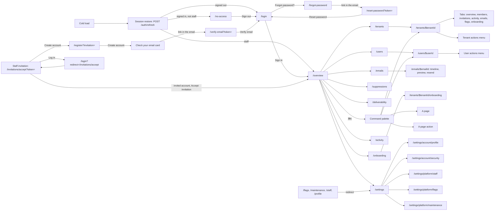

# Apex pages

This folder is the inventory of every route in the staff console: what each page is for, which file renders it, what guards it, which requests it waits on, which components it is built from, and what it looks like in its default, loading, error and empty states. The screenshots under `img/` are taken by the Playwright `capture` project in `e2e/capture/`: with the dev stack up (apex on `:5174`, the API on `:4040`, Mailpit on `:8025`), run `E2E_API_DIR=<express checkout> pnpm capture:pages`, or add `CAPTURE_ONLY=<areas>` to redo some areas (for example `CAPTURE_ONLY=auth,system`), or a route key such as `'/tenants/$tenantId/members'` (quote it, or the shell expands `$tenantId`). `E2E_API_DIR` names the express checkout in which the run grants its staff accounts their platform role. Run it only through `pnpm capture:pages`: the script sets `E2E_CAPTURE=1`, which turns Playwright's `webServer` off, and a bare `pnpm exec playwright test --project=capture` without it starts the dev server (`vite --force`) and then skips every test. The run writes its records to `capture-records/` (gitignored, and outside `test-results/`, which Playwright empties at the start of every run, so separate runs keep each other's records): `report.json` for the page shots, `boot.json` for the boot frames and `navigation.json` for the in-app navigation shots. The boot capture's `nginx-` scenarios run against a production build and are skipped unless `E2E_NGINX_ORIGIN` points at one (for example `vite preview` of this worktree's build); `e2e/capture/navigation.test.ts` takes the in-app navigation shots (`<shot>--nav-route.jpg`, `<shot>--nav-sections.jpg`), and `e2e/capture/boot.test.ts` takes the boot frames; run both in one invocation, `pnpm capture:pages e2e/capture/boot.test.ts e2e/capture/navigation.test.ts`, to refresh them together, and after a 429 wait 5 minutes and run `navigation.test.ts` alone. A 429 from the API stops the run with a message naming `CAPTURE_ONLY` and the 5-minute wait; the shot that saw the 429 may already be written under its real name, so restore it before the rerun with `git checkout -- docs/pages/img/<area>/<shot>--<state>.jpg`. The problems found are listed in [findings.md](findings.md). `tests/unit/docs-pages.test.ts` fails when a route is missing from the map below, when a screenshot is linked from no page, or when `img/` grows past 10 MiB.

The shots come from `vite dev`, so the TanStack Router and Query devtools buttons show in the bottom-right corner of some of them. Those buttons are dev-only (`src/components/dev/devtools.tsx`) and are not part of any page. The default shots are full-page, so the sticky sidebar ends at the viewport's height (900 px) with blank space below it; that is a capture artifact, not the page.

| Area                                   | Covers                                                                                            |
| -------------------------------------- | ------------------------------------------------------------------------------------------------- |
| [boot.md](boot.md)                     | The cold load, from `index.html` to the first page, frame by frame                                |
| [auth.md](auth.md)                     | Sign-in, invitation-only registration, password reset, email verification, invitations, no access |
| [system.md](system.md)                 | The root redirect and the not-found page                                                          |
| [overview.md](overview.md)             | The signed-in landing page and the staff shell                                                    |
| [tenants.md](tenants.md)               | The tenant list, a tenant's tabs and its actions menu                                             |
| [users.md](users.md)                   | The user list, a user's pages and its actions menu                                                |
| [emails.md](emails.md)                 | The sent-email log and an email's detail                                                          |
| [suppressions.md](suppressions.md)     | Suppressed addresses                                                                              |
| [deliverability.md](deliverability.md) | Email health over a time range                                                                    |
| [onboarding.md](onboarding.md)         | The onboarding funnel and its tenant lists                                                        |
| [activity.md](activity.md)             | The platform activity log                                                                         |
| [settings.md](settings.md)             | Account and platform settings, and the legacy paths that redirect into them                       |
| [palette.md](palette.md)               | The ⌘K command palette, a shell feature with no route                                             |
| [findings.md](findings.md)             | Every problem found, with its evidence and the work that fixes it                                 |

## Route map

Every full path of the route tree (`FileRoutesByFullPath` in `src/routeTree.gen.ts`). API paths are relative to `/api/v1`. "Awaited" requests hold the page (or, on a cold load, the boot shell) until they settle; "started" requests run while the page renders its own skeletons. Under `_app` the only awaited request is the flags read: every page loader starts its reads without awaiting them.

| Route                            | Kind                                                                       | File                                               | Guard                                                             | Data (awaited / started)                                                                                                                                                                                                                                              | Doc                                                                   |
| -------------------------------- | -------------------------------------------------------------------------- | -------------------------------------------------- | ----------------------------------------------------------------- | --------------------------------------------------------------------------------------------------------------------------------------------------------------------------------------------------------------------------------------------------------------------- | --------------------------------------------------------------------- |
| `/`                              | redirect → `/overview` (signed in) or `/login`                             | `src/pages/index.tsx`                              | none                                                              | none                                                                                                                                                                                                                                                                  | [system.md](system.md#--root-redirect)                                |
| `/$`                             | page (not found)                                                           | `src/pages/$.tsx`                                  | none                                                              | none                                                                                                                                                                                                                                                                  | [system.md](system.md#--not-found)                                    |
| `/no-access`                     | page                                                                       | `src/pages/no-access.tsx`                          | signed out → `/login`; staff → `/overview`                        | started on Sign out: `POST /auth/logout`                                                                                                                                                                                                                              | [auth.md](auth.md#no-access--no-platform-access)                      |
| `/login`                         | page                                                                       | `src/pages/_auth/login.tsx`                        | `_auth`: signed in → `/overview`                                  | started on submit: `POST /auth/login`                                                                                                                                                                                                                                 | [auth.md](auth.md#login--sign-in)                                     |
| `/register`                      | page (invitation only)                                                     | `src/pages/_auth/register.tsx`                     | `_auth`; no `?invitation` → `/login`                              | started: `POST /invitations/preview`; on submit `POST /auth/register`; `POST /auth/resend-verification`                                                                                                                                                               | [auth.md](auth.md#register--create-an-account)                        |
| `/forgot-password`               | page                                                                       | `src/pages/_auth/forgot-password.tsx`              | `_auth`                                                           | started on submit: `POST /auth/forgot-password`                                                                                                                                                                                                                       | [auth.md](auth.md#forgot-password--forgot-password)                   |
| `/reset-password`                | page                                                                       | `src/pages/reset-password.tsx`                     | none (top level)                                                  | started on submit: `POST /auth/reset-password`                                                                                                                                                                                                                        | [auth.md](auth.md#reset-password--choose-a-new-password)              |
| `/verify-email`                  | page                                                                       | `src/pages/verify-email.tsx`                       | none (top level)                                                  | started on submit: `POST /auth/verify-email`; `POST /auth/resend-verification`                                                                                                                                                                                        | [auth.md](auth.md#verify-email--verify-your-email)                    |
| `/auth/callback`                 | redirect (in an effect) → `/overview` or `/login?error=google_auth_failed` | `src/pages/auth/callback.tsx`                      | none (top level)                                                  | none                                                                                                                                                                                                                                                                  | [auth.md](auth.md#authcallback--google-sign-in-return)                |
| `/auth/confirm`                  | page                                                                       | `src/pages/auth/confirm.tsx`                       | none (top level)                                                  | started, signed in with `?token`: `POST /auth/step-up/link/verify`; `?result=confirmed` and `?error=step_up_failed` (the Google popup) post nothing                                                                                                                   | [auth.md](auth.md)                                                    |
| `/auth/link`                     | page                                                                       | `src/pages/auth/link.tsx`                          | none (top level)                                                  | started, signed out with `?token`: `POST /auth/link/verify` (once per load); on the dead link `POST /auth/link/request`; on switch account `POST /auth/logout`                                                                                                        | [auth.md](auth.md)                                                    |
| `/invitations/accept`            | page                                                                       | `src/pages/invitations/accept.tsx`                 | none (top level)                                                  | started: `POST /invitations/preview`; then once per load, signed out `POST /invitations/verify` (a staff invitation answers 202, Check your inbox; Resend posts it again), signed in as the invitee `POST /invitations/accept`; on switch account `POST /auth/logout` | [auth.md](auth.md#invitationsaccept--accept-an-invitation)            |
| `/invitations/confirm`           | page                                                                       | `src/pages/invitations/confirm.tsx`                | none (top level)                                                  | started, with `?token` and `?email`: `POST /invitations/confirm` (once per load); on the dead link `POST /auth/link/request`; on switch account `POST /auth/logout`                                                                                                   | [auth.md](auth.md)                                                    |
| `/overview`                      | page                                                                       | `src/pages/_app/overview.tsx`                      | `_app`: signed out → `/login?redirect=`; not staff → `/no-access` | awaited by `_app`: `GET /platform/me/flags`; started: `GET /platform/stats?range=`, `GET /platform/system/status` (admin and up)                                                                                                                                      | [overview.md](overview.md#overview--overview)                         |
| `/tenants/`                      | page                                                                       | `src/pages/_app/tenants/index.tsx`                 | `_app`                                                            | started: `GET /platform/tenants` (20 a page)                                                                                                                                                                                                                          | [tenants.md](tenants.md#tenants--tenants)                             |
| `/tenants/$tenantId`             | layout (header, tabs, actions menu)                                        | `src/pages/_app/tenants/$tenantId.tsx`             | `_app`                                                            | started: `GET /platform/tenants/:id`                                                                                                                                                                                                                                  | [tenants.md](tenants.md#layout)                                       |
| `/tenants/$tenantId/`            | page                                                                       | `src/pages/_app/tenants/$tenantId.index.tsx`       | `_app`                                                            | started: the layout's `GET /platform/tenants/:id`; once it answers, `GET /platform/audit-log?tenant=&access=platform` (admin and up)                                                                                                                                  | [tenants.md](tenants.md#tenantstenantid--tenant-overview)             |
| `/tenants/$tenantId/members`     | page                                                                       | `src/pages/_app/tenants/$tenantId.members.tsx`     | `_app`                                                            | started once the layout's detail answers: `GET /tenants/:slug`, `GET /tenants/:slug/members`                                                                                                                                                                          | [tenants.md](tenants.md#tenantstenantidmembers--members)              |
| `/tenants/$tenantId/invitations` | page                                                                       | `src/pages/_app/tenants/$tenantId.invitations.tsx` | `_app`                                                            | started once the layout's detail answers: `GET /tenants/:slug`, `GET /tenants/:slug/invitations`                                                                                                                                                                      | [tenants.md](tenants.md#tenantstenantidinvitations--invitations)      |
| `/tenants/$tenantId/activity`    | page                                                                       | `src/pages/_app/tenants/$tenantId.activity.tsx`    | `_app`                                                            | started once the layout's detail answers: `GET /tenants/:slug`, `GET /tenants/:slug/audit-log` (20 a page)                                                                                                                                                            | [tenants.md](tenants.md#tenantstenantidactivity--activity)            |
| `/tenants/$tenantId/emails`      | page                                                                       | `src/pages/_app/tenants/$tenantId.emails.tsx`      | `_app`                                                            | started: `GET /platform/emails?tenant=` (20 a page)                                                                                                                                                                                                                   | [tenants.md](tenants.md#tenantstenantidemails--emails)                |
| `/tenants/$tenantId/flags`       | page                                                                       | `src/pages/_app/tenants/$tenantId.flags.tsx`       | `_app`; below admin: role-denied                                  | started once the layout's detail answers: `GET /tenants/:slug/members`, `GET /platform/flags`; `GET /platform/flags/evaluate` once a member is picked                                                                                                                 | [tenants.md](tenants.md#tenantstenantidflags--flags)                  |
| `/tenants/$tenantId/onboarding`  | page                                                                       | `src/pages/_app/tenants/$tenantId.onboarding.tsx`  | `_app`                                                            | started: `GET /platform/tenants/:id/onboarding`                                                                                                                                                                                                                       | [tenants.md](tenants.md#tenantstenantidonboarding--onboarding)        |
| `/users/`                        | page                                                                       | `src/pages/_app/users/index.tsx`                   | `_app`                                                            | started: `GET /platform/users` (20 a page)                                                                                                                                                                                                                            | [users.md](users.md#users--users)                                     |
| `/users/$userId`                 | layout (no markup of its own)                                              | `src/pages/_app/users/$userId.tsx`                 | `_app`                                                            | started: `GET /platform/users/:id` (for the breadcrumb)                                                                                                                                                                                                               | [users.md](users.md#layout)                                           |
| `/users/$userId/`                | page                                                                       | `src/pages/_app/users/$userId.index.tsx`           | `_app`                                                            | started: `GET /platform/users/:id`; once it answers, `GET /platform/emails?user=&limit=10` (no total) and `GET /platform/audit-log?target=` (admin and up)                                                                                                            | [users.md](users.md#usersuserid--user)                                |
| `/emails/`                       | page                                                                       | `src/pages/_app/emails/index.tsx`                  | `_app`                                                            | started: `GET /platform/emails` (20 a page); a filter chip's `GET /platform/users/:id` or `GET /platform/tenants/:id`                                                                                                                                                 | [emails.md](emails.md#emails--emails)                                 |
| `/emails/$emailId`               | page                                                                       | `src/pages/_app/emails/$emailId.tsx`               | `_app`                                                            | started: `GET /platform/emails/:id`; on the preview tab `GET /platform/emails/:id/preview`                                                                                                                                                                            | [emails.md](emails.md#emailsemailid--email)                           |
| `/suppressions`                  | page                                                                       | `src/pages/_app/suppressions.tsx`                  | `_app`                                                            | started: `GET /platform/email-suppressions`                                                                                                                                                                                                                           | [suppressions.md](suppressions.md#suppressions--suppressions)         |
| `/deliverability`                | page                                                                       | `src/pages/_app/deliverability.tsx`                | `_app`                                                            | started: `GET /platform/emails/health?range=`                                                                                                                                                                                                                         | [deliverability.md](deliverability.md#deliverability--deliverability) |
| `/onboarding`                    | page                                                                       | `src/pages/_app/onboarding.tsx`                    | `_app`                                                            | started: `GET /platform/onboarding/funnel?range=`, `GET /platform/onboarding/tenants?state=`                                                                                                                                                                          | [onboarding.md](onboarding.md#onboarding--onboarding)                 |
| `/activity`                      | page                                                                       | `src/pages/_app/activity.tsx`                      | `_app`; below admin: a not-found card, no request                 | started on mount (no loader): `GET /platform/audit-log`, `GET /platform/users?limit=20`; the Actor facet's `GET /platform/users?search&limit=20` and the Tenant facet's `GET /platform/tenants?search&limit=20`                                                       | [activity.md](activity.md#activity--activity)                         |
| `/settings`                      | layout (settings shell, `h1` from the active section)                      | `src/pages/_app/settings.tsx`                      | `_app`                                                            | awaited by `_app`                                                                                                                                                                                                                                                     | [settings.md](settings.md#layout)                                     |
| `/settings/`                     | page                                                                       | `src/pages/_app/settings/index.tsx`                | `_app`                                                            | awaited by `_app`                                                                                                                                                                                                                                                     | [settings.md](settings.md#settings--settings)                         |
| `/settings/account/`             | redirect → `/settings/account/profile`                                     | `src/pages/_app/settings/account.index.tsx`        | `_app`                                                            | awaited by `_app`                                                                                                                                                                                                                                                     | [settings.md](settings.md#redirects)                                  |
| `/settings/account/profile`      | page                                                                       | `src/pages/_app/settings/account.profile.tsx`      | `_app`                                                            | awaited by `_app`; `GET /profile`, painted from the session restore's user                                                                                                                                                                                            | [settings.md](settings.md#settingsaccountprofile--profile)            |
| `/settings/account/security`     | page                                                                       | `src/pages/_app/settings/account.security.tsx`     | `_app`                                                            | started: `GET /auth/providers`                                                                                                                                                                                                                                        | [settings.md](settings.md#settingsaccountsecurity--security)          |
| `/settings/platform/`            | redirect → `/settings/platform/staff`                                      | `src/pages/_app/settings/platform.index.tsx`       | `_app`                                                            | awaited by `_app`                                                                                                                                                                                                                                                     | [settings.md](settings.md#redirects)                                  |
| `/settings/platform/staff`       | page                                                                       | `src/pages/_app/settings/platform.staff.tsx`       | `_app`                                                            | started: `GET /tenants/platform`, `GET /tenants/platform/members`, `GET /tenants/platform/invitations`                                                                                                                                                                | [settings.md](settings.md#settingsplatformstaff--staff)               |
| `/settings/platform/flags`       | page                                                                       | `src/pages/_app/settings/platform.flags.tsx`       | `_app`                                                            | started: `GET /platform/flags/meta`, `GET /platform/flags`, `GET /platform/flags/unregistered`; the evaluate panel's `GET /platform/users?search=` and `GET /platform/flags/evaluate` (admin and up)                                                                  | [settings.md](settings.md#settingsplatformflags--feature-flags)       |
| `/settings/platform/maintenance` | page                                                                       | `src/pages/_app/settings/platform.maintenance.tsx` | `_app`                                                            | started: `GET /platform/maintenance-mode`                                                                                                                                                                                                                             | [settings.md](settings.md#settingsplatformmaintenance--maintenance)   |
| `/flags`                         | redirect → `/settings/platform/flags`                                      | `src/pages/_app/flags.tsx`                         | `_app`                                                            | awaited by `_app`                                                                                                                                                                                                                                                     | [settings.md](settings.md#redirects)                                  |
| `/maintenance`                   | redirect → `/settings/platform/maintenance`                                | `src/pages/_app/maintenance.tsx`                   | `_app`                                                            | awaited by `_app`                                                                                                                                                                                                                                                     | [settings.md](settings.md#redirects)                                  |
| `/staff`                         | redirect → `/settings/platform/staff`                                      | `src/pages/_app/staff.tsx`                         | `_app`                                                            | awaited by `_app`                                                                                                                                                                                                                                                     | [settings.md](settings.md#redirects)                                  |
| `/profile`                       | redirect → `/settings/account/profile`                                     | `src/pages/_app/profile.tsx`                       | `_app`                                                            | awaited by `_app`                                                                                                                                                                                                                                                     | [settings.md](settings.md#redirects)                                  |

Every page also sits under `__root`, whose `beforeLoad` awaits the session restore (`POST /auth/refresh`, then `GET /profile`). The `_app` shell (`AppLayout`) starts `GET /platform/maintenance-mode` for its banner, and its command palette searches `GET /platform/tenants?search=` and `GET /platform/users?search=` while it is open with a term. The redirect routes run `_app`'s guard first, so a signed-out visitor to `/flags` lands on `/login?redirect=%2Fflags`; each redirect keeps the search and hash and replaces the history entry. [boot.md](boot.md#what-happens) has the order.

## Journeys



## Per-route block

Every area file describes each route with the same block, so the docs stay comparable:

```markdown
### `/tenants/` — Tenants


|                     |                                                                                             |
| ------------------- | ------------------------------------------------------------------------------------------- |
| Purpose             | …                                                                                           |
| File                | `src/pages/_app/tenants/index.tsx`                                                          |
| Guard and redirects | …                                                                                           |
| Layout              | `AppLayout` (sidebar)                                                                       |
| Data                | `GET /platform/tenants` (`['platform', 'tenants', 'page', params]`) — started by the loader |
| Sections            | Tenants table ← `GET /platform/tenants`; New tenant (no request until submit)               |
| Components          | `Table`, `Skeleton`, `LoadError`, … ; hand-rolled: …                                        |
| Transitions         | row → `/tenants/$tenantId`; create → `/tenants/$tenantId`                                   |

| Loading                             | Error                             | Empty                             |
| ----------------------------------- | --------------------------------- | --------------------------------- |
|  |  |  |
| skeleton · `h-96`                   | alert · `LoadError`               | `No tenants match "q".`           |

Findings: [F-tenants-1](findings.md#f-tenants-1) …
```

- The heading is the route in backticks, an em dash, and the page's name. The name differs between routes whose paths differ only by a trailing slash, so their anchors never collide.
- The `Data` row names each query's endpoint and its query key as the code defines it, whether it is awaited or only started, and its `staleTime` when it is not the default 30 s (`src/router.tsx`). A row with mutations only says "no query".
- The `Loading` cell's first line is the report's `loadingUi` (`skeleton`, `spinner` or `shell`, or `none`), the `Error` cell's is its `errorUi` (`alert` or `none`). The second line names what is drawn.
- A state with no shot has no column. A route with no shot at all (a redirect) has no image.
- Dark and mobile shots go in a second table under the first, when the route has them.
- A route with a role gate has a `Role-denied` table: what a viewer (the seed's `viewer` session) sees instead, with its shot `img/<area>/<shot>--role-denied.jpg`.
- The image paths are `img/<area>/<shot>--<state>.jpg`, with the area and shot stem from `e2e/capture/manifest.ts`; the example writes them as placeholders so it links no real screenshot.
- Findings ids are `F-<area>-<n>`, and each one has a heading in [findings.md](findings.md).
