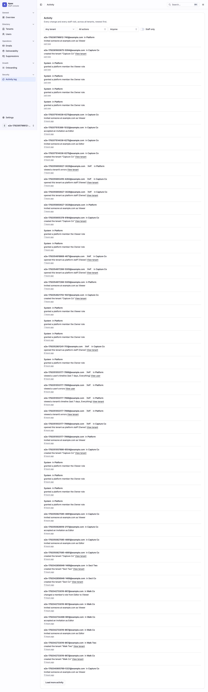
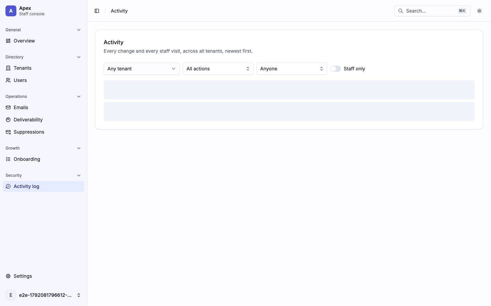
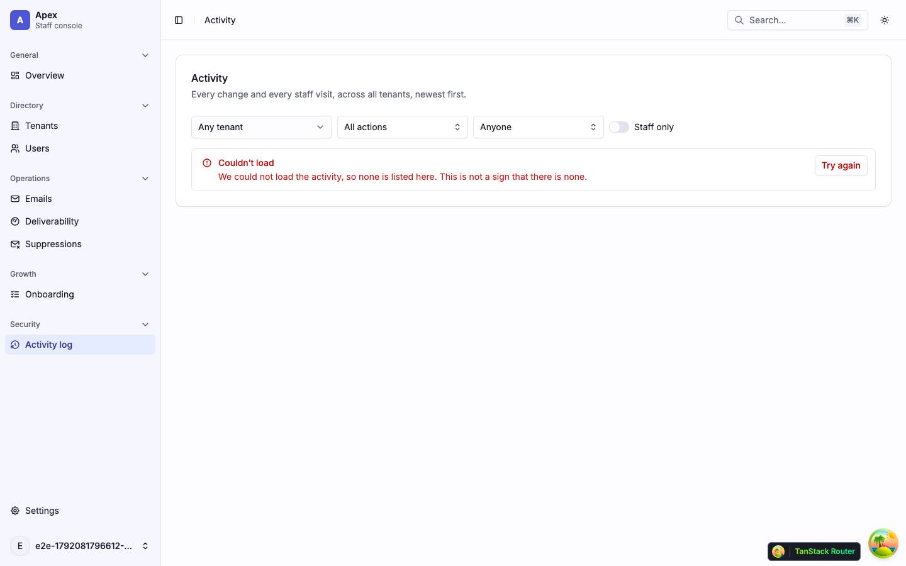
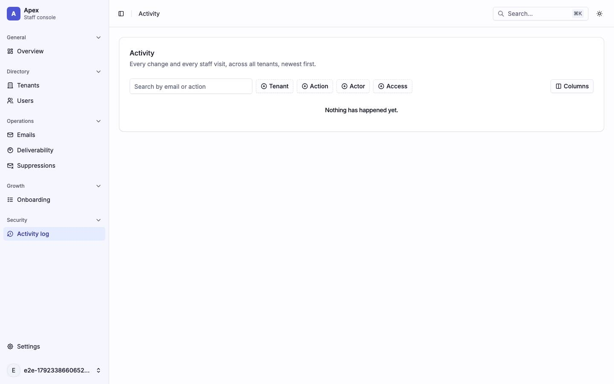
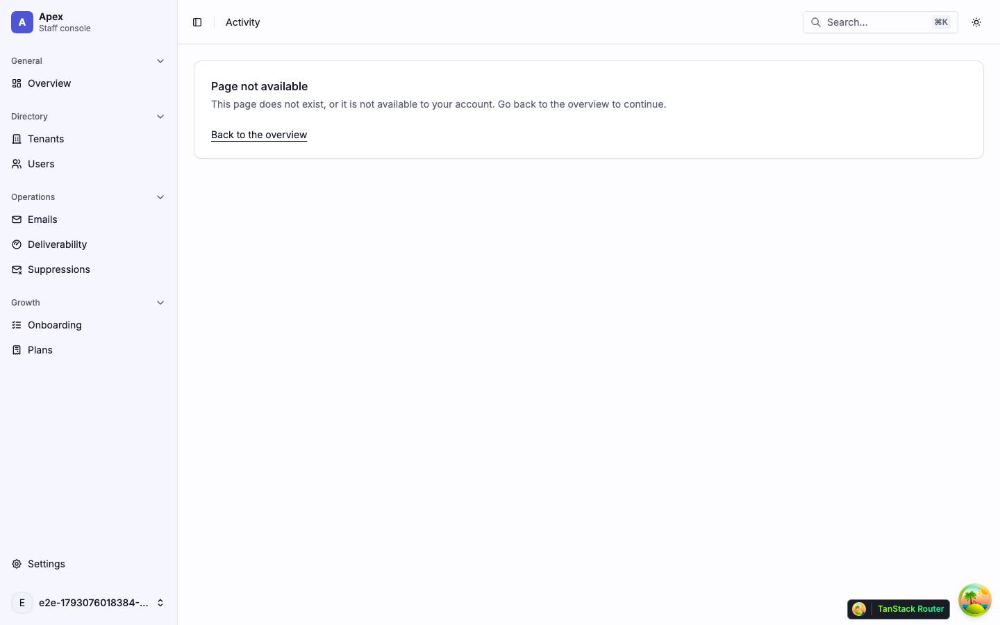

# Activity

The platform activity log across every tenant (`/activity`), for admins and owners. One tenant's log is its [Activity tab](tenants.md#tenantstenantidactivity--activity). Back to the [route map](README.md#route-map).

## Pages

### `/activity` — Activity

|                     |                                                                                                                                                                                                                                                                                                                                                                                                                                                                    |
| ------------------- | ------------------------------------------------------------------------------------------------------------------------------------------------------------------------------------------------------------------------------------------------------------------------------------------------------------------------------------------------------------------------------------------------------------------------------------------------------------------ |
| Purpose             | Every change and every staff visit, across all tenants, newest first, filtered by tenant, action, actor and staff access.                                                                                                                                                                                                                                                                                                                                          |
| File                | `src/pages/_app/activity.tsx`                                                                                                                                                                                                                                                                                                                                                                                                                                      |
| Guard and redirects | `_app`; below admin the page renders `PlatformNotFound` ("Page not available", "This page does not exist, or it is not available to your account." and Back to the overview) and makes no request. The nav item (Activity log) is hidden below admin.                                                                                                                                                                                                              |
| Layout              | `AppLayout`                                                                                                                                                                                                                                                                                                                                                                                                                                                        |
| Data                | no loader: on mount, `GET /platform/audit-log?tenant&action&actor&access&search&sort&cursor&direction&limit` (`['platform', 'audit-log', …]`, `staleTime` 0) and `GET /platform/users?limit=20` (no total, the Actor facet). The Actor facet searches `GET /platform/users?search&limit=20` and the Tenant facet `GET /platform/tenants?search&limit=20`, both with no total and debounced 250 ms. Every filter, the search, the sort and the page are URL params. |
| Sections            | One **Activity** card holding the `h1`, "Every change and every staff visit, across all tenants, newest first.", and `ActivityTable`: a search box, the Tenant, Action, Actor and Access facets, a sortable When column, the Tenant column and Next page / Previous page                                                                                                                                                                                           |
| Components          | `Card`, `ActivityTable` (`DataTable`, `Badge`, `Tooltip`), `DataTableChip`, `RoleDenied`, `EmptyState` (compact)                                                                                                                                                                                                                                                                                                                                                   |
| Transitions         | an actor → `/users/$userId`; View tenant → `/tenants/$tenantId`; View user → `/users/$userId`                                                                                                                                                                                                                                                                                                                                                                      |

Every filter lives in the URL, so Back undoes one. The Actor facet lists twenty users by name, and its search box asks the server for the rest; a URL naming an actor outside the results still filters, and its chip resolves the name from the user's record. When the users read fails, the facet says "Actor could not be loaded." and offers Try again.

| Loading                                                                  | Error                                                                                                     | Empty                                          |
| ------------------------------------------------------------------------ | --------------------------------------------------------------------------------------------------------- | ---------------------------------------------- |
|                                   |                                                                      |           |
| skeleton · the card and filters over `DataTable`’s table-shaped skeleton | alert · `LoadError` "We couldn’t load the activity, so none is listed. Select Try again." inside the card | log stubbed empty: "Nothing has happened yet." |

| Role-denied                                                               |
| ------------------------------------------------------------------------- |
|                                |
| A viewer: the "Page not available" card; no audit-log or members request. |

Findings: [F-activity-1](findings.md#f-activity-1), [F-activity-2](findings.md#f-activity-2), [F-activity-3](findings.md#f-activity-3), [F-overview-4](findings.md#f-overview-4), [F-overview-7](findings.md#f-overview-7)
