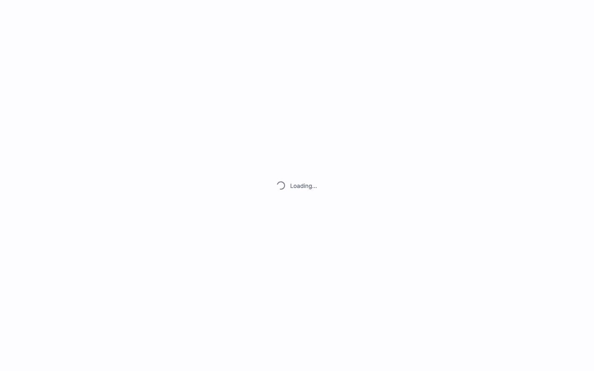
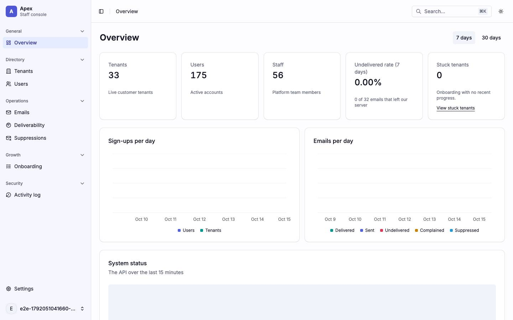
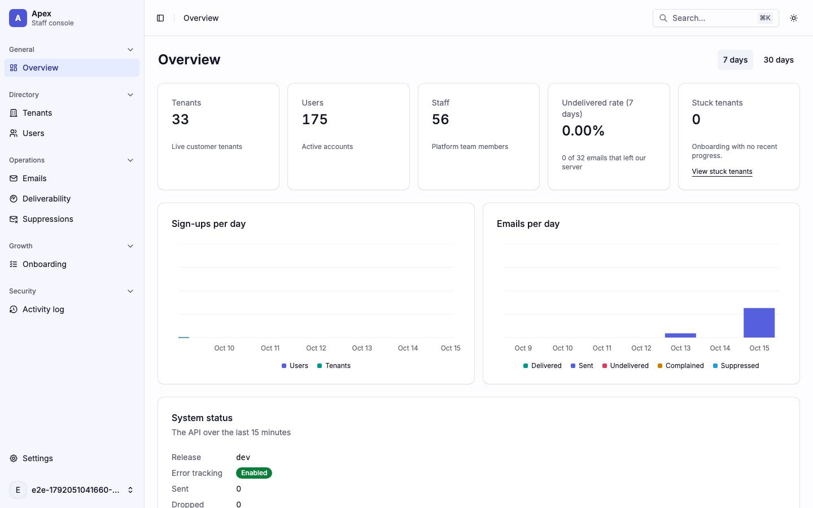
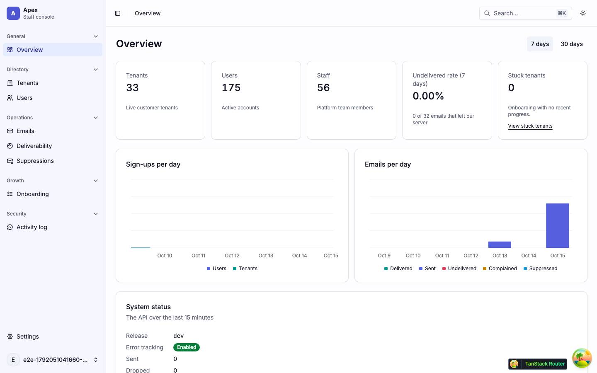
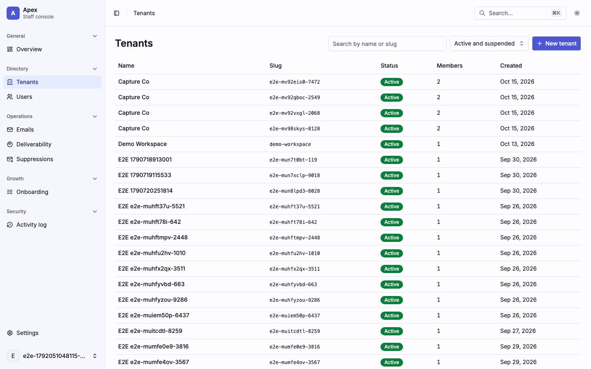

# Boot

What a cold load of the staff console does, from `index.html` to the first page, and what it looks like while it does it. Back to the [route map](README.md#route-map).

## What happens

1. The browser parses `index.html`. Its `<head>` runs three blocking scripts: `/theme-init.js`, which sets the `dark` class on `<html>` from the stored theme or the system preference, `/boot-variant.js`, which marks `<html data-boot="auth">` on an auth path, and `/runtime-config.js`, the run-time settings. `#root` already holds the static boot shell: `.boot-shell` with `role="status"`, a visually hidden "Loading…", and the app or auth variant that `/boot-variant.js` picked, styled by the inline `<style>` blocks in `<head>`.
2. `src/main.tsx` loads as a module. Its imports bring in the router (`src/router.tsx`) and `src/styles/globals.css`, and it calls `router.load()` before React mounts anything.
3. `__root`'s `beforeLoad` awaits `bootstrapSession()`: `POST /api/v1/auth/refresh` with the refresh cookie (a 401 when signed out), run under a Web Lock so tabs queue, then, when the refresh succeeds, `GET /api/v1/profile`.
4. The matched layout's guard runs. `_auth` sends a signed-in user to `/overview`. `_app` sends a signed-out user to `/login?redirect=<the URL>` and a signed-in user without a platform role to `/no-access`.
5. `_app`'s loader awaits the flags: `GET /api/v1/platform/me/flags` (`ensureFlags` in `src/observability/flags/flag-query.ts`). The read has no retry. A failure, or an answer still out after `FLAGS_BOOT_WAIT_MS` (10 s), resolves to the fallback values, so the flags hold the page for 10 s at most; the read is not cancelled, and a late answer reaches every flag hook from the cache. The page's own loader only starts its reads (`void prefetchQuery`) and does not await them.
6. `router.load()` settles, whether it resolved or rejected, and React mounts (`createRoot().render()` in the `finally`). The first commit replaces the splash with the matched page: on an `_app` page, the shell with the page's own skeletons where its reads are still out. Until this point the splash is the only thing on screen, however long steps 3 to 5 take.
7. After mount: the shell's maintenance banner starts `GET /api/v1/platform/maintenance-mode` (asked again every 60 s while maintenance is off, every 30 s while it is on); analytics starts (`initAnalytics()`), and posthog-js fetches its config and extensions through `/api/v1/collect/…`. A page that reads a flag posts its exposure to `POST /api/v1/platform/me/flags/exposures`; this app's flag slice is empty, so the capture recorded none.

The capture's signed-in `/overview` load recorded this order: `POST /auth/refresh` 200, `GET /profile` 200, `GET /platform/me/flags` 200, then the page's `GET /platform/stats` and `GET /platform/system/status`, `GET /platform/maintenance-mode` and the `/collect/…` scripts (`report.json`). A signed-out load of an `_auth` page makes one API request of its own, `POST /auth/refresh` 401, besides `/runtime-config.js` and the analytics scripts; there is no shell, so no maintenance read.

## Frame by frame

A CDP screencast of each cold load (`e2e/capture/boot.test.ts`), unthrottled, cache disabled, against `vite dev`. Times are from the first distinct frame. Consecutive identical frames are dropped, and when a scenario has more than twelve, a time-spread sample is kept, so the gaps between rows are not frame intervals.

### Signed out, `/login`

| Frame                                         | ms   | What it shows                                                                                                                       |
| --------------------------------------------- | ---- | ----------------------------------------------------------------------------------------------------------------------------------- |
|     | 0    | A blank white page.                                                                                                                 |
|   | 207  | The splash without its CSS: "Loading…" in the browser's default black serif, top-left. The spinner span is empty, so nothing spins. |
|  | 1308 | The styled splash: grey spinner and "Loading…", centred, on the page background.                                                    |
|  | 1515 | The styled splash; only the spinner's angle differs.                                                                                |
|  | 1814 | The styled splash.                                                                                                                  |
|  | 2131 | The styled splash.                                                                                                                  |
|  | 2432 | The styled splash.                                                                                                                  |
|  | 2732 | The styled splash.                                                                                                                  |
|  | 3031 | The styled splash.                                                                                                                  |
|  | 3341 | The sign-in page: the app mark and name over the card, on the muted auth background.                                                |

This scenario ran first in its capture run and is the slow one: 1.3 s to the styled splash and 3.3 s to the form. It did not repeat. The capture's own `/login` shot loaded in 837 ms (`report.json`), and three further cold loads of `/login` signed out, with the cache disabled, reached the styled splash in 412–608 ms and the form in 805–854 ms. The extra two seconds of styled splash in this recording are not explained by anything the shots or the report show.

### Signed in, `/overview`

| Frame                                           | ms   | What it shows                                                                                                                                                                              |
| ----------------------------------------------- | ---- | ------------------------------------------------------------------------------------------------------------------------------------------------------------------------------------------ |
|     | 0    | A blank white page.                                                                                                                                                                        |
|    | 26   | The unstyled splash, "Loading…" top-left.                                                                                                                                                  |
|   | 524  | The styled splash, centred.                                                                                                                                                                |
|   | 620  | The styled splash.                                                                                                                                                                         |
|   | 738  | The styled splash.                                                                                                                                                                         |
|   | 870  | The styled splash.                                                                                                                                                                         |
|   | 988  | The styled splash.                                                                                                                                                                         |
|  | 1091 | The overview in the staff shell: sidebar, header with the search box, the five figure cards already filled, both charts with gridlines and no bars, and a skeleton block in System status. |
|  | 1226 | The chart bars growing in; System status filled (release, error tracking, counts).                                                                                                         |
|  | 1355 | The bars at full height; the devtools buttons have loaded in the corner.                                                                                                                   |

### Signed in, `/tenants`

| Frame                                          | ms   | What it shows                                                                          |
| ---------------------------------------------- | ---- | -------------------------------------------------------------------------------------- |
|     | 0    | A blank white page.                                                                    |
|    | 26   | The unstyled splash, "Loading…" top-left.                                              |
|   | 533  | The styled splash, centred.                                                            |
|   | 574  | The styled splash.                                                                     |
|   | 708  | The styled splash.                                                                     |
|   | 857  | The styled splash.                                                                     |
|   | 991  | The styled splash.                                                                     |
|  | 1141 | The styled splash.                                                                     |
|  | 1274 | The styled splash.                                                                     |
|  | 1424 | The styled splash.                                                                     |
|  | 1563 | The tenants page in the shell: search, state filter, New tenant, and the filled table. |

In the two signed-in loads the unstyled splash is on screen for about half a second (from 26 ms to 524–533 ms), and the styled splash for a further 0.5–0.9 s. When React mounts, an `_app` page appears in its shell straight away and fills its own sections as their reads land: the overview's first page frame already has the shell, the figures and a System status skeleton, and the bars and status rows fill in the next two frames. The `/tenants` table was filled in the first page frame kept; the scenario had 65 distinct frames, so a skeleton frame may have fallen between the sampled ones. This is the main difference from a boot that awaits its page data: here the splash waits only for the session restore and the flags read ([F-boot-2](findings.md#f-boot-2)).

## Why the first frame is unstyled

The splash markup lives in `index.html`, but its only styles (`.boot-splash`, `.boot-splash-spinner`) are in `src/styles/globals.css`. Under `vite dev` that stylesheet is not linked from the page: `src/main.tsx` imports it, and Vite turns the import into a JavaScript module that injects a `<style>` tag when it runs. So the CSS arrives only after the browser has fetched and run the module graph up to that import, about half a second on a cold dev load, and until then the splash renders as unstyled inline text in the top-left corner. A production build (`vite build`) extracts the CSS and links it from `<head>` (`<link rel="stylesheet" href="/assets/index-….css">`), so there the splash is styled from its first paint. The comment above `.boot-splash` in `globals.css`, which says the splash is painted from the stylesheet before any script runs, holds for the production build only. Finding: [F-boot-1](findings.md#f-boot-1).

The same gap applies to the page background: `theme-init.js` sets the `dark` class before first paint, but the colours it selects are also in `globals.css`, so under `vite dev` a dark-theme user should see white until the CSS lands. That follows from the code; the boot capture runs in the light theme and did not record it.

## Dev and production

- **Dev-only:** the unstyled first frames and their half-second duration ([F-boot-1](findings.md#f-boot-1)); the module-by-module fetches under `/src/…`; the TanStack devtools buttons.
- **Both:** the boot waits on `POST /auth/refresh` and `GET /profile` (the HTTP client's timeout applies) and, on `_app` pages, `GET /platform/me/flags` (up to 10 s, the cap in `ensureFlags`), before React mounts ([F-boot-2](findings.md#f-boot-2)). Page data is not part of the wait.
- **Both:** a signed-out load logs one console error, the browser's own "Failed to load resource" line for the `POST /auth/refresh` 401 (seen in each of the three re-measured loads). The 401 is how the app learns it is signed out, so the line is expected; no page script logs an error.
