# Boot

What a cold load of the staff console does, from `index.html` to the first page, and what it looks like while it does it. Back to the [route map](README.md#route-map).

## What happens

1. The browser parses `index.html`. Its `<head>` runs three blocking scripts: `/theme-init.js`, which sets the `dark` class on `<html>` from the stored theme or the system preference, `/boot-variant.js`, which marks `<html data-boot="auth">` on an auth path, and `/runtime-config.js`, the run-time settings. `#root` already holds the static boot shell: `.boot-shell` with `role="status"`, a visually hidden "Loading…", and the app or auth variant that `/boot-variant.js` picked, styled by the inline `<style>` blocks in `<head>`.
2. `src/main.tsx` loads as a module. Its imports bring in the router (`src/router.tsx`) and `src/styles/globals.css`, and it calls `router.load()` before React mounts anything.
3. `__root`'s `beforeLoad` awaits `bootstrapSession()`: `POST /api/v1/auth/refresh` with the refresh cookie (a 401 when signed out), run under a Web Lock so tabs queue, then, when the refresh succeeds, `GET /api/v1/profile`.
4. The matched layout's guard runs. `_auth` sends a signed-in user to `/overview`. `_app` sends a signed-out user to `/login?redirect=<the URL>` and a signed-in user without a platform role to `/no-access`.
5. `_app`'s loader awaits the flags: `GET /api/v1/platform/me/flags` (`ensureFlags` in `src/observability/flags/flag-query.ts`). The read has no retry. A failure, or an answer still out after `FLAGS_BOOT_WAIT_MS` (10 s), resolves to the fallback values, so the flags hold the page for 10 s at most; the read is not cancelled, and a late answer reaches every flag hook from the cache. The page's own loader only starts its reads (`void prefetchQuery`) and does not await them.
6. React mounts (`createRoot().render()`) once `router.load()` has settled, whether it resolved or rejected, and the pending templates' chunks have loaded, or after `TEMPLATES_WAIT_MS` (3 s) if they have not. Two catches log what would otherwise strand the shell: `loading.catch` logs a rejection of the load, and the mount chain's `.catch` logs a throw from the mount. The first commit replaces the shell with the matched page: on an `_app` page, the staff shell with the page's own skeletons where its reads are still out. Until this point the boot shell is the only thing on screen, however long steps 3 to 5 take.
7. After mount: the shell's maintenance banner starts `GET /api/v1/platform/maintenance-mode` (asked again every 60 s while maintenance is off, every 30 s while it is on); analytics starts (`initAnalytics()`), and posthog-js fetches its config and extensions through `/api/v1/collect/…`. A page that reads a flag posts its exposure to `POST /api/v1/platform/me/flags/exposures`; this app's flag slice is empty, so the capture recorded none.

The capture's signed-in `/overview` load recorded this order: `POST /auth/refresh` 200, `GET /profile` 200, `GET /platform/me/flags` 200, then the page's `GET /platform/stats` and `GET /platform/system/status`, `GET /platform/maintenance-mode` and the `/collect/…` scripts (`report.json`). A signed-out load of an `_auth` page makes one API request of its own, `POST /auth/refresh` 401, besides `/runtime-config.js` and the analytics scripts; there is no shell, so no maintenance read.

## Frame by frame

A CDP screencast of each cold load (`e2e/capture/boot.test.ts`), unthrottled, cache disabled. Times are from the first distinct frame. Consecutive identical frames are dropped. Each scenario keeps a time-spread sample of its distinct frames, at most 16, and always the first distinct frame (`first-paint`), the first frame at or after the shell's first appearance in `#root` (`shell`), the first frame at or after the shell's replacement (`first-content`) and the last (`ready`), so the gaps between rows are not frame intervals. The capture waits up to 2 s after the ready element is visible for a frame stamped after it, so the last frame is the drawn page. The first-content frame can precede the page's first drawn frame by one: the mark is the DOM change, and the screencast stamps the compositor's frame. Frame files are named `<scenario>--<nn>.jpg`, so a rerun rewrites the same files, and `capture-records/boot.json` records each frame's `ms` and label; a frame that marks two moments carries both, joined by `+`.

The dev frames come from `vite dev` (`signed-…`). The production frames (`nginx-signed-…`) come from `vite preview` of the production build on this machine: the same `dist/` the image serves, without nginx. The image's CSP and first paint are pinned by `e2e/nginx/boot-shell.test.ts`. The capture runs in the light theme, so these frames do not show the dark theme.

### Signed out, `/login`

The auth shell paints the sign-in card's outline as it renders: a title bar over a field bar and two button bars (`public/boot-variant.js` picks it, and `index.html`'s `<style id="boot-shell">` draws it).

Dev (`signed-out-login`, 12 frames kept of 34 distinct, 1149 ms):

| Frame                                  | ms   | Moment        | What it shows                                                                                                                                                                                             |
| -------------------------------------- | ---- | ------------- | --------------------------------------------------------------------------------------------------------------------------------------------------------------------------------------------------------- |
|  | 0    | first-paint   | A blank white page: the browser's own frame before the document paints.                                                                                                                                   |
|  | 100  | shell         | The auth shell: a card with a title bar and three bars on the muted background, styled.                                                                                                                   |
|  | 248  |               | The auth shell: a card with a title bar and three bars on the muted background, styled. Only the shimmer differs.                                                                                         |
|  | 264  |               | The auth shell: a card with a title bar and three bars on the muted background, styled. Only the shimmer differs.                                                                                         |
|  | 348  |               | The auth shell: a card with a title bar and three bars on the muted background, styled. Only the shimmer differs.                                                                                         |
|  | 448  |               | The auth shell: a card with a title bar and three bars on the muted background, styled. Only the shimmer differs.                                                                                         |
|  | 531  |               | The auth shell: a card with a title bar and three bars on the muted background, styled. Only the shimmer differs.                                                                                         |
|  | 579  | first-content | The auth shell: a card with a title bar and three bars on the muted background, styled. The first frame at or after the DOM change; the compositor has not yet drawn the mounted page.                    |
|  | 642  |               | The sign-in page: the app mark over the card with the Email field, Email me a sign-in link, Sign in with a passkey and Continue with Google.                                                              |
| 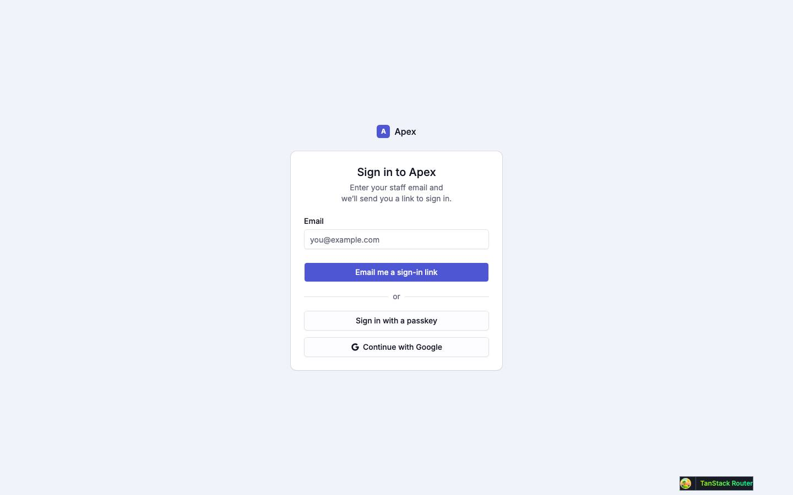 | 968  |               | The same, with the TanStack devtools button (dev only) in the corner.                                                                                                                                     |
| 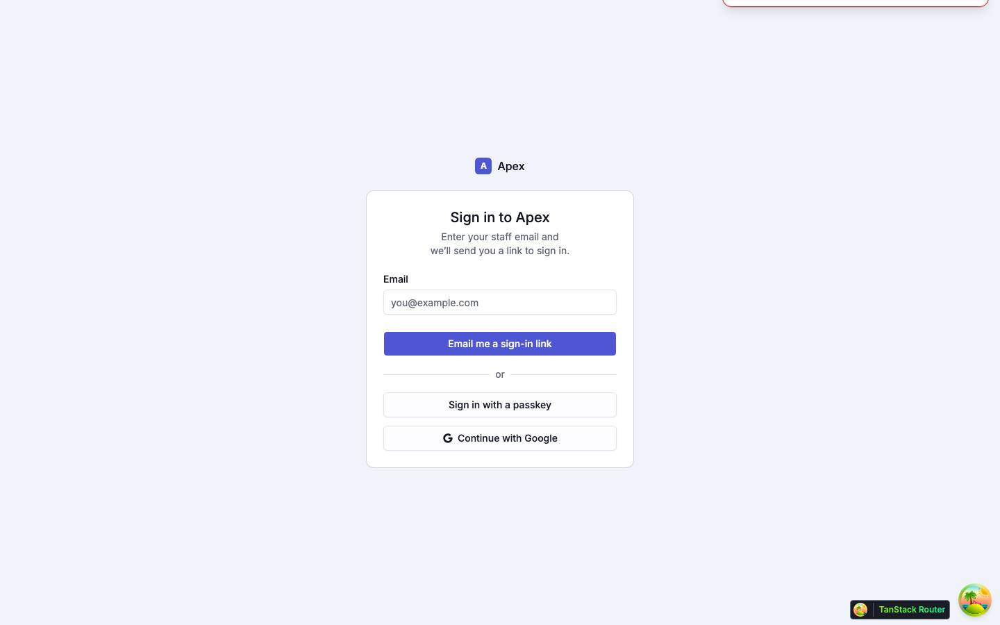 | 1065 |               | The same, with an error toast sliding in at the top right.                                                                                                                                                |
| 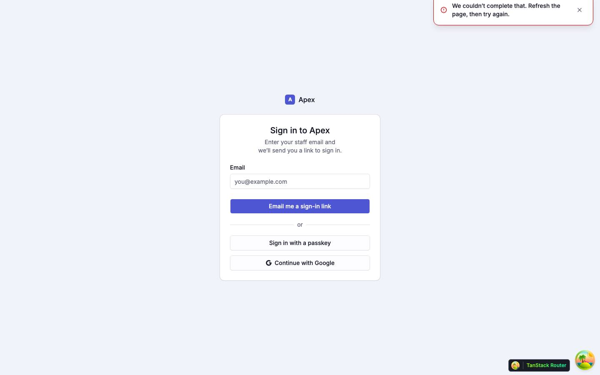 | 1149 | ready         | The sign-in page with the toast "We couldn’t complete that. Refresh the page, then try again.", from the passkey autofill request in the capture’s headless Chromium ([auth.md](auth.md#login--sign-in)). |

Production (`nginx-signed-out-login`, 3 frames kept of 3 distinct, 186 ms):

| Frame                                        | ms  | Moment              | What it shows                                                                                 |
| -------------------------------------------- | --- | ------------------- | --------------------------------------------------------------------------------------------- |
|  | 0   | first-paint         | A blank white page: the browser's own frame before the document paints.                       |
|  | 52  | shell               | The auth shell: a card with a title bar and three field bars on the muted background, styled. |
| 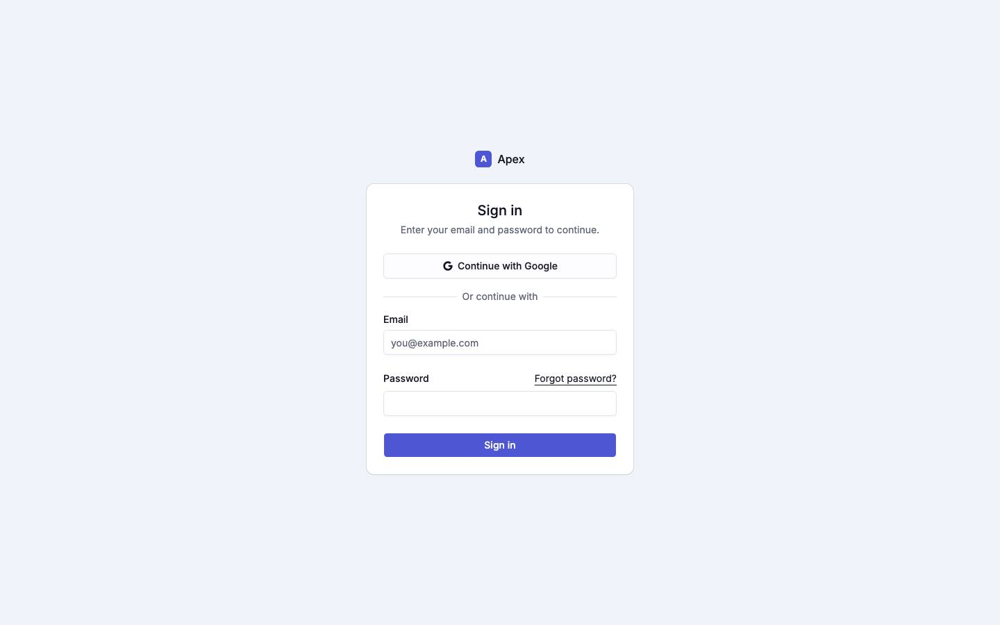 | 186 | first-content+ready | The sign-in page.                                                                             |

### Signed in, `/overview`

Dev (`signed-in-overview`, 16 frames kept of 49 distinct, 1008 ms):

| Frame                                    | ms   | Moment        | What it shows                                                                                                                                                                                  |
| ---------------------------------------- | ---- | ------------- | ---------------------------------------------------------------------------------------------------------------------------------------------------------------------------------------------- |
|  | 0    | first-paint   | A blank white page: the browser's own frame before the document paints.                                                                                                                        |
|  | 27   | shell         | The app shell: sidebar and header bars, a heading and subtitle bar and one large block, styled.                                                                                                |
|  | 92   |               | The app shell: sidebar and header bars, a heading and subtitle bar and one large block, styled. Only the shimmer differs.                                                                      |
|  | 158  |               | The app shell: sidebar and header bars, a heading and subtitle bar and one large block, styled. Only the shimmer differs.                                                                      |
| 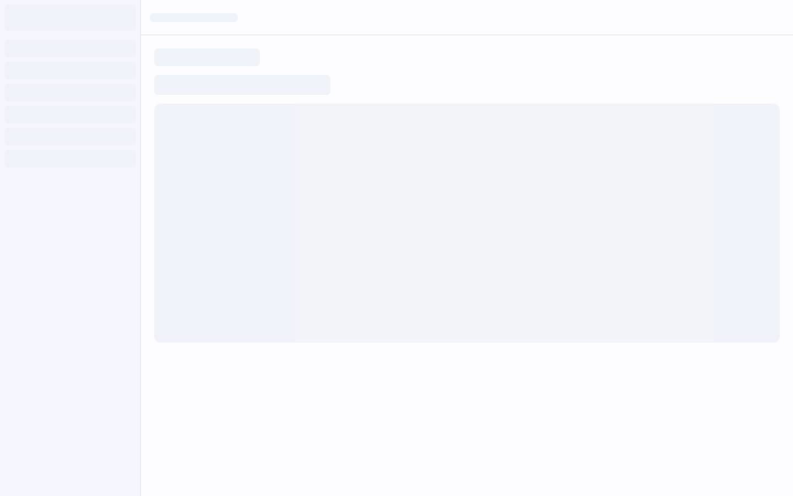 | 224  |               | The app shell: sidebar and header bars, a heading and subtitle bar and one large block, styled. Only the shimmer differs.                                                                      |
|  | 310  |               | The app shell: sidebar and header bars, a heading and subtitle bar and one large block, styled. Only the shimmer differs.                                                                      |
|  | 391  |               | The app shell: sidebar and header bars, a heading and subtitle bar and one large block, styled. Only the shimmer differs.                                                                      |
|  | 458  |               | The app shell: sidebar and header bars, a heading and subtitle bar and one large block, styled. Only the shimmer differs.                                                                      |
|  | 539  |               | The app shell: sidebar and header bars, a heading and subtitle bar and one large block, styled. Only the shimmer differs.                                                                      |
| 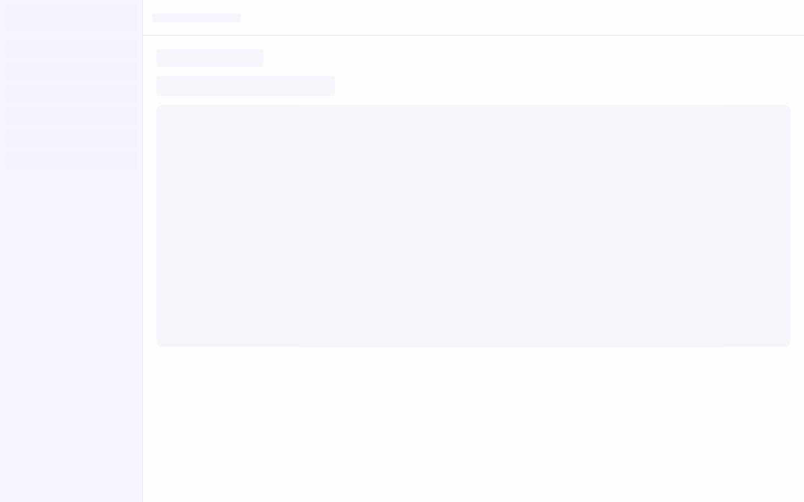 | 623  |               | The app shell: sidebar and header bars, a heading and subtitle bar and one large block, styled. Only the shimmer differs.                                                                      |
|  | 689  | first-content | The app shell: sidebar and header bars, a heading and subtitle bar and one large block, styled. The first frame at or after the DOM change; the compositor has not yet drawn the mounted page. |
| 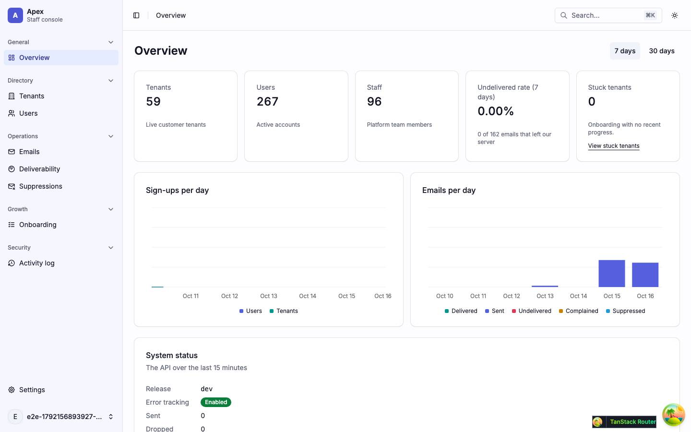 | 697  |               | The overview in the staff shell: sidebar, header, the five figure cards filled, both charts with gridlines and no bars, and rows of skeleton bars in System status.                            |
| 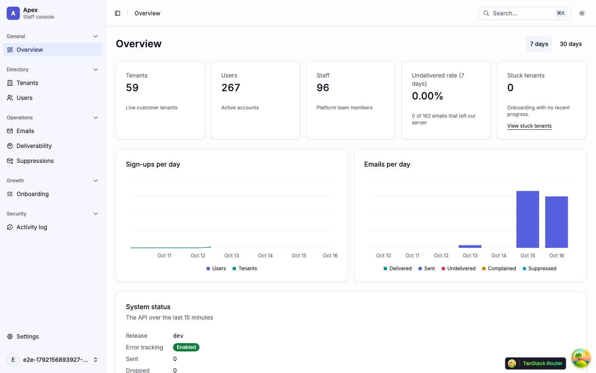 | 778  |               | The same with System status filled; the charts’ first bars growing in.                                                                                                                         |
| 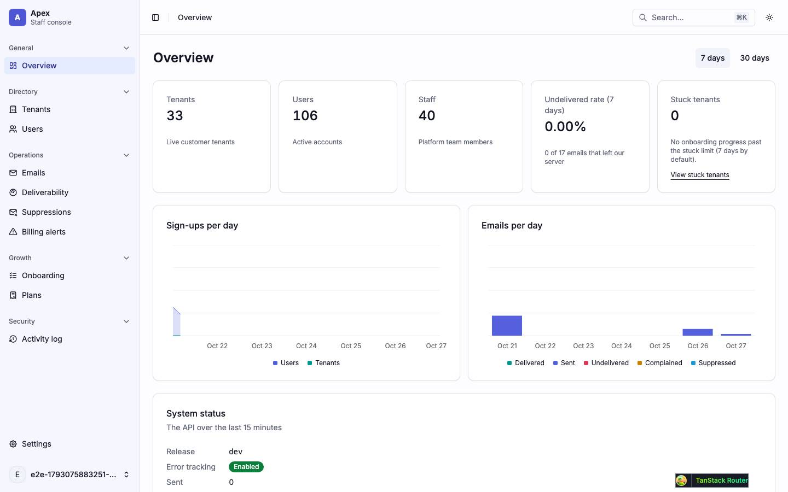 | 869  |               | The bars growing; the TanStack devtools button (dev only) appears in the corner.                                                                                                               |
| 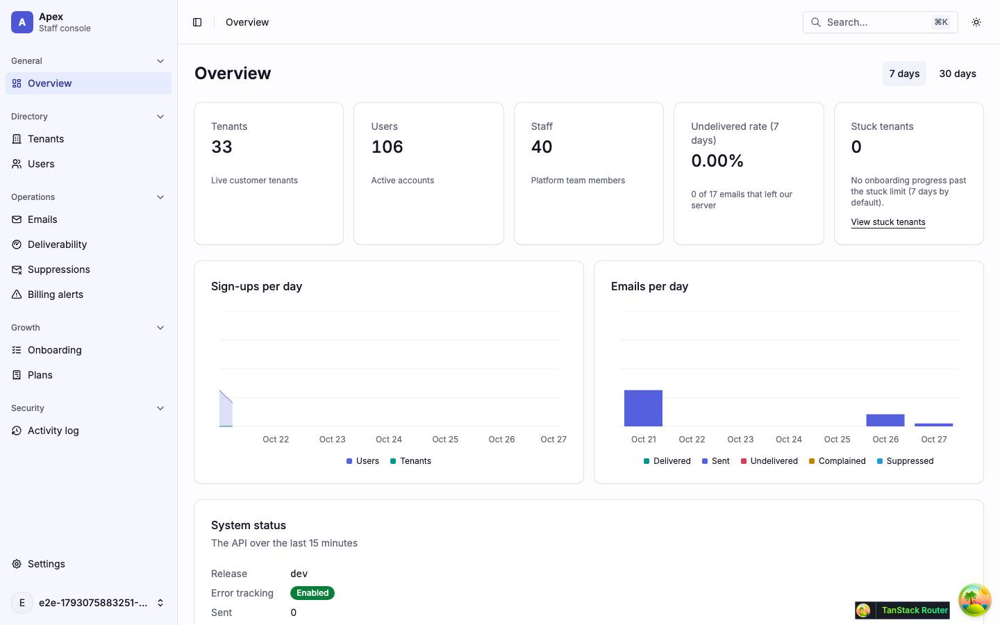 | 927  |               | The bars almost at full height.                                                                                                                                                                |
| 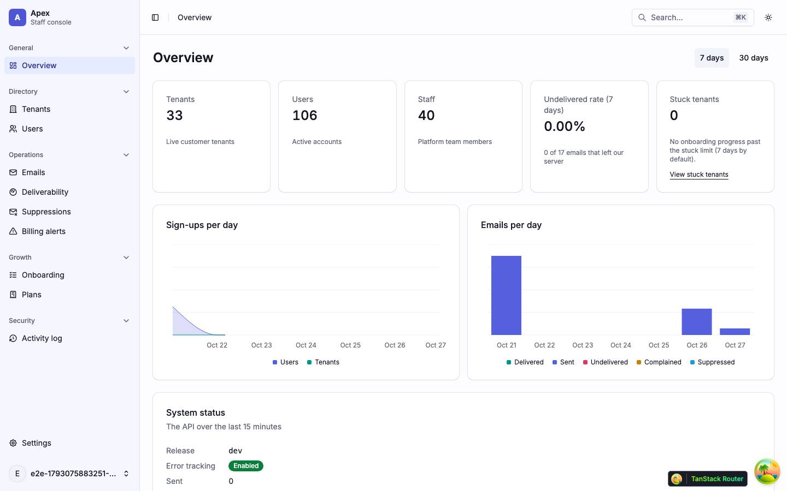 | 1008 | ready         | The overview with the bars at full height.                                                                                                                                                     |

Production (`nginx-signed-in-overview`, 16 frames kept of 46 distinct, 964 ms):

| Frame                                          | ms  | Moment        | What it shows                                                                                                                                                                                  |
| ---------------------------------------------- | --- | ------------- | ---------------------------------------------------------------------------------------------------------------------------------------------------------------------------------------------- |
|  | 0   | first-paint   | A blank white page: the browser's own frame before the document paints.                                                                                                                        |
|  | 53  | shell         | The app shell: sidebar and header bars, a heading and subtitle bar and one large block, styled.                                                                                                |
|  | 78  |               | The app shell: sidebar and header bars, a heading and subtitle bar and one large block, styled. Only the shimmer differs.                                                                      |
|  | 160 |               | The app shell: sidebar and header bars, a heading and subtitle bar and one large block, styled. Only the shimmer differs.                                                                      |
|  | 227 |               | The app shell: sidebar and header bars, a heading and subtitle bar and one large block, styled. Only the shimmer differs.                                                                      |
|  | 295 |               | The app shell: sidebar and header bars, a heading and subtitle bar and one large block, styled. Only the shimmer differs.                                                                      |
| 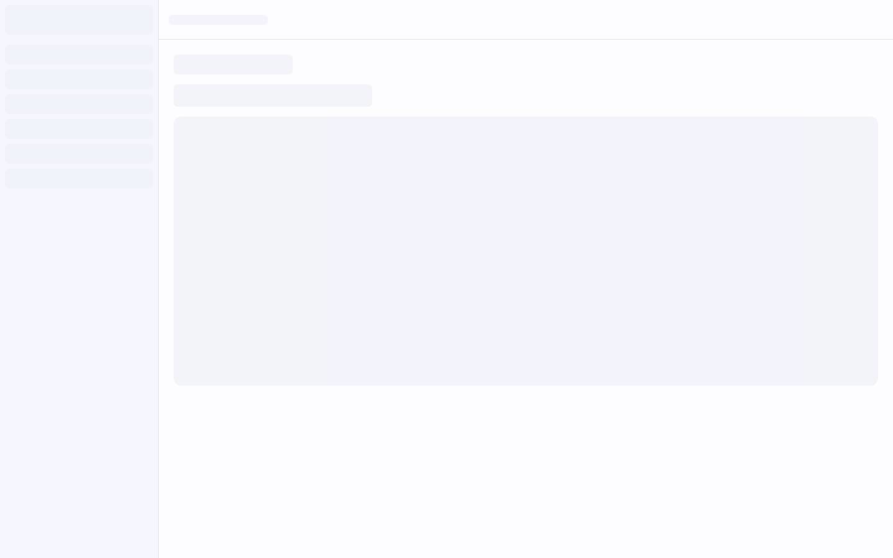 | 378 |               | The app shell: sidebar and header bars, a heading and subtitle bar and one large block, styled. Only the shimmer differs.                                                                      |
|  | 444 |               | The app shell: sidebar and header bars, a heading and subtitle bar and one large block, styled. Only the shimmer differs.                                                                      |
|  | 460 | first-content | The app shell: sidebar and header bars, a heading and subtitle bar and one large block, styled. The first frame at or after the DOM change; the compositor has not yet drawn the mounted page. |
| 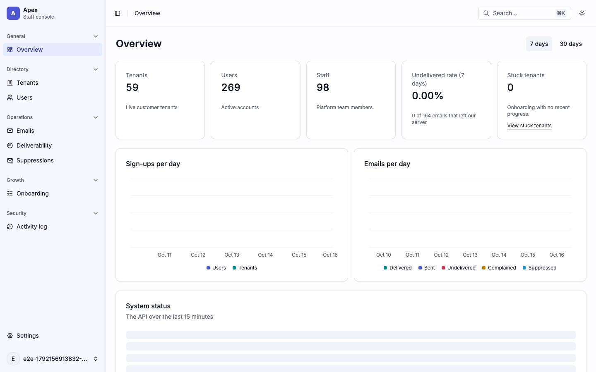 | 560 |               | The overview in the staff shell: the five figure cards filled, both charts with gridlines and no bars, and rows of skeleton bars in System status.                                             |
| 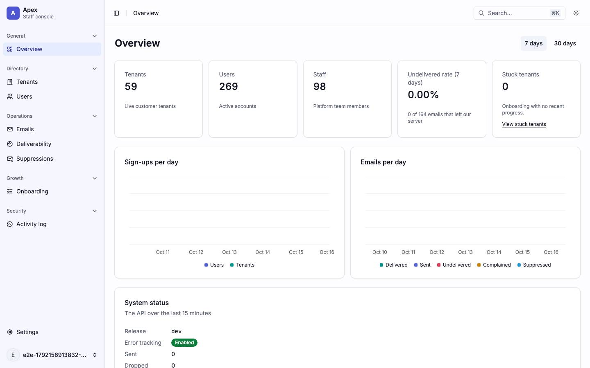 | 578 |               | The same with System status filled; the charts still have no bars.                                                                                                                             |
| 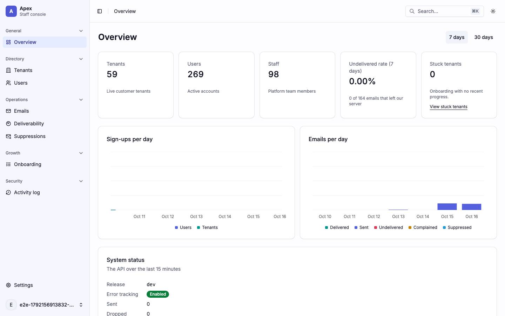 | 664 |               | The emails chart's first bars growing in.                                                                                                                                                      |
| 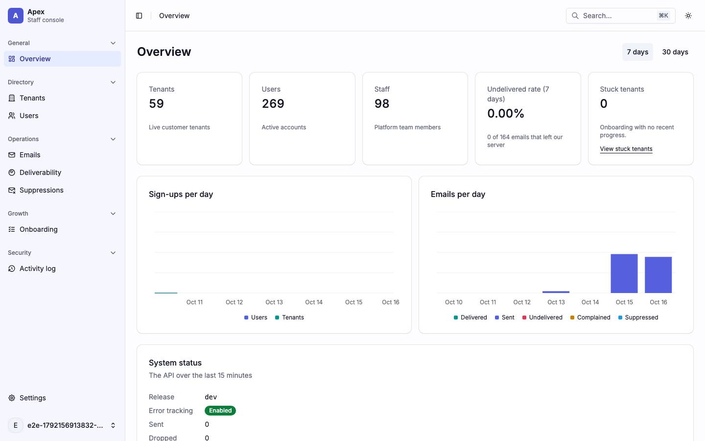 | 745 |               | The bars growing.                                                                                                                                                                              |
| 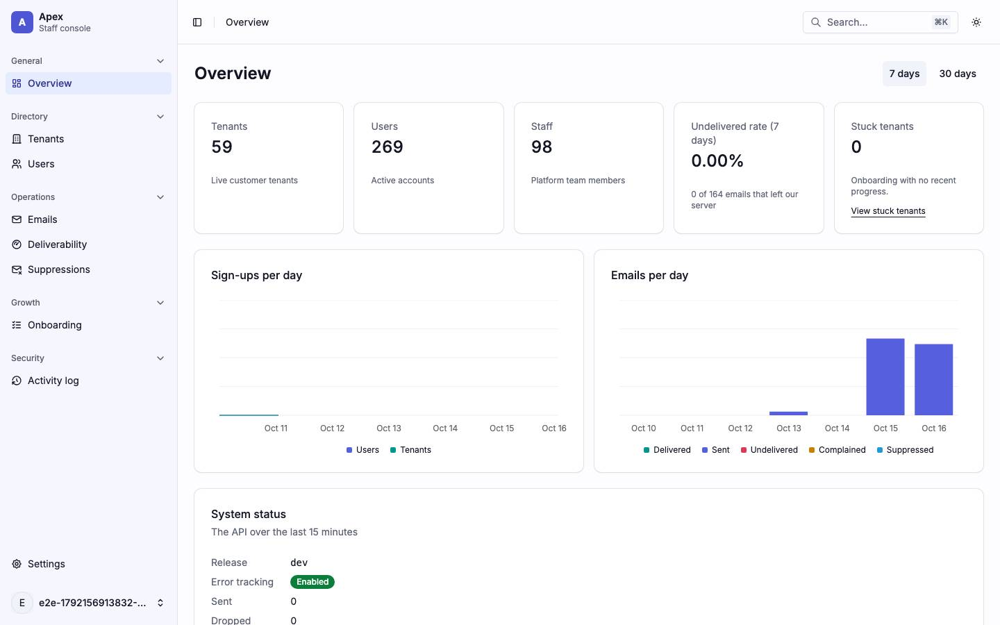 | 814 |               | The bars growing.                                                                                                                                                                              |
| 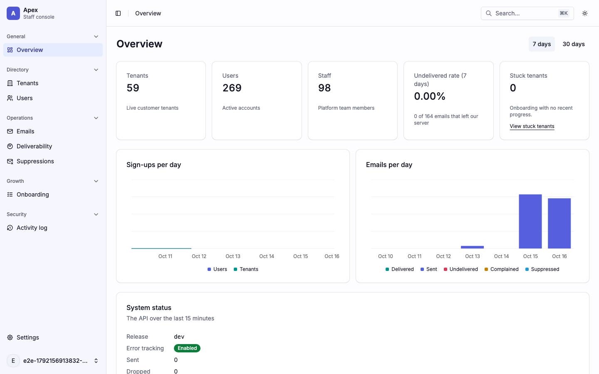 | 897 |               | The bars almost at full height.                                                                                                                                                                |
| 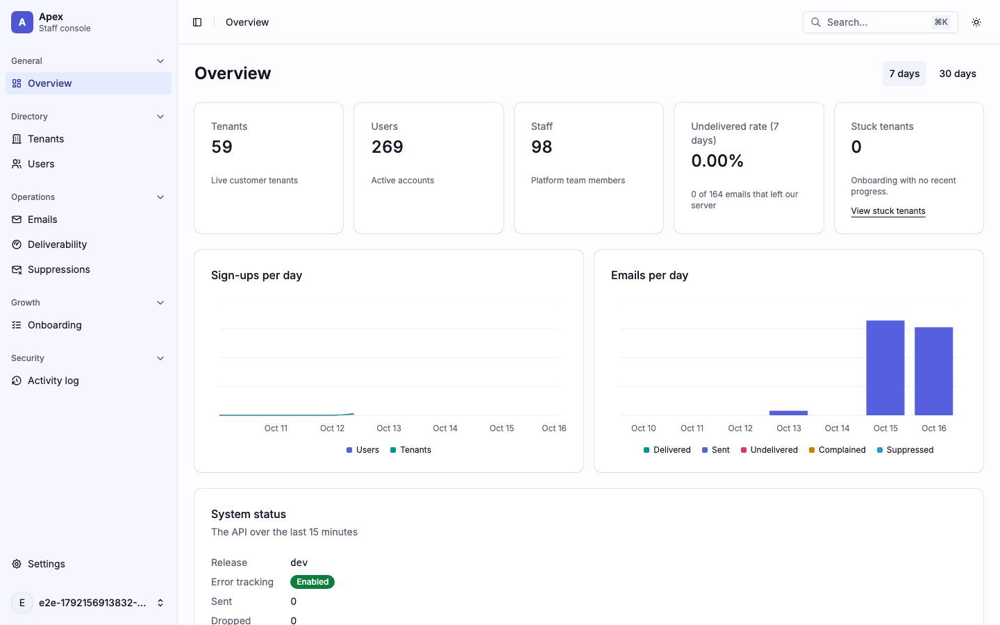 | 964 | ready         | The overview with the bars at full height.                                                                                                                                                     |

### Signed in, `/tenants`

Dev (`signed-in-tenants`, 13 frames kept of 37 distinct, 972 ms):

| Frame                                   | ms  | Moment        | What it shows                                                                                                                                                                                  |
| --------------------------------------- | --- | ------------- | ---------------------------------------------------------------------------------------------------------------------------------------------------------------------------------------------- |
|  | 0   | first-paint   | A blank white page: the browser's own frame before the document paints.                                                                                                                        |
|  | 23  | shell         | The app shell: sidebar and header bars, a heading and subtitle bar and one large block, styled.                                                                                                |
| 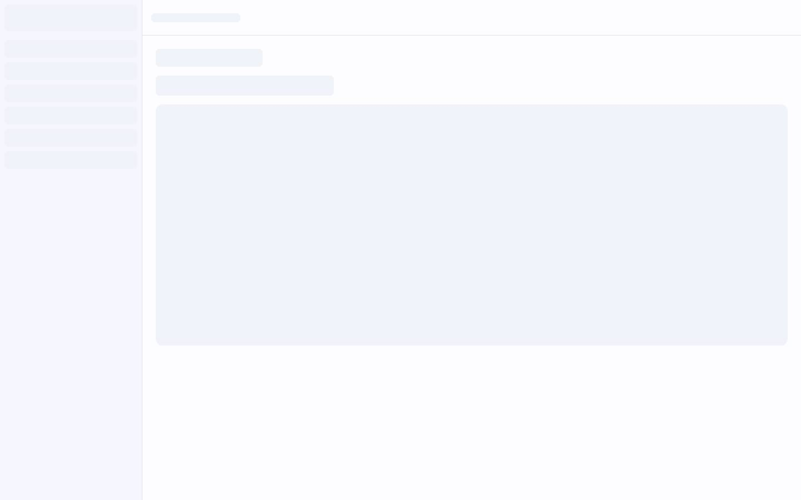 | 73  |               | The app shell: sidebar and header bars, a heading and subtitle bar and one large block, styled. Only the shimmer differs.                                                                      |
|  | 155 |               | The app shell: sidebar and header bars, a heading and subtitle bar and one large block, styled. Only the shimmer differs.                                                                      |
| 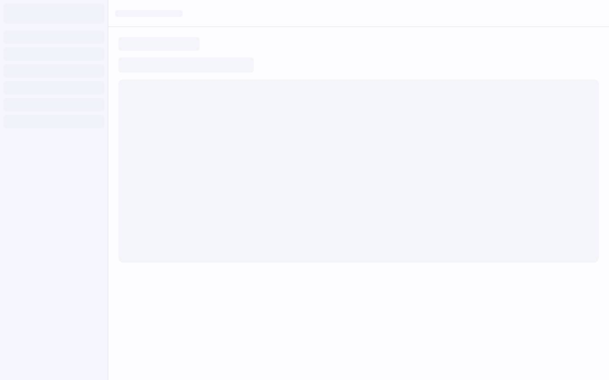 | 222 |               | The app shell: sidebar and header bars, a heading and subtitle bar and one large block, styled. Only the shimmer differs.                                                                      |
| 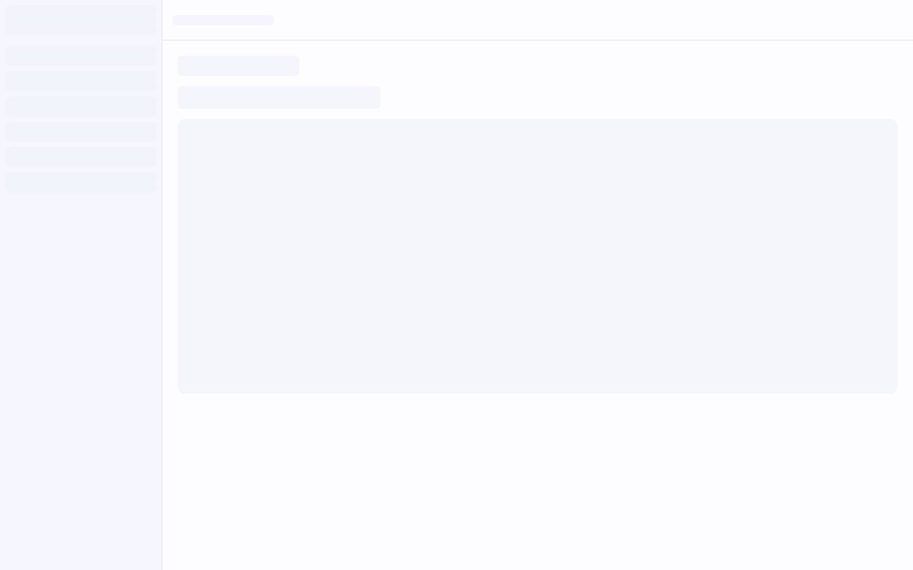 | 290 |               | The app shell: sidebar and header bars, a heading and subtitle bar and one large block, styled. Only the shimmer differs.                                                                      |
| 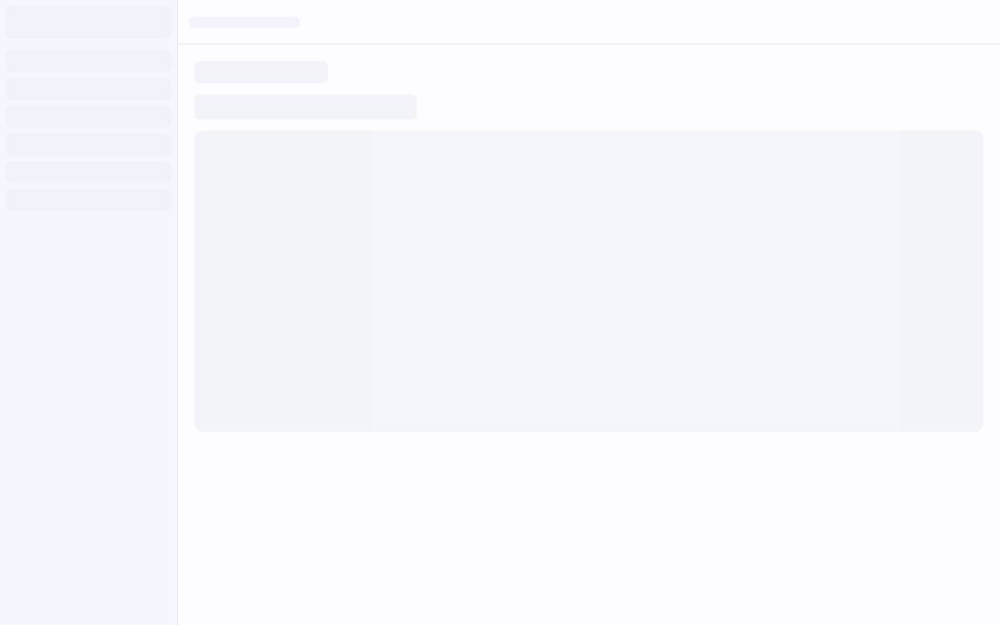 | 389 |               | The app shell: sidebar and header bars, a heading and subtitle bar and one large block, styled. Only the shimmer differs.                                                                      |
|  | 454 | first-content | The app shell: sidebar and header bars, a heading and subtitle bar and one large block, styled. The first frame at or after the DOM change; the compositor has not yet drawn the mounted page. |
| 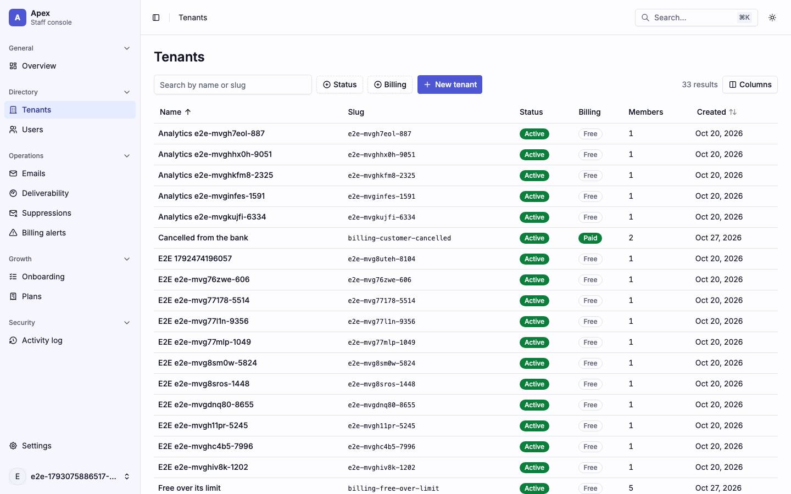 | 494 |               | The tenants page in the staff shell: heading, search, filters, New tenant and the filled table.                                                                                                |
| 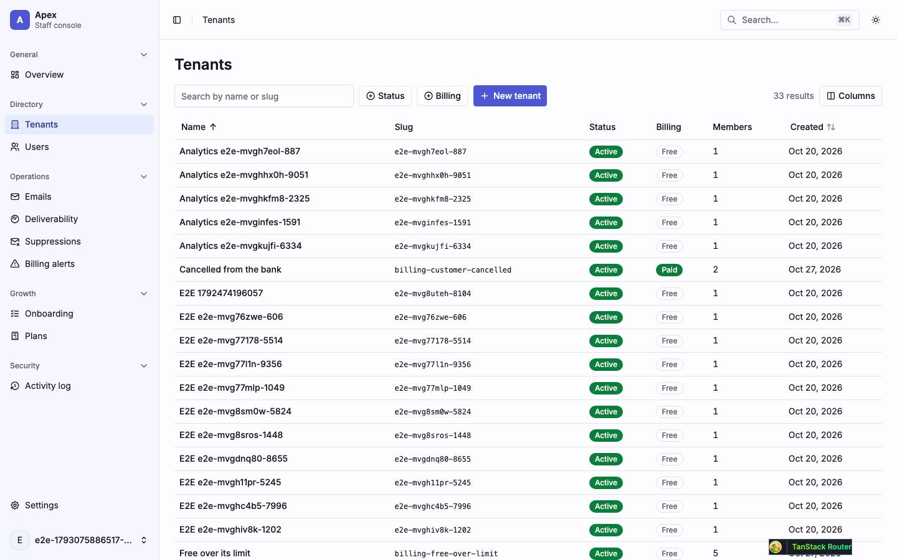 | 806 |               | The same, with the TanStack devtools button (dev only) in the corner.                                                                                                                          |
| 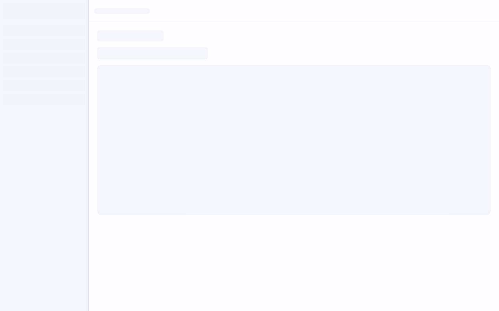 | 822 |               | The same.                                                                                                                                                                                      |
|  | 905 |               | The same.                                                                                                                                                                                      |
| 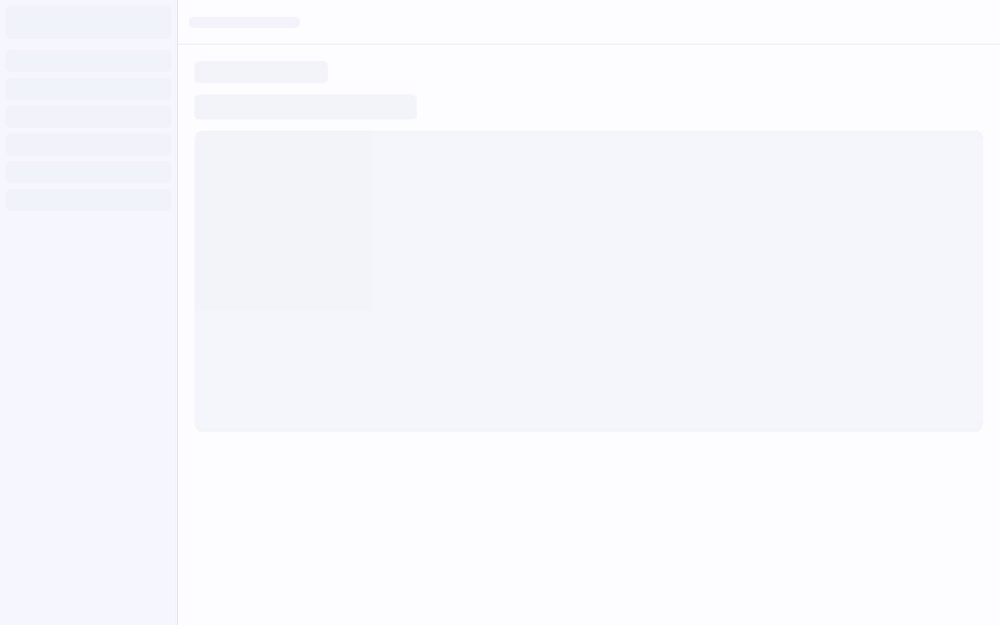 | 972 | ready         | The tenants page, the same.                                                                                                                                                                    |

## The first frame

The shell's inline CSS paints it in both builds, so no frame of either build shows unstyled text or a bare browser page after the first blank frame, which is the browser's own. `globals.css` arrives later and only replaces the shell's own values with the same ones: the shell sets `box-sizing: border-box` on its own boxes, so under `vite dev` the sidebar edge is at 255 px from the first shell frame, where it stays once the stylesheet lands. The blank frame before the shell lasts 23 ms, 27 ms and 100 ms in the three dev loads and 52–53 ms in the production loads.

## The handoff

On `/login` the frame after the shell is the page. On an `_app` page React mounts once the first load has resolved and the templates are in, and there is no tenant guard in this app, so the first app frame is the staff shell with the page itself: the overview's figure cards are already filled (the page's loader started its reads while the boot shell was up), its charts show gridlines until the data lands and System status shows skeleton rows (`signed-in-overview` frame 11 in dev and `nginx-signed-in-overview` frame 09). The `/tenants` table is drawn in its first page frame. The router's own pending templates (`defaultPendingMs`, 300 ms) show only on an in-app navigation still pending after that.

## In-app navigation

A cold load only shows the boot shell, so the route and section templates are shot on an in-app navigation (`e2e/capture/navigation.test.ts`), from a settled page, once with the target route's code held and once with only its section requests held. `capture-records/navigation.json` records, per navigation, `routeTemplate` (the Loading status appeared with the code held, and carried the `data-variant` and `data-nested` the navigation expects, so `true` means the target's own template showed) and `sectionSkeleton` (a busy `QueryState` section showed skeleton bars with its requests held).

| Navigation                     | Route template (code held)                                                                                | Section skeletons (requests held)                                                                               |
| ------------------------------ | --------------------------------------------------------------------------------------------------------- | --------------------------------------------------------------------------------------------------------------- |
| Overview to Deliverability     | [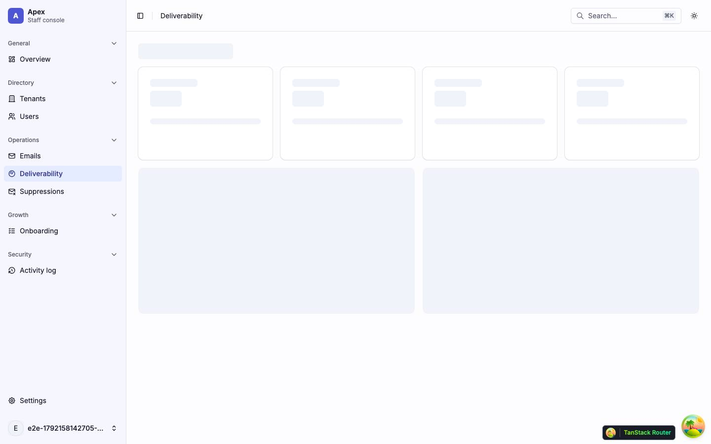](img/deliverability/deliverability--nav-route.jpg) | [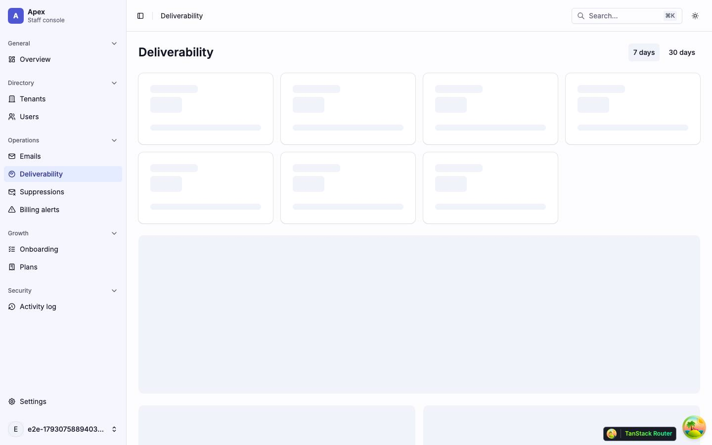](img/deliverability/deliverability--nav-sections.jpg) |
| Tenants to a tenant's overview | [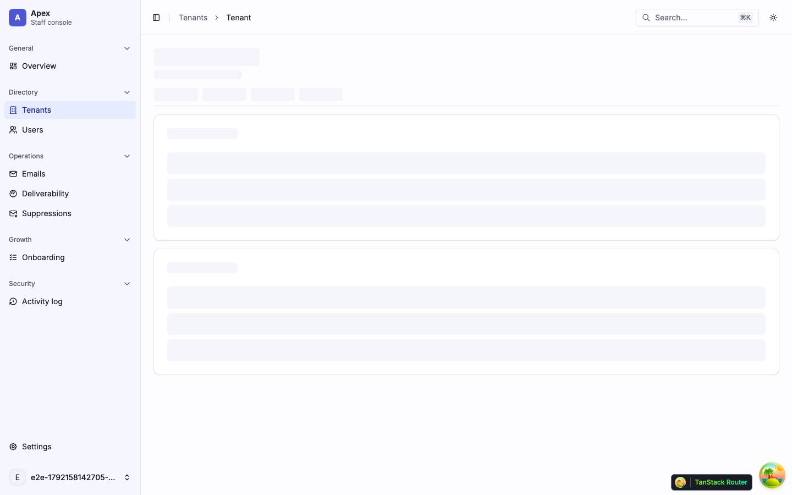](img/tenants/tenant-overview--nav-route.jpg)             | [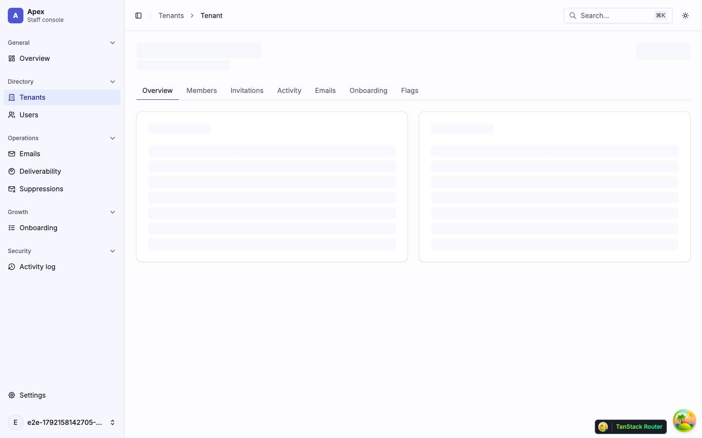](img/tenants/tenant-overview--nav-sections.jpg)             |
| Users to a user                | [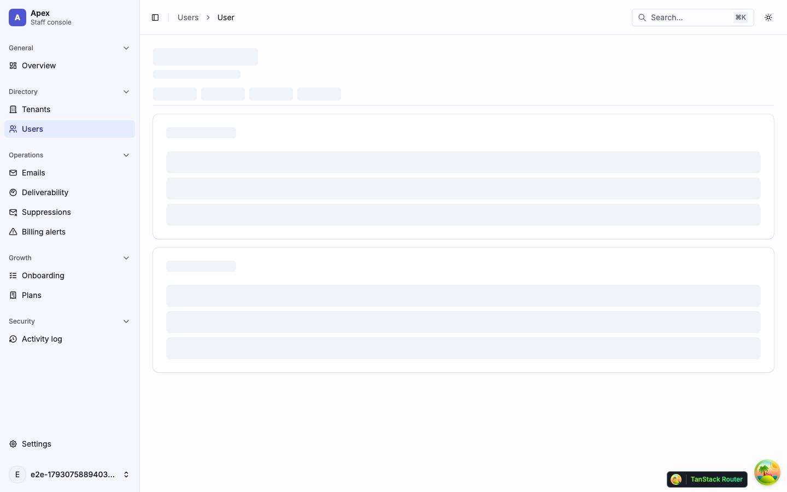](img/users/user--nav-route.jpg)                                       | [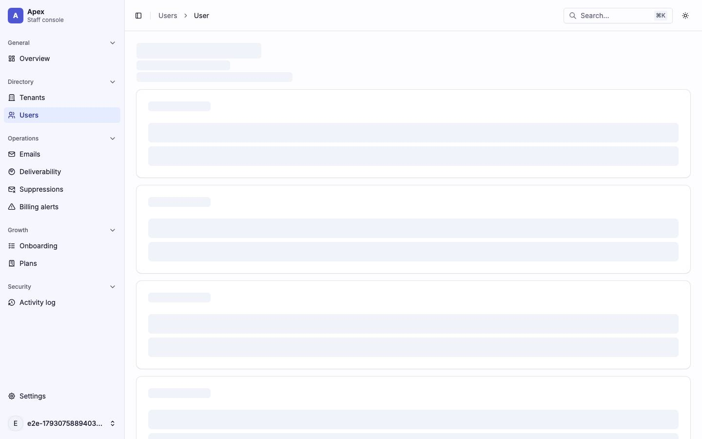](img/users/user--nav-sections.jpg)                                       |

- **Deliverability, route template:** the staff shell stays, the breadcrumb already reads Deliverability, and the page slot shows the dashboard template: a heading bar, four figure cards and two chart blocks. Both Deliverability shots show the TanStack Router devtools button, which is dev-only.
- **Deliverability, sections:** the real heading and the 7 days / 30 days switch, with seven figure cards and the chart blocks on skeleton bars.
- **Tenant and user, route template:** the staff shell stays, the breadcrumb already reads Tenants / Tenant or Users / User, and the page slot shows the detail template: heading and subtitle bars, tab bars and two cards of rows.
- **Tenant and user, sections:** the same shell with the tenant page's own skeleton (heading and subtitle bars, the real tab row, two cards of rows) or the user page's own (heading bars and five cards of rows, four of them in the viewport). These pages draw their skeleton from their own `useQuery` branch rather than from a `QueryState`, and the navigation capture looks for a busy `QueryState` section, so `capture-records/navigation.json` records `sectionSkeleton: false` for them although the shot shows the skeleton. Both skeleton wrappers are `aria-busy`.

## Dev and production

- **Dev-only:** the module-by-module fetches under `/src/…`; the TanStack devtools buttons.
- **Both:** the boot waits on `POST /auth/refresh`, `GET /profile`, and on `_app` pages the flags (up to 10 s, the cap in `ensureFlags`), before React mounts, and nothing else: page data is not part of the wait ([F-boot-2](findings.md#f-boot-2)).
- **Both:** a signed-out load logs one console error, the browser's own "Failed to load resource" line for the `POST /auth/refresh` 401. The 401 is how the app learns it is signed out, so the line is expected; no page script logs an error.
