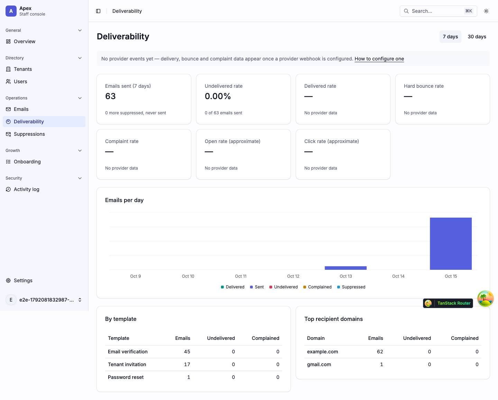
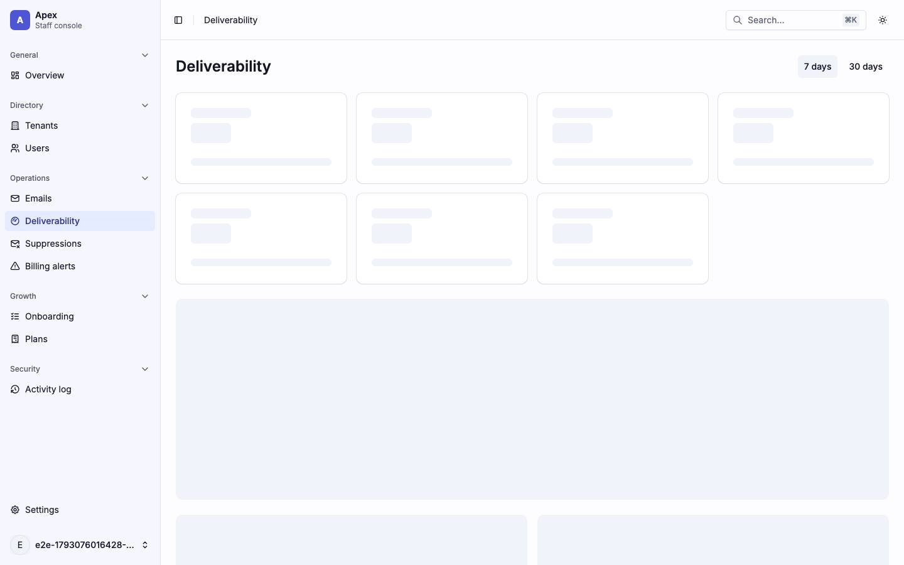
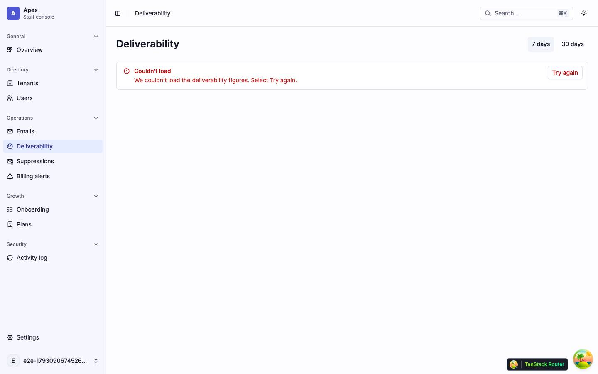
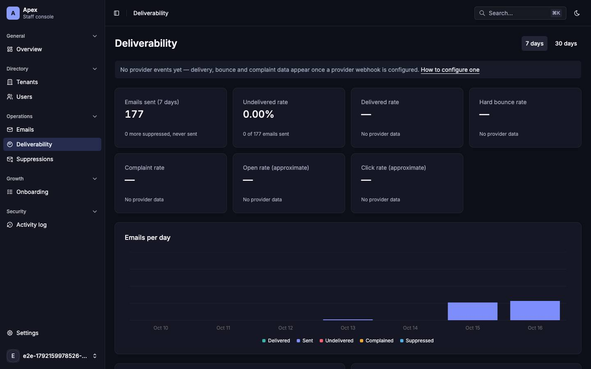
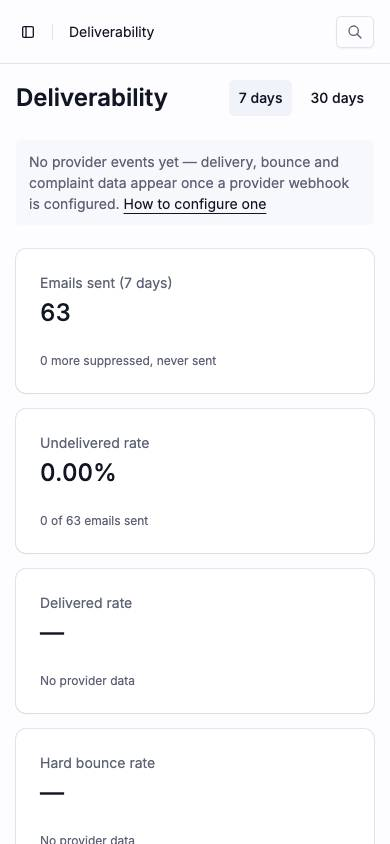

# Deliverability

Email health over a time window (`/deliverability`). Back to the [route map](README.md#route-map).

## Pages

### `/deliverability` — Deliverability

|                     |                                                                                                                                                                                                                                                                                                                                                                   |
| ------------------- | ----------------------------------------------------------------------------------------------------------------------------------------------------------------------------------------------------------------------------------------------------------------------------------------------------------------------------------------------------------------- |
| Purpose             | How the app's email fared over 7 or 30 days: sent, undelivered, delivered, bounce, complaint, open and click rates, per day, per template and per recipient domain.                                                                                                                                                                                               |
| File                | `src/pages/_app/deliverability.tsx`                                                                                                                                                                                                                                                                                                                               |
| Guard and redirects | `_app`; `?range=7d\|30d`, default `7d`                                                                                                                                                                                                                                                                                                                            |
| Layout              | `AppLayout`                                                                                                                                                                                                                                                                                                                                                       |
| Data                | `GET /platform/emails/health?range` (`['platform', 'emails', 'health', range]`), started by the loader; `keepPreviousData`, so switching the window keeps the old figures up (`aria-busy`)                                                                                                                                                                        |
| Sections            | The `h1` and the range `ToggleGroup`. `NoProviderEvents` when no provider webhook has reported ("No provider events yet — … How to configure one"). Seven KPI cards (`DeliverabilityKpis`), the **Emails per day** chart (`EmailsChart`), and two `BreakdownCard` tables: **By template** and **Top recipient domains**. Each widget sits in a `SectionBoundary`. |
| Components          | `ToggleGroup`, `Card`, `ChartContainer` (Recharts), `Table`, `Skeleton`, `KpiCardSkeleton`, `LoadError`, `RoleDenied`, `QueryState`, `SectionBoundary`, `Note` (passive, `NoProviderEvents`)                                                                                                                                                                      |
| Transitions         | How to configure one → the docs link                                                                                                                                                                                                                                                                                                                              |

One request feeds every widget, through `QueryState`: one skeleton, one `LoadError` or `RoleDenied`, and a failed refetch keeps the figures up under its `LoadError`. `DeliverabilitySkeleton` has seven `KpiCardSkeleton` cards at the loaded cards' 9rem, an `h-80` block (the chart card's height) and two `h-62` blocks (a breakdown card with three rows); a breakdown card moves by about 37 px for each row more or fewer, and the skeleton has no slot for the provider note.

| Loading                                             | Error                                                                                |
| --------------------------------------------------- | ------------------------------------------------------------------------------------ |
|  |                                     |
| skeleton · 7× 9rem KPI cards, `h-80`, 2× `h-62`     | alert · `LoadError` "We couldn’t load the deliverability figures. Select Try again." |

| Dark                                             | Mobile                                                                               |
| ------------------------------------------------ | ------------------------------------------------------------------------------------ |
|  |                                    |
| Cards and chart on the dark surfaces.            | One KPI card per row: the seven cards fill about a thousand pixels before the chart. |

Findings: [F-deliverability-1](findings.md#f-deliverability-1), [F-overview-3](findings.md#f-overview-3), [F-overview-6](findings.md#f-overview-6)
