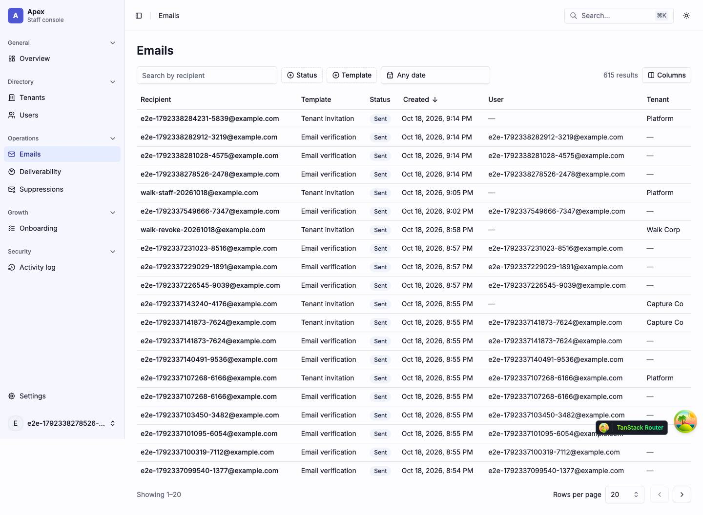
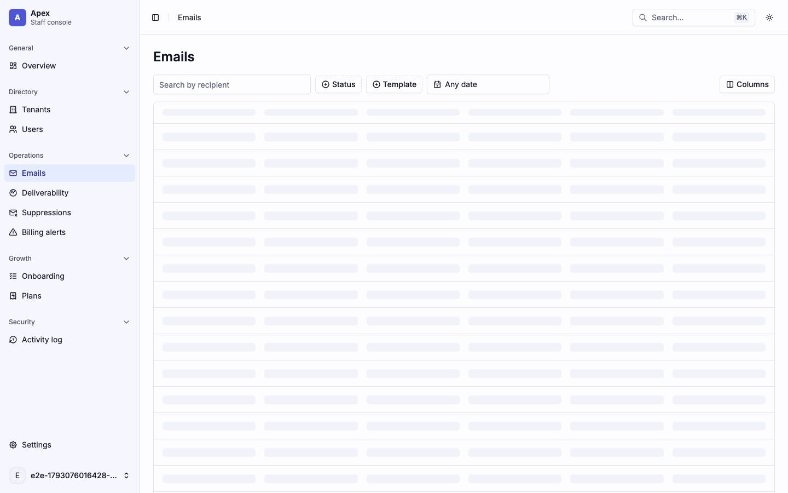
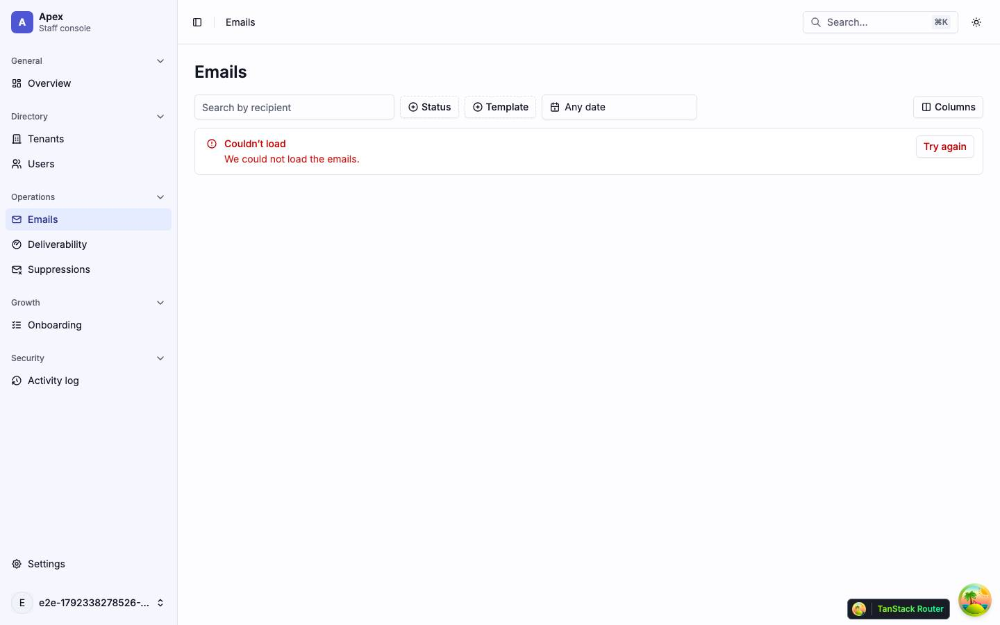
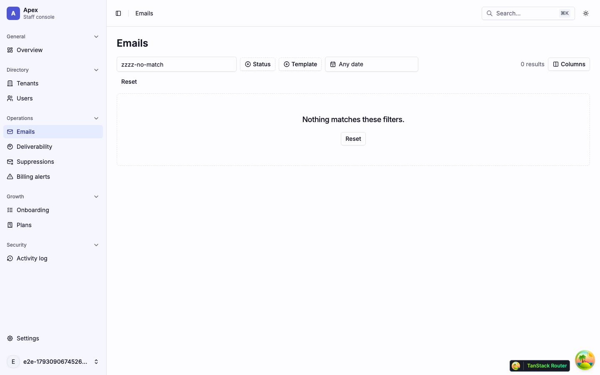
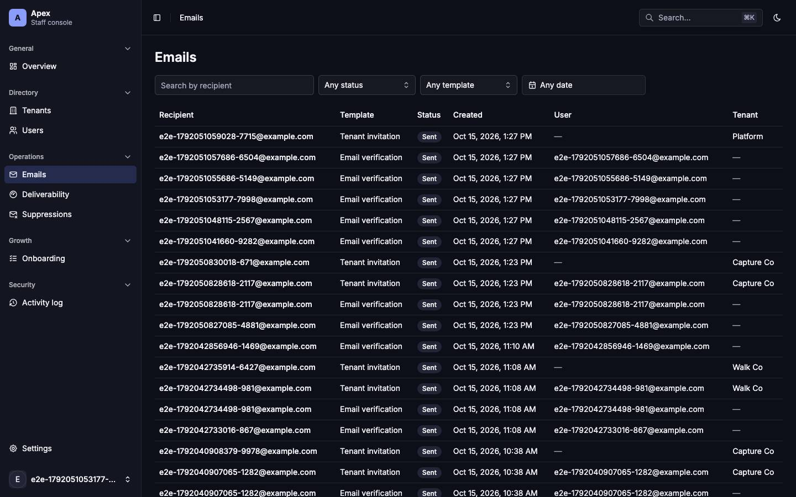
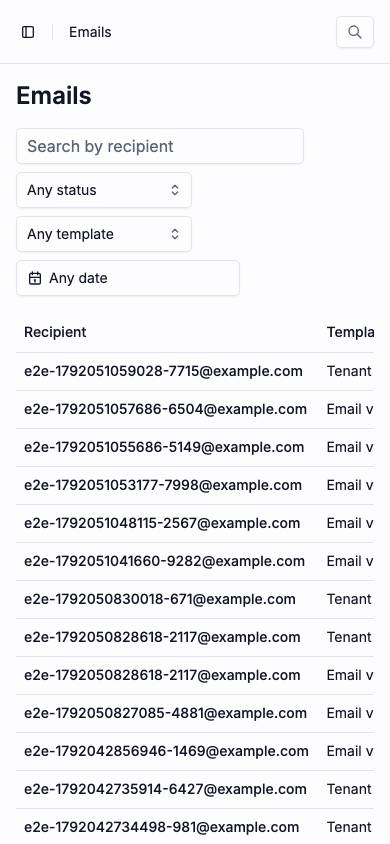
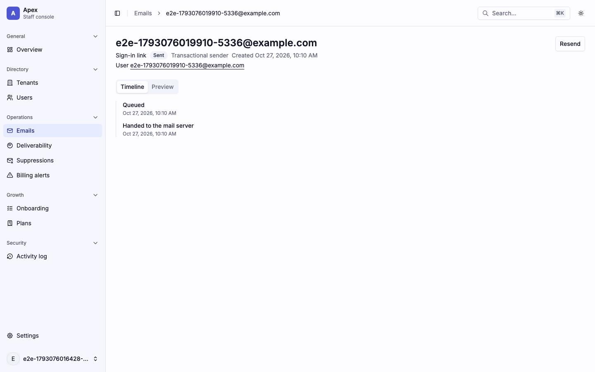
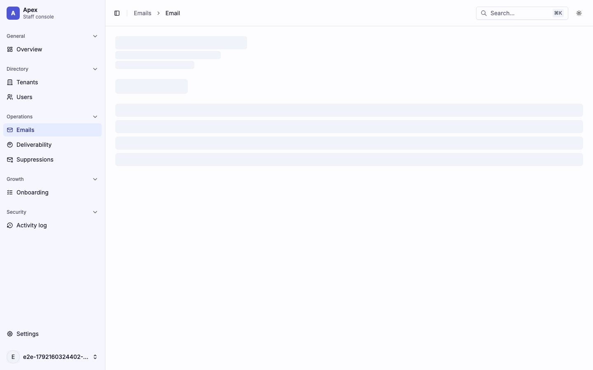
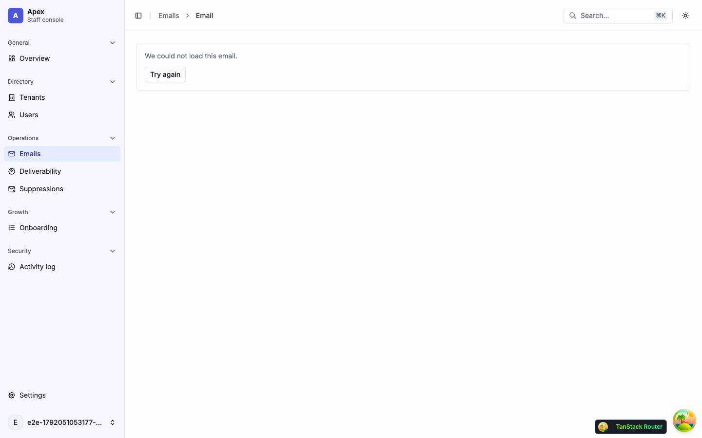
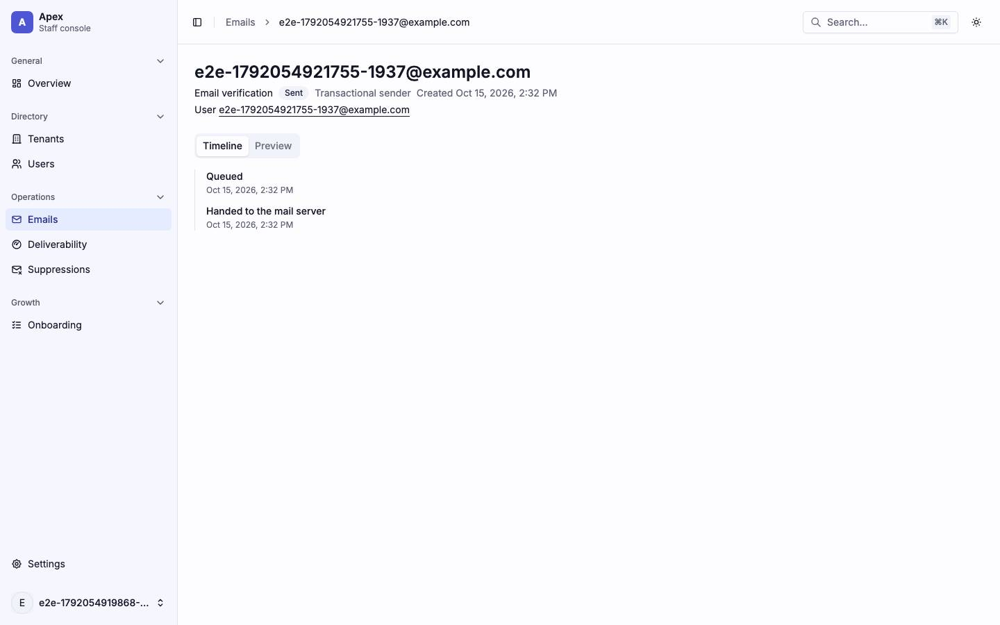

# Emails

The sent-email log (`/emails/`) and one email's page (`/emails/$emailId`). Back to the [route map](README.md#route-map).

## Pages

### `/emails/` — Emails

|                     |                                                                                                                                                                                                                                                                                                                                          |
| ------------------- | ---------------------------------------------------------------------------------------------------------------------------------------------------------------------------------------------------------------------------------------------------------------------------------------------------------------------------------------- |
| Purpose             | Every email the app sent, newest first, searched by recipient and filtered by status, template, date, user and tenant.                                                                                                                                                                                                                   |
| File                | `src/pages/_app/emails/index.tsx`                                                                                                                                                                                                                                                                                                        |
| Guard and redirects | `_app`                                                                                                                                                                                                                                                                                                                                   |
| Layout              | `AppLayout`                                                                                                                                                                                                                                                                                                                              |
| Data                | `GET /platform/emails?q&status&template&userId&tenantId&from&to&cursor&direction&limit=20` (`['platform', 'emails', params]`), started by the loader; `keepPreviousData`. A user or tenant filter chip whose name is not on the page reads `GET /platform/users/:id` or `GET /platform/tenants/:id`.                                     |
| Sections            | The `h1`, then a filter row: "Search by recipient" (debounced 250 ms, `?q`), status and template `Select`s (`?status`, `?template`) and `DateRangeFilter` (a `Popover` with a range `Calendar`, `?from` `?to`). Under it, removable chips for `?userId` and `?tenantId` when set. Then `EmailsTable` and the Previous/Next icon buttons. |
| Components          | `Input`, `Select`, `Popover`, `Calendar`, `Button`, `Table` through `EmailsTable` (TanStack Table `useTable` with no features: Recipient (link), Template, Status badge, Created, User, Tenant), `Skeleton`, `EmptyState`, `LoadError`, `RoleDenied`; hand-rolled: the filter chips                                                      |
| Transitions         | a recipient → `/emails/$emailId`; a user → `/users/$userId`; a tenant → `/tenants/$tenantId`                                                                                                                                                                                                                                             |

The User column repeats the recipient's address for most rows, since an email to an account goes to its address.

| Loading                             | Error                                               | Empty                                                                             |
| ----------------------------------- | --------------------------------------------------- | --------------------------------------------------------------------------------- |
|  |                    |                                                  |
| skeleton · one `h-96` block         | alert · `LoadError` "We could not load the emails." | "No emails match these filters." and "Try fewer filters, or part of the address." |

| Dark                                          | Mobile                                                                      |
| --------------------------------------------- | --------------------------------------------------------------------------- |
|               |                                           |
| The table and status badges on dark surfaces. | Each filter takes its own row; the table scrolls sideways, cut at Template. |

Findings: [F-emails-1](findings.md#f-emails-1), [F-emails-2](findings.md#f-emails-2)

### `/emails/$emailId` — Email

|                     |                                                                                                                                                                                                                                                                                                                                                                                                     |
| ------------------- | --------------------------------------------------------------------------------------------------------------------------------------------------------------------------------------------------------------------------------------------------------------------------------------------------------------------------------------------------------------------------------------------------- |
| Purpose             | One email: who it went to, how it stands, its delivery timeline and a rendered preview; resend when the API allows.                                                                                                                                                                                                                                                                                 |
| File                | `src/pages/_app/emails/$emailId.tsx`                                                                                                                                                                                                                                                                                                                                                                |
| Guard and redirects | `_app`. A 404 renders an `EmptyState` with the `h1` "Email not found" and Back to emails. `?tab=timeline\|preview`.                                                                                                                                                                                                                                                                                 |
| Layout              | `AppLayout`                                                                                                                                                                                                                                                                                                                                                                                         |
| Data                | `GET /platform/emails/:id` (`['platform', 'email', id]`), started by the loader. On the Preview tab, `GET /platform/emails/:id/preview` (`['platform', 'email', id, 'preview']`). Resend posts through `ReasonDialog`.                                                                                                                                                                              |
| Sections            | Header: the recipient as the `h1`, the template, status badge, sender class and created time, links to the user and the tenant, the failure reason for a failed email, and **Resend** (when `canResend`). A suppression note when the address is suppressed, with View suppression. `Tabs`: Timeline (`EmailTimeline`, an `ol` of events) and Preview (the rendered email in a sandboxed `iframe`). |
| Components          | `Tabs`, `Badge`, `Button`, `Skeleton`, `EmptyState`, `LoadError`, `ReasonDialog`, `EmailTimeline`, `EmailPreviewPanel`, `Note` (warning: the suppression note and the preview's placeholders note; info: the template-unavailable note)                                                                                                                                                             |
| Transitions         | the user → `/users/$userId`; the tenant → `/tenants/$tenantId`; View suppression → `/suppressions?q=`                                                                                                                                                                                                                                                                                               |

The preview has its own states: an `h-160` skeleton, a `LoadError` "We could not load the preview.", and a note when the template can no longer render (409).

| Loading                                   | Error                                               |
| ----------------------------------------- | --------------------------------------------------- |
|  |              |
| skeleton · `h-16` and `h-64`, full width  | alert · `LoadError` "We could not load this email." |

| Role-denied                                                                                                                                                       |
| ----------------------------------------------------------------------------------------------------------------------------------------------------------------- |
|                                                                                                                      |
| A viewer: no Resend, which needs a platform admin or owner. This run's email is a verification mail to a verified user, so the default shot has no Resend either. |

Findings: [F-emails-3](findings.md#f-emails-3), [F-overview-3](findings.md#f-overview-3), [F-palette-4](findings.md#f-palette-4)
