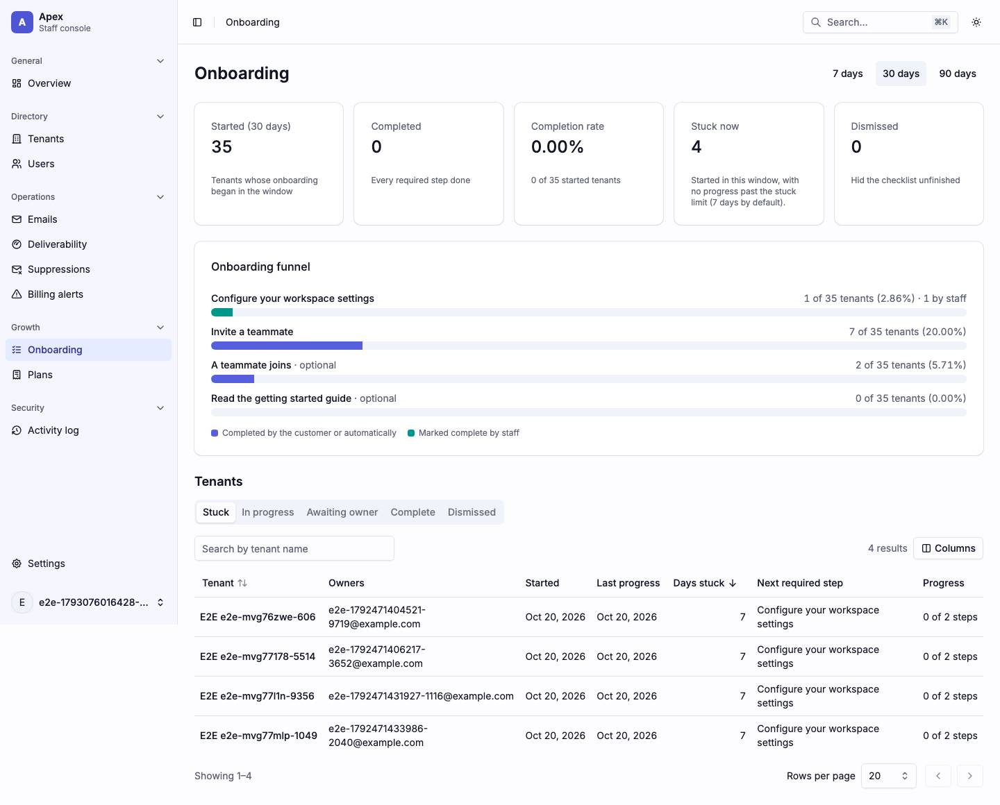
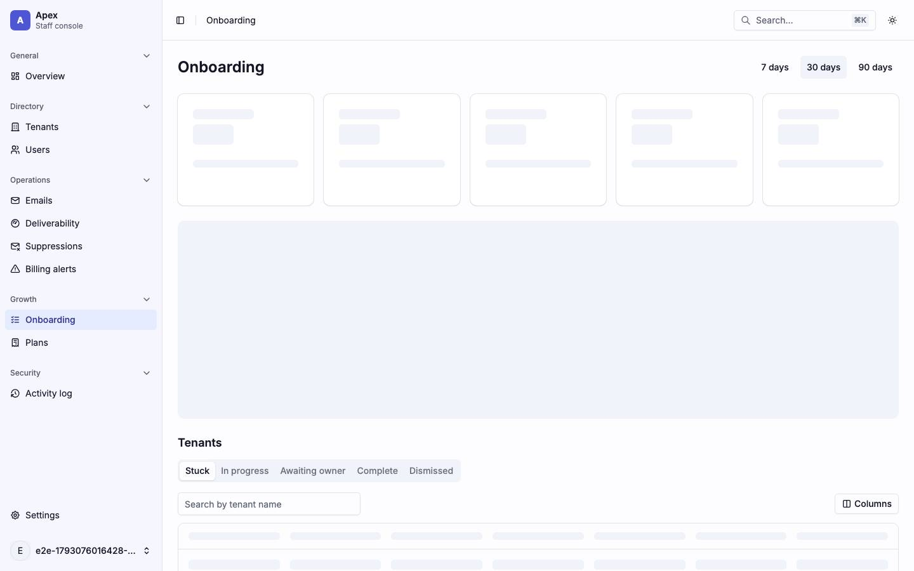
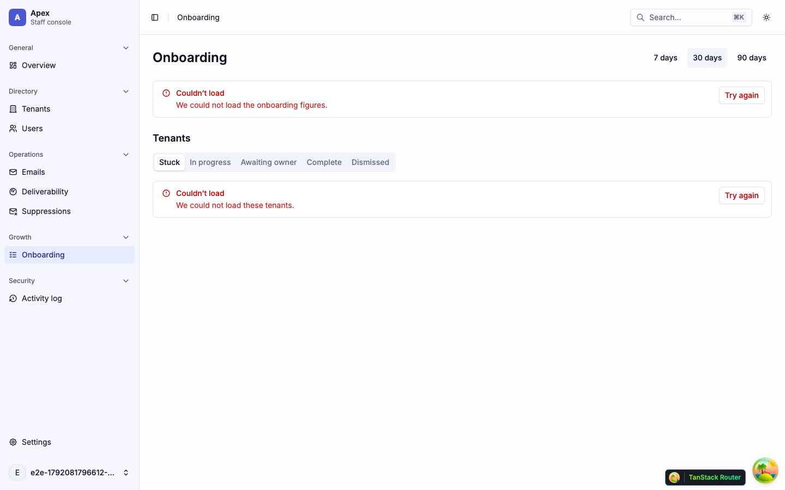
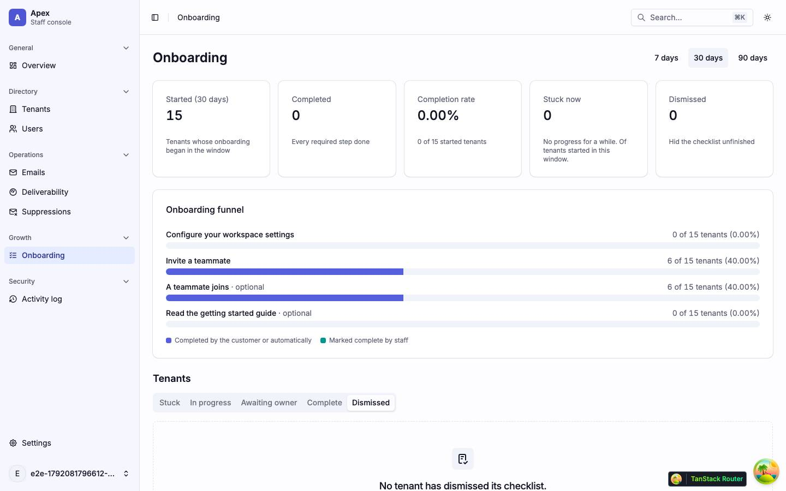

# Onboarding

The onboarding funnel and the tenants in each onboarding state (`/onboarding`). A tenant's own onboarding is its [Onboarding tab](tenants.md#tenantstenantidonboarding--onboarding). Back to the [route map](README.md#route-map).

## Pages

### `/onboarding` — Onboarding

|                     |                                                                                                                                                                                                                                                                                                                                                                      |
| ------------------- | -------------------------------------------------------------------------------------------------------------------------------------------------------------------------------------------------------------------------------------------------------------------------------------------------------------------------------------------------------------------- |
| Purpose             | How far new tenants get through the getting-started checklist over 7, 30 or 90 days, and which tenants are stuck, in progress, awaiting their owner, complete or dismissed.                                                                                                                                                                                          |
| File                | `src/pages/_app/onboarding.tsx`                                                                                                                                                                                                                                                                                                                                      |
| Guard and redirects | `_app`; `?range` (default `30d`), `?state` (default `stuck`), `?cursor`, `?dir`                                                                                                                                                                                                                                                                                      |
| Layout              | `AppLayout`                                                                                                                                                                                                                                                                                                                                                          |
| Data                | the loader starts both: `GET /platform/onboarding/funnel?range` (`['platform', 'onboarding', 'funnel', range]`) and `GET /platform/onboarding/tenants?state&cursor&direction&limit=20` (`['platform', 'onboarding', 'tenants', params]`)                                                                                                                             |
| Sections            | The `h1` and the range `ToggleGroup`. Five KPI cards (`OnboardingKpis`: Started, Completed, Completion rate, Stuck now, Dismissed) and the **Onboarding funnel** card (one stacked bar per step, customer and staff completions). Then **Tenants**: `Tabs` for the five states and, in the active one, `OnboardingTenantsTable` with the Previous/Next icon buttons. |
| Components          | `ToggleGroup`, `Card`, `Tabs`, `Table`, `Button`, `Skeleton`, `KpiCardSkeleton`, `EmptyState`, `LoadError`, `RoleDenied`, `QueryState`, `SectionBoundary`; hand-rolled: the funnel bars                                                                                                                                                                              |
| Transitions         | a tenant → `/tenants/$tenantId/onboarding`; a state tab → `?state` (cursor dropped); the Overview's View stuck tenants → `?state=stuck`                                                                                                                                                                                                                              |

The funnel loads through `QueryState` (`FunnelSkeleton`: five `KpiCardSkeleton` cards at 11rem and an `h-78` block). The Tenants section mounts with the page and starts its own read, so it shows while the funnel loads. When the funnel fails (not 404), the page shows the funnel's `LoadError` and still renders the Tenants section. When the funnel is refused for the role (404), the page shows one `RoleDenied` and no Tenants section. When no tenant is tracked, the page is one `Empty` "No tenant is tracked yet." and has no Tenants section. Each state tab has its own empty wording ("No tenant is stuck.", "No tenant has dismissed its checklist.", …).

`OnboardingTenantsTable` columns: Tenant (link), Owners, Started, Last progress, Days stuck (on the stuck tab only, which sorts by it), Next required step, Progress ("{n} of {m}").

| Loading                                                               | Error                                                                                          | Empty                                                        |
| --------------------------------------------------------------------- | ---------------------------------------------------------------------------------------------- | ------------------------------------------------------------ |
|                            |                                                       |                     |
| skeleton · `FunnelSkeleton`: 5× `h-30` and `h-74`; no Tenants section | alert · two `LoadError`s: the funnel's at full width, the list's shrink-wrapped under the tabs | `?state=dismissed`: "No tenant has dismissed its checklist." |

Findings: [F-onboarding-1](findings.md#f-onboarding-1), [F-onboarding-2](findings.md#f-onboarding-2), [F-onboarding-3](findings.md#f-onboarding-3), [F-overview-2](findings.md#f-overview-2)
