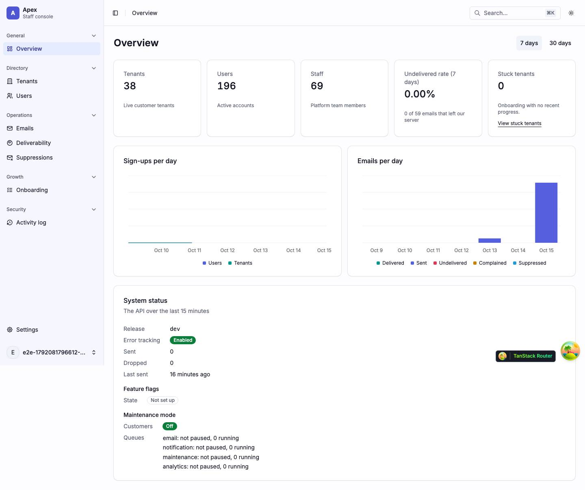
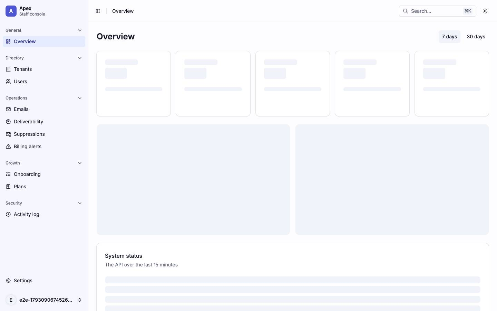
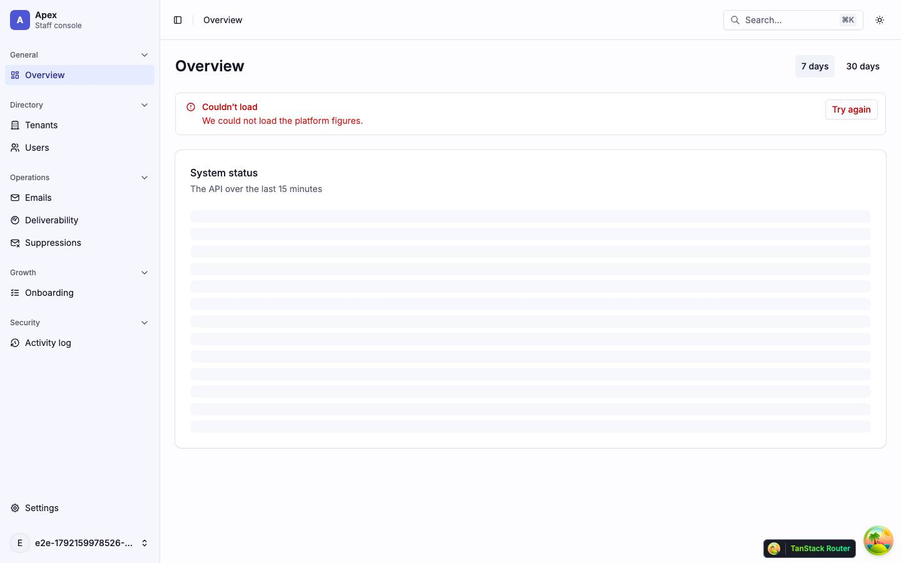
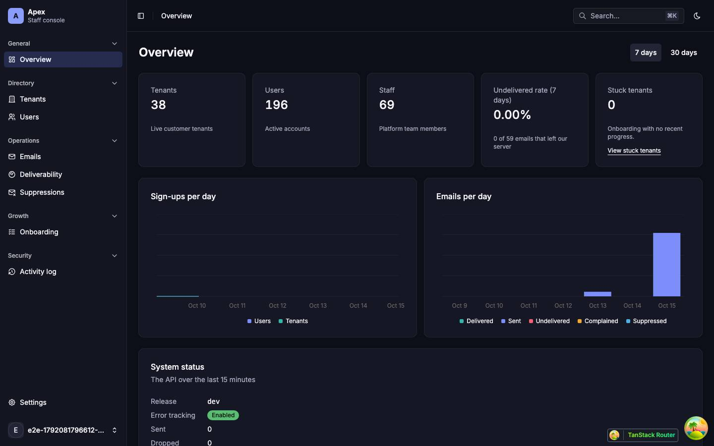
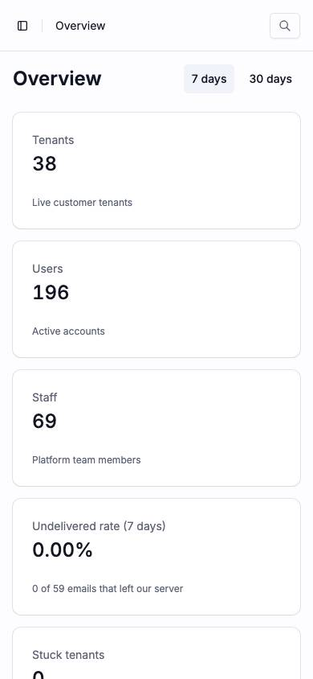
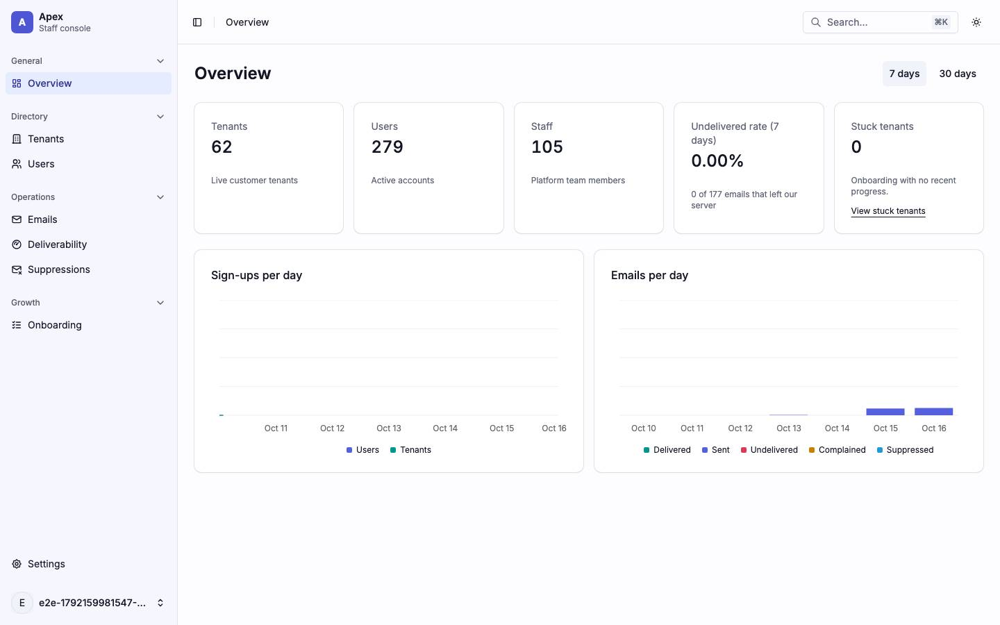

# Overview

The signed-in landing page (`/overview`) and the staff shell every signed-in page renders in. Back to the [route map](README.md#route-map).

## The staff shell

`_app` (`src/pages/_app.tsx`) renders `AppLayout` (`src/components/layouts/app-layout.tsx`), after shadcn's sidebar-07 block, around every signed-in page.

|                  |                                                                                                                                                                                                                                                                                                                                                                                                                                                                                                                                                                                                                                                                                                                                                  |
| ---------------- | ------------------------------------------------------------------------------------------------------------------------------------------------------------------------------------------------------------------------------------------------------------------------------------------------------------------------------------------------------------------------------------------------------------------------------------------------------------------------------------------------------------------------------------------------------------------------------------------------------------------------------------------------------------------------------------------------------------------------------------------------ |
| Guard            | `beforeLoad`: signed out → `/login?redirect=`; signed in without a platform role → `/no-access`. Its loader awaits `ensureFlags` (`GET /platform/me/flags`, no retry, falls back on failure), so a flagged nav item never flashes. That wait happens before React mounts on a cold load ([boot.md](boot.md#what-happens)).                                                                                                                                                                                                                                                                                                                                                                                                                       |
| Fetches          | After mount: `GET /platform/maintenance-mode` (`['platform', 'maintenance-mode']`) for `MaintenanceBanner`, polled every 30 s while customers are in maintenance and every 60 s while not, stopped by a 404. The ⌘K palette searches while it is open ([palette.md](palette.md#the-command-palette)).                                                                                                                                                                                                                                                                                                                                                                                                                                            |
| Sidebar          | Collapsible to icons, with a rail. Its header is the Apex mark, "Apex" and "Staff console", a link to Overview. Its content is `NavMain`: five labelled, foldable sections from `navGroupsFor(role, flags)` (`src/constants/navigation.ts`): General (Overview), Directory (Tenants, Users), Operations (Emails, Deliverability, Suppressions), Growth (Onboarding), Security (Activity log, admins and up). An item above the role, or behind an off flag, is absent. Settings sits at the bottom (`NavSecondary`). On `/settings/*` the content becomes `NavSettings` ([settings.md](settings.md#layout)). The footer is the account menu (`UserMenu`): the avatar, name and email, then Profile, Settings and Sign out (`POST /auth/logout`). |
| Header           | The sidebar toggle, the breadcrumb (from each route's `staticData.crumb`, with `crumbParent` for detail pages), a **Search…** button with the shortcut hint (`⌘K` or `Ctrl K`) that opens the palette, and from `md` up the theme menu (Light, Dark, System). Below `md` the theme menu moves to the drawer's footer and the search button shows only its icon.                                                                                                                                                                                                                                                                                                                                                                                  |
| Under the header | `MaintenanceBanner`: a red `role="status"` strip with who set customer maintenance and when, and Manage → `/settings/platform/maintenance`. Nothing while the mode is off.                                                                                                                                                                                                                                                                                                                                                                                                                                                                                                                                                                       |
| Around it        | `StepUpProvider` (one step-up dialog for every destructive staff action; `GET /auth/providers` when it opens, `POST /auth/reauthenticate`), the skip link, and the `CommandPalette`.                                                                                                                                                                                                                                                                                                                                                                                                                                                                                                                                                             |

Below `md` the sidebar is a `Sheet` opened from the header toggle; every link in it closes it.

Findings: [F-overview-2](findings.md#f-overview-2), [F-overview-3](findings.md#f-overview-3), [F-overview-4](findings.md#f-overview-4), [F-overview-5](findings.md#f-overview-5), [F-overview-7](findings.md#f-overview-7)

## Pages

### `/overview` — Overview

|                     |                                                                                                                                                                                                                                                                                                                                                                                                                                    |
| ------------------- | ---------------------------------------------------------------------------------------------------------------------------------------------------------------------------------------------------------------------------------------------------------------------------------------------------------------------------------------------------------------------------------------------------------------------------------- |
| Purpose             | The platform's headline figures for the last 7 or 30 days, and for admins the API's health.                                                                                                                                                                                                                                                                                                                                        |
| File                | `src/pages/_app/overview.tsx`                                                                                                                                                                                                                                                                                                                                                                                                      |
| Guard and redirects | `_app`; `?range=7d\|30d`, default `7d`                                                                                                                                                                                                                                                                                                                                                                                             |
| Layout              | `AppLayout`                                                                                                                                                                                                                                                                                                                                                                                                                        |
| Data                | `GET /platform/stats?range` (`['platform', 'stats', range]`), started by the loader; `keepPreviousData` when the window changes. For admins and up, `SystemStatusCard` starts `GET /platform/system/status` (`['platform', 'system', 'status']`) when it mounts, polled every minute while the tab is visible, stopped by a 404.                                                                                                   |
| Sections            | The `h1` and the range `ToggleGroup`. ← stats: five KPI cards (Tenants, Users, Staff, Undelivered rate, Stuck tenants with View stuck tenants), **Sign-ups per day** and **Emails per day** charts, each in a `WidgetBoundary`. ← system status (admins): **System status**, "The API over the last 15 minutes": release, error tracking, sent and dropped counts, last sent, feature-flag state, maintenance mode and each queue. |
| Components          | `ToggleGroup`, `Card`, `ChartContainer` (Recharts, with a visually hidden table per chart), `Badge`, `Skeleton`, `LoadError`, `RoleDenied`, `WidgetBoundary`, `SystemStatusCard`; `EmptyState` (compact, in the chart cards: "No sign-ups in the last 7 days")                                                                                                                                                                     |
| Transitions         | View stuck tenants → `/onboarding?state=stuck`                                                                                                                                                                                                                                                                                                                                                                                     |

One request feeds every figure and chart, so the stats have one skeleton (`OverviewSkeleton`: five `h-30` cards and two `h-74` blocks) and one error state. The status card has its own: an `h-32` skeleton inside the card, a `LoadError`, and nothing at all on a 404. In the error shot both reads answered 500: the stats show their `LoadError`, while the status card still shows its skeleton, because its first failure is retried once and the shot was taken before the retry settled. The single-section failure of the status card is from the code.

| Loading                                                       | Error                                                                                                |
| ------------------------------------------------------------- | ---------------------------------------------------------------------------------------------------- |
|                        |                                                                 |
| skeleton · 5× `h-30`, 2× `h-74`, and the status card's `h-32` | alert · `LoadError` "We could not load the platform figures."; the status card still on its skeleton |

| Dark                                   | Mobile                                                       |
| -------------------------------------- | ------------------------------------------------------------ |
|    |                        |
| Cards and charts on the dark surfaces. | One KPI card per row; the charts start below the fifth card. |

| Role-denied                                                                                                         |
| ------------------------------------------------------------------------------------------------------------------- |
|                                                                          |
| A viewer: the figures and charts without the System status card; the Activity log item is missing from the sidebar. |

Findings: [F-overview-1](findings.md#f-overview-1), [F-overview-2](findings.md#f-overview-2), [F-overview-4](findings.md#f-overview-4), [F-overview-6](findings.md#f-overview-6)
