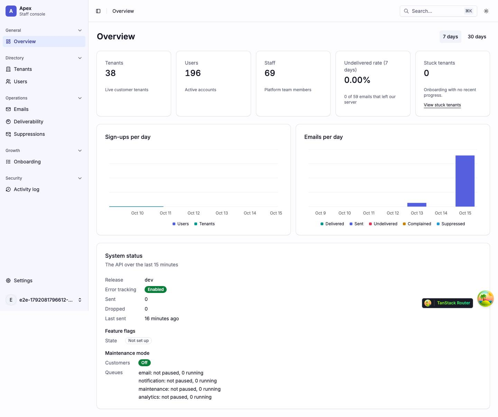
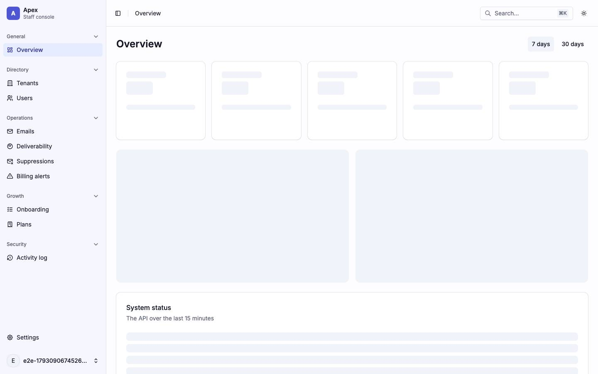
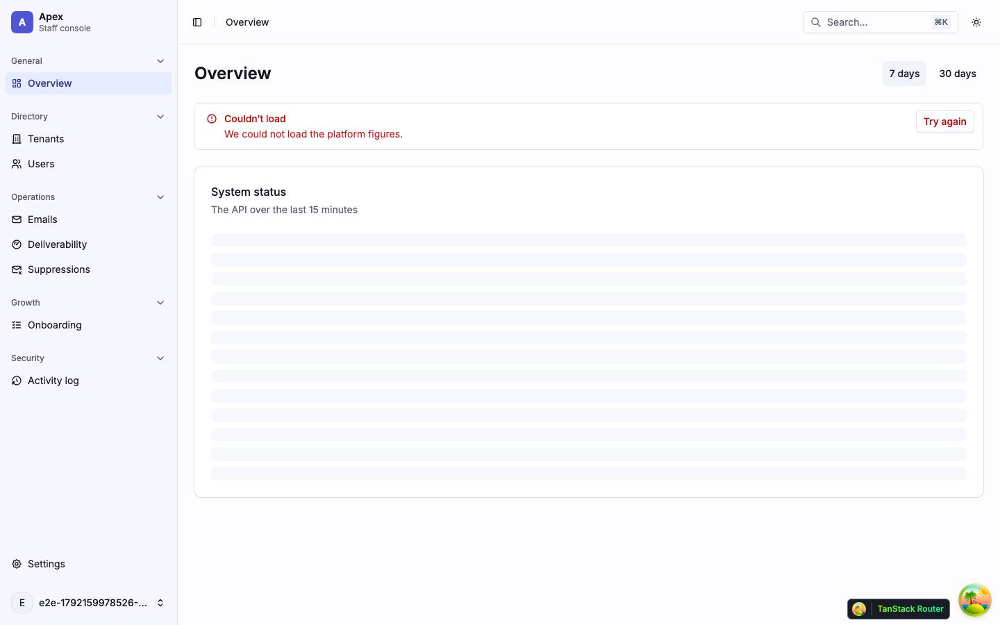
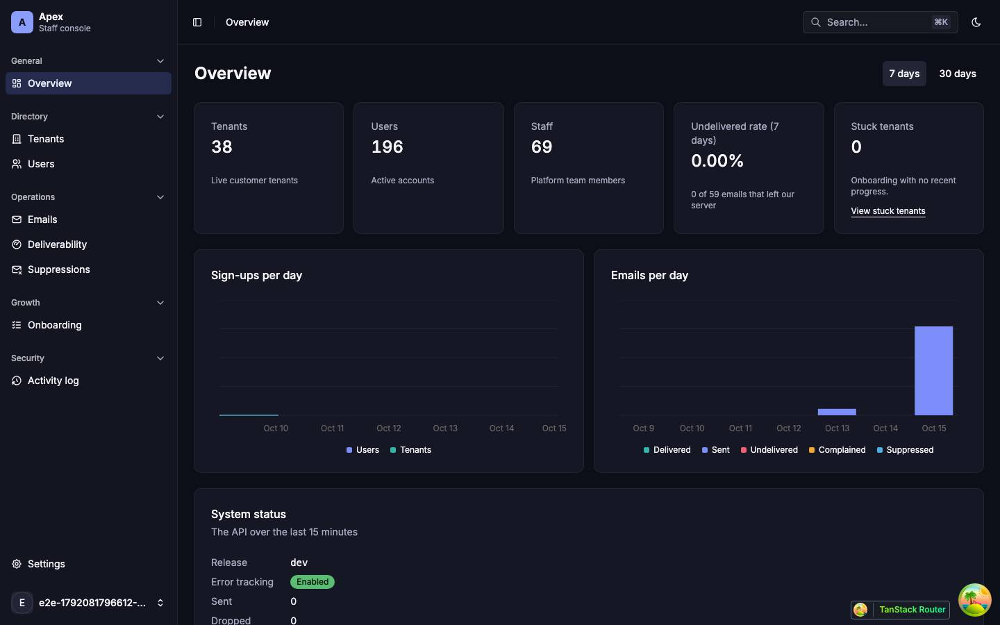
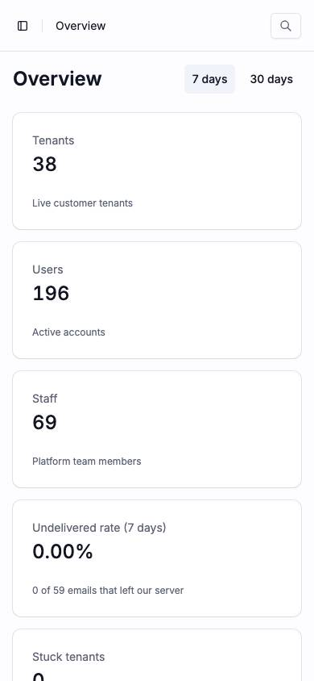
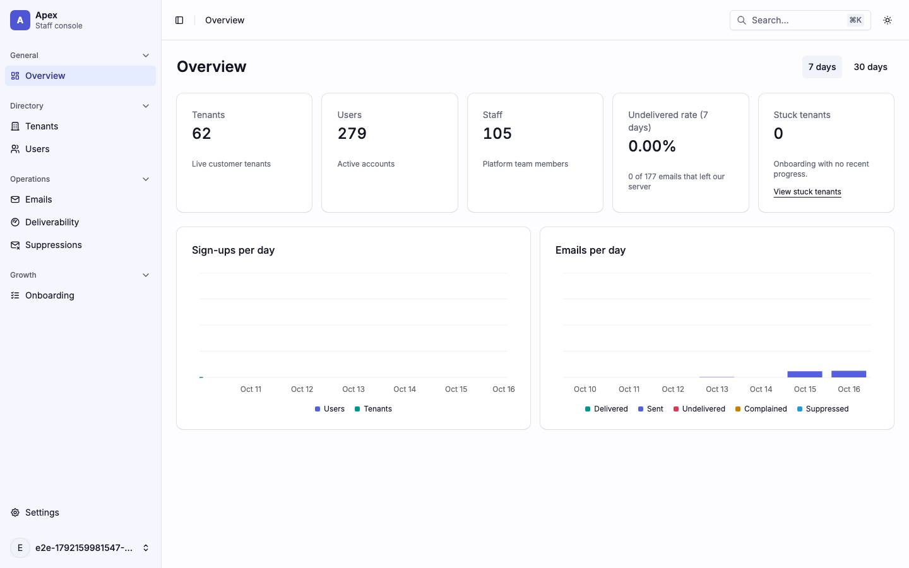

# Overview

This file covers the signed-in landing page (`/overview`) and the staff shell that every signed-in page renders in. Back to the [route map](README.md#route-map).

## The staff shell

`_app` (`src/pages/_app.tsx`) renders `AppLayout` (`src/components/layouts/app-layout.tsx`) around every signed-in page. `AppLayout` follows shadcn's sidebar-07 block.

|                  |                                                                                                                                                                                                                                                                                                                                                                                                                                                                                      |
| ---------------- | ------------------------------------------------------------------------------------------------------------------------------------------------------------------------------------------------------------------------------------------------------------------------------------------------------------------------------------------------------------------------------------------------------------------------------------------------------------------------------------ |
| Guard            | `beforeLoad`: signed out → `/login?redirect=`; signed in without a platform role → `/no-access`. Its loader awaits `ensureFlags` (`GET /platform/me/flags`, no retry, falls back on failure), so a flagged nav item never flashes. On a cold load that wait happens before React mounts ([boot.md](boot.md#what-happens)).                                                                                                                                                           |
| Fetches          | After mount: `GET /platform/maintenance-mode` (`['platform', 'maintenance-mode']`) for `MaintenanceBanner`, polled every 30 s while customers are in maintenance and every 60 s while not, stopped by a 404. The ⌘K palette searches while it is open ([palette.md](palette.md#the-command-palette)).                                                                                                                                                                                |
| Sidebar          | Collapsible to icons, with a rail. Header: the Apex mark, "Apex" and "Staff console", a link to Overview. Content: `NavMain`, five labelled, foldable sections listed [below the table](#sidebar-sections). Settings sits at the bottom (`NavSecondary`). On `/settings/*` the content becomes `NavSettings` ([settings.md](settings.md#layout)). Footer: the account menu (`UserMenu`), with the avatar, name and email, then Profile, Settings and Sign out (`POST /auth/logout`). |
| Header           | The sidebar toggle, the breadcrumb (from each route's `staticData.crumb`, with `crumbParent` for detail pages), a **Search…** button with the shortcut hint (`⌘K` or `Ctrl K`) that opens the palette, and from `md` up the theme menu (Light, Dark, System). Below `md` the theme menu moves to the drawer's footer and the search button shows only its icon.                                                                                                                      |
| Under the header | `MaintenanceBanner`: a red `role="status"` strip with who set customer maintenance and when, and Manage → `/settings/platform/maintenance`. Nothing while the mode is off.                                                                                                                                                                                                                                                                                                           |
| Around it        | `StepUpProvider`, the skip link, and the `CommandPalette`. `StepUpProvider` is described [below the table](#step-up).                                                                                                                                                                                                                                                                                                                                                                |

Below `md` the sidebar is a `Sheet` opened from the header toggle. Every link in it closes it.

Findings: [F-overview-2](findings.md#f-overview-2), [F-overview-3](findings.md#f-overview-3), [F-overview-4](findings.md#f-overview-4), [F-overview-5](findings.md#f-overview-5), [F-overview-7](findings.md#f-overview-7)

### Sidebar sections

`navGroupsFor(role, flags)` (`src/constants/navigation.ts`) returns the five sections:

| Section    | Items                                                                      |
| ---------- | -------------------------------------------------------------------------- |
| General    | Overview                                                                   |
| Directory  | Tenants, Users                                                             |
| Operations | Emails, Deliverability, Suppressions, and Billing alerts for admins and up |
| Growth     | Onboarding, Plans                                                          |
| Security   | Activity, admins and up                                                    |

An item above the role, or behind an off flag, is absent.

### Step-up

`StepUpProvider` shows one "Confirm it’s you" dialog for every destructive staff action:

- The dialog offers a passkey when the account has one, or Email me a link (`POST /auth/step-up/link/request`) under "Use another method".
- In required mode with no passkey, the lazy Create your passkey screen takes the layout's place (`AppShell`).
- The waiting action retries once after the confirm.

## Pages

### `/overview` — Overview

|                     |                                                                                                                                                                                                                                                                                                                                                                                                                                                                                               |
| ------------------- | --------------------------------------------------------------------------------------------------------------------------------------------------------------------------------------------------------------------------------------------------------------------------------------------------------------------------------------------------------------------------------------------------------------------------------------------------------------------------------------------- |
| Purpose             | The platform's headline figures for the last 7 or 30 days, and for admins the API's health.                                                                                                                                                                                                                                                                                                                                                                                                   |
| File                | `src/pages/_app/overview.tsx`                                                                                                                                                                                                                                                                                                                                                                                                                                                                 |
| Guard and redirects | `_app`; `?range=7d\|30d`, default `7d`                                                                                                                                                                                                                                                                                                                                                                                                                                                        |
| Layout              | `AppLayout`                                                                                                                                                                                                                                                                                                                                                                                                                                                                                   |
| Data                | `GET /platform/stats?range` (`['platform', 'stats', range]`), started by the loader, with `keepPreviousData` when the window changes. For admins and up, `SystemStatusCard` starts `GET /platform/system/status` (`['platform', 'system', 'status']`) when it mounts, polled every minute while the tab is visible, stopped by a 404. For admins and up, `BillingAlertsCard` starts `GET /platform/billing/alerts?limit=5` (`['platform', 'billing', 'alerts', …]`, no total) when it mounts. |
| Sections            | The `h1` and the range `ToggleGroup`, then three groups fed by stats, system status and billing alerts; listed [below the table](#overview-sections).                                                                                                                                                                                                                                                                                                                                         |
| Components          | `ToggleGroup`, `Card`, `ChartContainer` (Recharts, with a visually hidden table per chart), `Badge`, `Skeleton`, `KpiCardSkeleton`, `CardRowsSkeleton`, `LoadError`, `RoleDenied`, `QueryState`, `SectionBoundary`, `SystemStatusCard` (`ItemGroup`, `Item` for the queue pause state), `BillingAlertsCard`; `EmptyState` (compact, in the chart cards: "No sign-ups in the last 7 days")                                                                                                     |
| Transitions         | View stuck tenants → `/onboarding?state=stuck`                                                                                                                                                                                                                                                                                                                                                                                                                                                |

#### Overview sections

- **Stats** (`GET /platform/stats`):
  - five KPI (key performance indicator) cards: Tenants, Users, Staff, Undelivered rate, and Stuck tenants (all tracked) with View stuck tenants. The stuck threshold comes from the stats' `stuckAfterDays`.
  - **Sign-ups per day** and **Emails per day** charts, each in a `SectionBoundary` and described "Per UTC day. As of {date and time with zone}." The Emails chart adds "Without an email provider webhook, delivered emails count as Sent."
- **System status** (admins), "The API over the last 15 minutes":
  - release, error tracking, error events sent and dropped, last sent, feature-flag state, maintenance mode and each queue;
  - a batch dropped after every send names `errorTracking.retryLimit`, express's `ERROR_RETRY_LIMIT`: "Dropped after 5 sends".
- **Billing alerts** (admins), the newest 5:
  - each alert shows its kind (Duplicate refunded, Provider event failing, Billing job needs attention, Payment dispute, Subscription ended), its tenant linked to the tenant's Billing tab ("No tenant" when express names none), the time and the message;
  - the time is absolute with its zone, with the relative time in a tooltip;
  - "No billing alerts." when there are none, and a Show all alerts link to `/billing-alerts`;
  - a 404 hides the card, as it does the status card.

#### States

One request feeds every figure and chart, through `QueryState`. It draws:

- one skeleton: `OverviewSkeleton`, five `KpiCardSkeleton` cards at the loaded cards' 11.75rem and two `h-80` blocks;
- one `LoadError` or `RoleDenied`;
- on a failed refetch, the figures stay up under its `LoadError`.

The status card has its own states: a `CardRowsSkeleton` of 13 rows of 1.25rem inside the card, a `LoadError`, and nothing at all on a 404.

In the error shot all three reads answered 500. The stats show their `LoadError`, and the System status and Billing alerts cards each show their own ("We couldn’t load the system status. Select Try again.", "We couldn’t load the billing alerts. Select Try again.").

| Loading                                                                                    | Error                                                                                                                                          |
| ------------------------------------------------------------------------------------------ | ---------------------------------------------------------------------------------------------------------------------------------------------- |
|                                                     |                                                                                                           |
| skeleton · five KPI cards at 11.75rem, 2× `h-80`, and the status card's 13 rows of 1.25rem | alert · `LoadError` "We couldn’t load the platform figures. Select Try again."; the System status and Billing alerts cards each with their own |

| Dark                                   | Mobile                                                       |
| -------------------------------------- | ------------------------------------------------------------ |
|    |                        |
| Cards and charts on the dark surfaces. | One KPI card per row; the charts start below the fifth card. |

| Role-denied                                                                                                                       |
| --------------------------------------------------------------------------------------------------------------------------------- |
|                                                                                        |
| A viewer: the figures and charts without the System status or Billing alerts card; the Activity item is missing from the sidebar. |

Findings: [F-overview-1](findings.md#f-overview-1), [F-overview-2](findings.md#f-overview-2), [F-overview-4](findings.md#f-overview-4), [F-overview-6](findings.md#f-overview-6)
