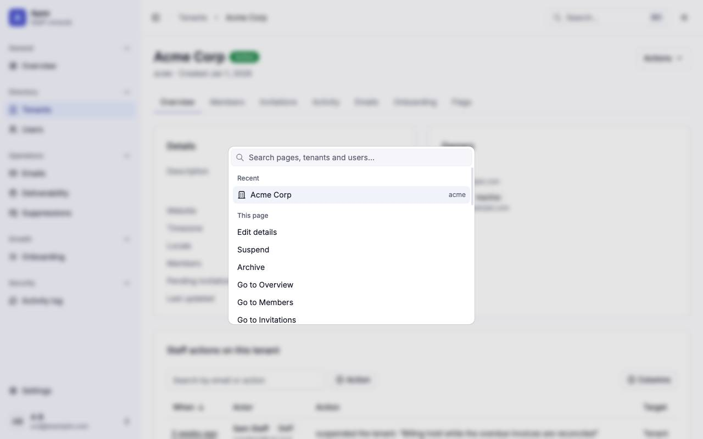
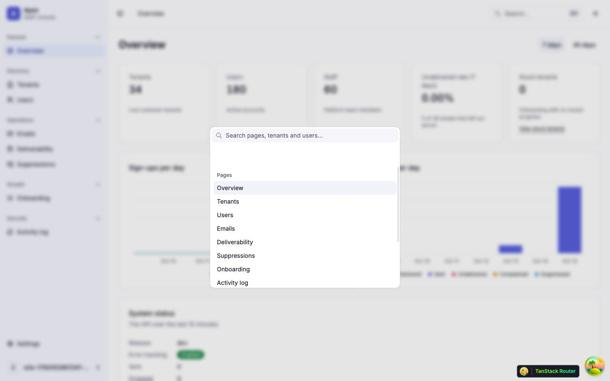
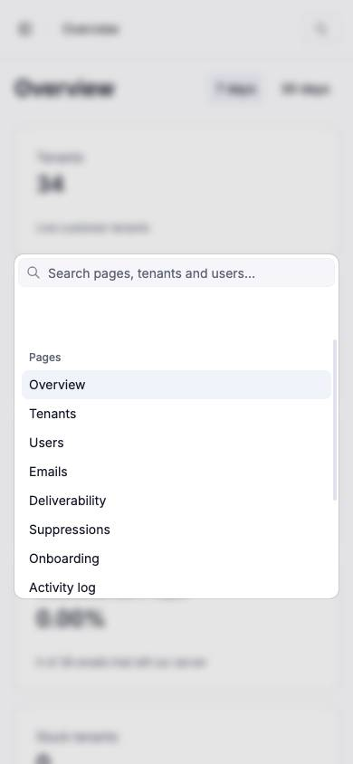

# Command palette

The command palette in the staff shell, opened by ⌘K on Apple platforms or Ctrl+K elsewhere, which goes to a page, a tenant or a user and runs the open page's actions; it has no route of its own. Back to the [route map](README.md#route-map).

## The command palette

|               |                                                                                                                                                                                                                                                                                                                                                                                                                                                                                                                                                                                                                                                                                                                                                                                                                                                                                                                                                                                                                                                                                   |
| ------------- | --------------------------------------------------------------------------------------------------------------------------------------------------------------------------------------------------------------------------------------------------------------------------------------------------------------------------------------------------------------------------------------------------------------------------------------------------------------------------------------------------------------------------------------------------------------------------------------------------------------------------------------------------------------------------------------------------------------------------------------------------------------------------------------------------------------------------------------------------------------------------------------------------------------------------------------------------------------------------------------------------------------------------------------------------------------------------------- |
| Purpose       | Go to any page the role can see, a tenant or user found by name, slug or email, or one opened lately; run the open page's own actions; change the theme, create a tenant or sign out, from the keyboard.                                                                                                                                                                                                                                                                                                                                                                                                                                                                                                                                                                                                                                                                                                                                                                                                                                                                          |
| Files         | `src/components/features/command-palette.tsx` (apex's commands); the shared `src/components/shared/command-palette/*` (shell, host, loader, registry, recents); `src/states/command-palette.store.ts` (`open`, `query`); `src/components/ui/command.tsx` (hand-written on Base UI's `Autocomplete`, not `cmdk`); `src/lib/shortcut.ts`; `src/hooks/use-record-recent.ts` (the detail pages record Recent); `src/components/features/page-palette-commands.tsx` (a page's tabs and Copy ID)                                                                                                                                                                                                                                                                                                                                                                                                                                                                                                                                                                                        |
| Mounted by    | `AppLayout`, once, through `CommandPaletteHost`, so it exists on every signed-in page and nowhere else (not on the auth pages or the not-found page)                                                                                                                                                                                                                                                                                                                                                                                                                                                                                                                                                                                                                                                                                                                                                                                                                                                                                                                              |
| Opens         | ⌘K on Apple platforms or Ctrl+K elsewhere, ignoring repeats, IME composition and Shift or Alt; the same keys close it. The header's **Search…** button opens it and names the shortcut in `aria-keyshortcuts`. Escape, a click outside or a choice closes it, and every close clears the term.                                                                                                                                                                                                                                                                                                                                                                                                                                                                                                                                                                                                                                                                                                                                                                                    |
| Loading       | The palette's code is fetched once, on idle, on the Search… button's hover or focus, or at the first open, whichever comes first. Only an open that beats the fetch shows a "Loading search…" overlay, whose field holds the typed text in the store's `query`, so keys pressed right after the shortcut carry into the palette. A failed fetch closes the palette and shows the toast "Search could not be loaded. Reloading the page will fix it." with a Reload action; there is no in-page retry, because Chromium keeps a failed `import()` for the page's lifetime.                                                                                                                                                                                                                                                                                                                                                                                                                                                                                                         |
| Groups        | In this order: **Recent**: tenants (name, slug) and users (email) whose pages were opened lately, for staff. **This page**: what the open page registers, its actions first, then the tenant tabs ("Go to Overview" and the others the role sees), then Copy ID: Edit details, Resend owner invitation, Suspend, Reactivate, Archive and Delete permanently on a tenant, as its actions menu shows them; Edit name, Send sign-in link, Sign out everywhere, Deactivate, Reactivate, Delete and Delete permanently on a user, as its menu shows them; Resend email on an email when the API allows it; Copy tenant ID, Copy user ID or Copy email ID. Nothing is registered while the item loads or when its page answers 404. **Go to**: `navItemsFor(role, flags)`, then Settings, then every settings section (keyword `settings`), for staff. **Tenants** and **Users**: the API's results for the term, for staff. **Theme**: Light, Dark, System, the current one marked "Current". **Account**: New tenant (admin and up), Sign out (disabled while a sign-out is pending). |
| Search        | Recent, This page, Go to, Theme and Account are matched here, on the label, the detail (unless it is personal) and the keywords. Tenants and users are matched by the API once the term has settled for `LIST_SEARCH_DEBOUNCE_MS` (250 ms): `GET /platform/tenants?search&limit=8` and `GET /platform/users?search&limit=8`, with no total, only while the palette is open, the term is not blank and the caller is staff. Eight results a group; there is no "more results" row. Each list shows only for the term it was fetched for, so Enter never acts on an older term's list.                                                                                                                                                                                                                                                                                                                                                                                                                                                                                              |
| Rows          | A page: its icon and label. A tenant: a building icon, the name, and the slug, with " · Suspended" or " · Archived" when it is not active. A user: a person icon, the email and the full name, both inside `Pii`; a recent user's email is inside `Pii` too. A page action: its menu label.                                                                                                                                                                                                                                                                                                                                                                                                                                                                                                                                                                                                                                                                                                                                                                                       |
| States        | While a term's results are pending: "Searching…" in a `role="status"` line. When a search fails with anything but a role refusal: a "Search failed. Try again" row in place of "No results.", which retries the failed searches and keeps the palette open. No rows: "No results." An empty status line takes no room.                                                                                                                                                                                                                                                                                                                                                                                                                                                                                                                                                                                                                                                                                                                                                            |
| Choosing      | Enter on the highlighted row or a click; the first row is always highlighted (`autoHighlight="always"`). Each row runs by its `timing`: a page, a tenant (`/tenants/$tenantId`), a user (`/users/$userId`), a tab, Copy ID, the theme and Sign out run at once; a page action's dialog (Send sign-in link's confirm dialog included) and New tenant open after the palette has closed. A dialog opened from the palette returns focus to the page heading when it closes; Resend's returns it to the Resend button when it is cancelled, and after a resend wherever the page sends focus; New tenant's returns it, when cancelled, to the page heading where it takes focus and to the main landmark elsewhere; after a create the palette opens the new tenant with focus on its heading.                                                                                                                                                                                                                                                                                       |
| Analytics     | `command_palette_opened` on each open; `command_palette_action_run` with a fixed `action` key and nothing else: `open_page`, `open_recent`, `open_tenant`, `open_user`, `open_tab`, `copy_id`, `set_theme`, `create_tenant`, `sign_out`, `retry_search`, and for page actions `page_action_edit`, `page_action_owner`, `page_action_suspend`, `page_action_reactivate`, `page_action_archive`, `page_action_purge`, `page_action_send_sign_in_link`, `page_action_sign_out`, `page_action_deactivate`, `page_action_delete` and `page_action_resend`.                                                                                                                                                                                                                                                                                                                                                                                                                                                                                                                             |
| Accessibility | A dialog named "Command palette" and described "Go to a page, a tenant or a user, or run an action."; the input is labelled "Search pages, tenants and users" and described by a hidden line on the arrow keys and Enter; disabled rows `aria-disabled`; icons hidden.                                                                                                                                                                                                                                                                                                                                                                                                                                                                                                                                                                                                                                                                                                                                                                                                            |
| Storage       | `palette.recent.v1:<userId>` in `localStorage` (Recent), when storage allows: at most 5 tenants and 5 users, newest first, each with its kind, id, the name or email and the slug the pages show, and a time. Recents are cleared on every session end, expiry included: `logout()` removes every `palette.recent.v1:` key, and it runs on sign-out, on a 401 verdict at the cold-load restore or a refresh, and on another tab's logout, whether or not the palette ever loaded.                                                                                                                                                                                                                                                                                                                                                                                                                                                                                                                                                                                                 |
| Bundle        | The entry chunk holds none of the palette's code. `pnpm check:bundle` fails when a chunk with the palette's code is statically reachable from the entry or the host.                                                                                                                                                                                                                                                                                                                                                                                                                                                                                                                                                                                                                                                                                                                                                                                                                                                                                                              |

## Out of scope

- **Lift on a suppression**: Lift is a list row's action, and the palette has no row to run it on; it stays in the [Suppressions](suppressions.md) table ([F-palette-6](findings.md#f-palette-6)).
- **Emails by recipient or id, and filtered lists**: the palette neither searches emails nor opens a list with a filter applied; both are a later `[P5 palette]` follow-up ([F-palette-8](findings.md#f-palette-8)).

## After

The palette as built, from the fixtures harness: an admin, the harness's data.

| Search                                                 | Error                                                                                              | This page                                                                                         | Mobile                                          |
| ------------------------------------------------------ | -------------------------------------------------------------------------------------------------- | ------------------------------------------------------------------------------------------------- | ----------------------------------------------- |
|                    |                                                                 |                                                                 |             |
| `acme`: the Tenants group's one result, with its slug. | Tenants search failing, term `acme`: the "Search failed. Try again" row in place of "No results.". | Acme Corp's page, no term: Recent, then This page with the tenant's actions first, then its tabs. | Opened from the header's search icon at 390 px. |

## Before

The walk and the shots below show the palette before the shared shell, This page, Recent, Theme and Account. Its dialog was described "Search for a page or a tenant.", and a failed search said "Some results could not be loaded." over "No results.".

The palette lists only places to go: it runs no action. In the walk (an owner, the dev data), the empty palette listed thirteen pages; the term `e2e` sent one tenants and one users request after the debounce and listed eight tenants, five of them reading "Capture Co" with nothing to tell them apart, and eight users; `theme`, `settings`, `sign out` and `zzzz-no-match` each gave "No results."; with the tenants search answering 500, the palette said "Some results could not be loaded." over "No results.", with no way to retry but typing again. With no term, an empty status line and the list's padding leave a band of about 56 px between the input and the first group.

| Search                                               | Empty                                      | Error                                                                         | Mobile                                                                                      |
| ---------------------------------------------------- | ------------------------------------------ | ----------------------------------------------------------------------------- | ------------------------------------------------------------------------------------------- |
|           |  |                                     |                                                  |
| `e2e`: the Tenants group, then Users below the fold. | `zzzz-no-match`: "No results."             | Tenants search failing: "Some results could not be loaded." and "No results." | Opened from the header's search icon at 390 px; the dialog fills the width less the gutter. |

Findings: [F-palette-1](findings.md#f-palette-1), [F-palette-2](findings.md#f-palette-2), [F-palette-3](findings.md#f-palette-3), [F-palette-4](findings.md#f-palette-4), [F-palette-5](findings.md#f-palette-5), [F-palette-6](findings.md#f-palette-6), [F-palette-7](findings.md#f-palette-7), [F-palette-8](findings.md#f-palette-8), [F-palette-9](findings.md#f-palette-9), [F-palette-10](findings.md#f-palette-10)
