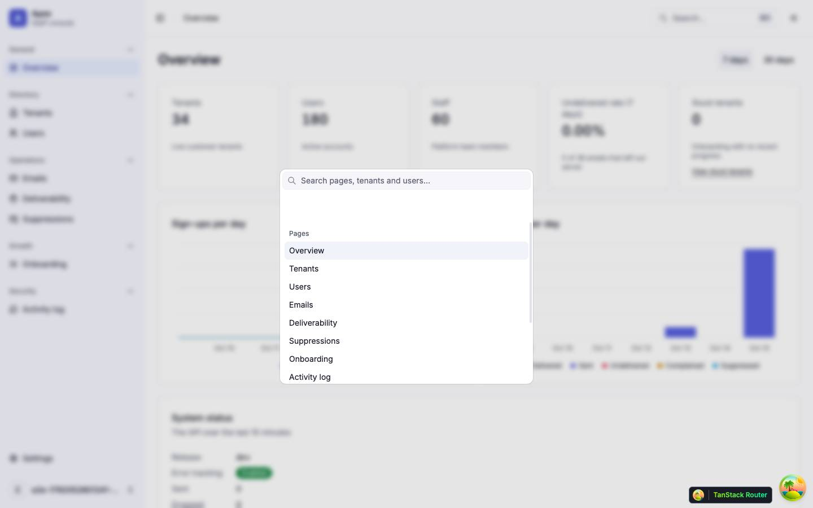
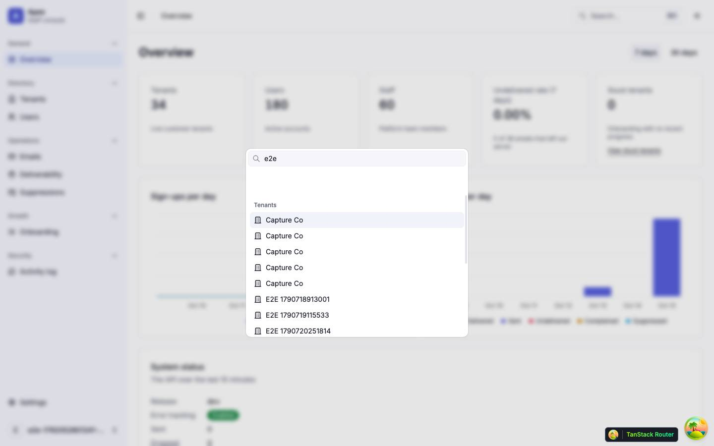
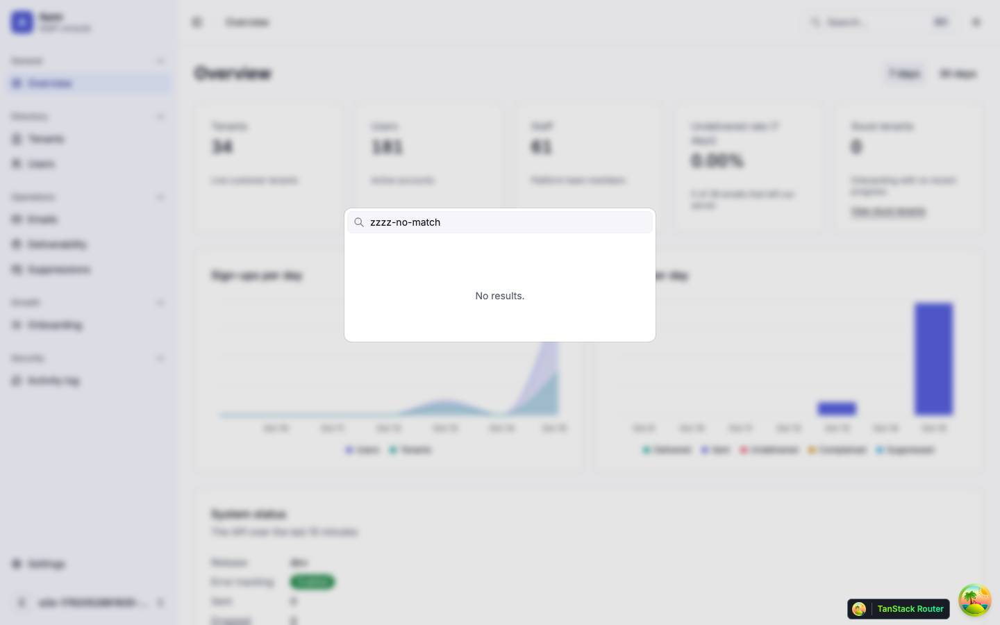
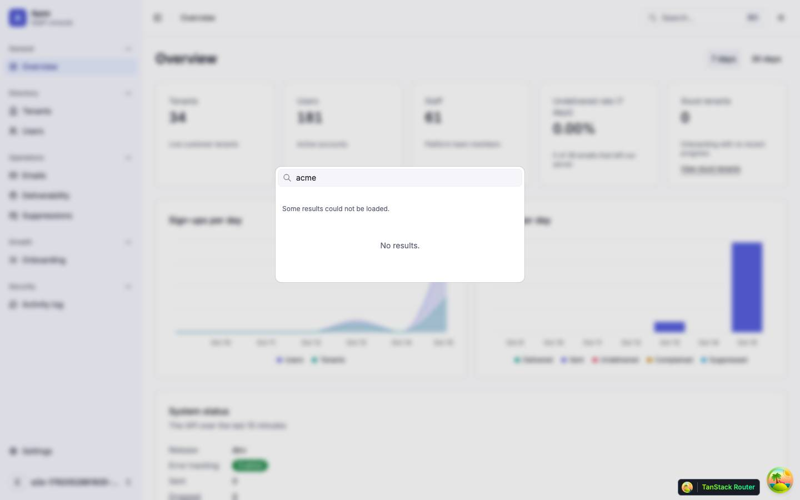
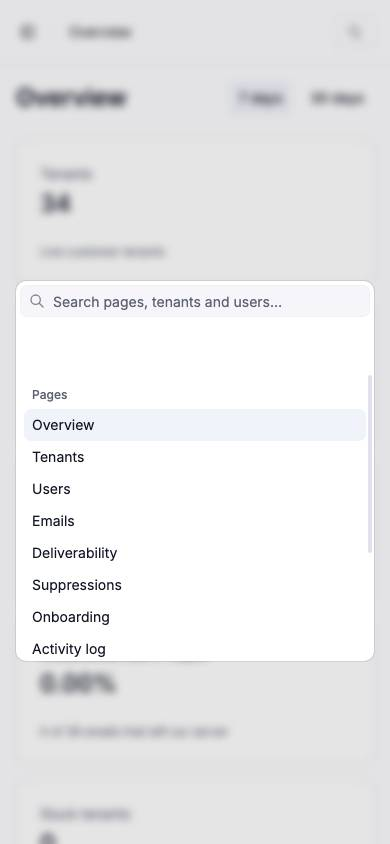

# Command palette

The ⌘K (Ctrl+K) command palette in the staff shell, which jumps to a page, a settings section, a tenant or a user; it has no route of its own. Back to the [route map](README.md#route-map).

## The command palette

|               |                                                                                                                                                                                                                                                                                                                                                                                                                                                                                                                                                                                                                       |
| ------------- | --------------------------------------------------------------------------------------------------------------------------------------------------------------------------------------------------------------------------------------------------------------------------------------------------------------------------------------------------------------------------------------------------------------------------------------------------------------------------------------------------------------------------------------------------------------------------------------------------------------------- |
| Purpose       | Jump to any page the role can see, or to a tenant or user found by name, slug or email.                                                                                                                                                                                                                                                                                                                                                                                                                                                                                                                               |
| Files         | `src/components/features/command-palette.tsx`; its open flag in `src/states/command-palette.store.ts` (`open`, `setOpen`, `toggle`); the frame and list in `src/components/ui/command.tsx` (hand-written on Base UI's `Autocomplete`, not `cmdk`); the hint in `src/lib/shortcut.ts`                                                                                                                                                                                                                                                                                                                                  |
| Mounted by    | `AppLayout`, once, so it exists on every signed-in page and nowhere else (not on the auth pages or the not-found page)                                                                                                                                                                                                                                                                                                                                                                                                                                                                                                |
| Opens         | ⌘K on Apple platforms or Ctrl+K elsewhere, read from the physical key (`event.code === 'KeyK'`), ignoring repeats, IME composition and Shift or Alt; the same keys close it (`toggle`). The header's **Search…** button opens it (`setOpen(true)`). Escape, a click outside or a choice closes it, and every close clears the term.                                                                                                                                                                                                                                                                                   |
| Groups        | **Pages**: the main-nav items `navItemsFor(role, flags)` returns, then the five settings sections (Profile, Security, Staff, Feature flags, Maintenance) for any staff role. **Tenants** and **Users**: API results for the term. A group with no rows is left out.                                                                                                                                                                                                                                                                                                                                                   |
| Search        | Pages are filtered here, by a case-insensitive substring of the label, on every keystroke. Tenants and users are filtered by the API: after a 250 ms debounce (`SEARCH_DEBOUNCE_MS`), `GET /platform/tenants?q&limit=8` (`['platform', 'tenants', 'page', params]`) and `GET /platform/users?q&limit=8` (`['platform', 'users', params]`, its usual placeholder turned off), only while the palette is open, the term is not blank and the caller is staff. Eight results a group; there is no "more results" row. Results show only for the term they were fetched for, so Enter never acts on an older term's list. |
| Rows          | A page: its label. A tenant: a building icon and the tenant's name. A user: a person icon, the email and, right-aligned, the name (both masked for analytics).                                                                                                                                                                                                                                                                                                                                                                                                                                                        |
| States        | While a term is typed and its results are pending: "Searching…" in a `role="status"` line. When either search fails with anything but a role refusal: "Some results could not be loaded." No rows: "No results." A 404 role refusal is not shown.                                                                                                                                                                                                                                                                                                                                                                     |
| Choosing      | Enter on the highlighted row or a click: a page → its path; a tenant → `/tenants/$tenantId`; a user → `/users/$userId`. The first row is always highlighted (`autoHighlight="always"`).                                                                                                                                                                                                                                                                                                                                                                                                                               |
| Analytics     | `command_palette_opened` on each open; `command_palette_action_run` with `action` `open_page`, `open_tenant` or `open_user` on each choice.                                                                                                                                                                                                                                                                                                                                                                                                                                                                           |
| Accessibility | The dialog's hidden title is "Command palette" and its hidden description "Search for a page or a tenant."; the input is labelled "Search pages, tenants and users" and described by a hidden line on the arrow keys and Enter.                                                                                                                                                                                                                                                                                                                                                                                       |

The palette lists only places to go: it runs no action. In the walk (an owner, the dev data), the empty palette listed thirteen pages; the term `e2e` sent one tenants and one users request after the debounce and listed eight tenants, five of them reading "Capture Co" with nothing to tell them apart, and eight users; `theme`, `settings`, `sign out` and `zzzz-no-match` each gave "No results."; with the tenants search answering 500, the palette said "Some results could not be loaded." over "No results.", with no way to retry but typing again. With no term, an empty status line and the list's padding leave a band of about 56 px between the input and the first group.

| Search                                               | Empty                               | Error                                                                         | Mobile                                                                                      |
| ---------------------------------------------------- | ----------------------------------- | ----------------------------------------------------------------------------- | ------------------------------------------------------------------------------------------- |
|                  |  |                                            |                                                         |
| `e2e`: the Tenants group, then Users below the fold. | `zzzz-no-match`: "No results."      | Tenants search failing: "Some results could not be loaded." and "No results." | Opened from the header's search icon at 390 px; the dialog fills the width less the gutter. |

## What it lacks

Against the command palette part of the UX pass (`[P5 palette]`), the palette has none of these:

- **Theme**: no Light, Dark or System action ([F-palette-1](findings.md#f-palette-1)).
- **Create tenant**: no New tenant action for admins ([F-palette-2](findings.md#f-palette-2)).
- **Sign out** ([F-palette-3](findings.md#f-palette-3)).
- **Copy the current id**: no way to copy the tenant, user or email id of the page open ([F-palette-4](findings.md#f-palette-4)).
- **Recents**: the empty palette shows the static page list, not the tenants and users opened lately ([F-palette-5](findings.md#f-palette-5)).
- **Role-gated actions for the current page**: none of the tenant or user actions menus, Resend on an email, or Lift on a suppression ([F-palette-6](findings.md#f-palette-6)).

Findings: [F-palette-1](findings.md#f-palette-1), [F-palette-2](findings.md#f-palette-2), [F-palette-3](findings.md#f-palette-3), [F-palette-4](findings.md#f-palette-4), [F-palette-5](findings.md#f-palette-5), [F-palette-6](findings.md#f-palette-6), [F-palette-7](findings.md#f-palette-7), [F-palette-8](findings.md#f-palette-8), [F-palette-9](findings.md#f-palette-9), [F-palette-10](findings.md#f-palette-10)
