# Plans

This file covers two pages. `/plans` shows the Free and Paid plans, their entitlements, Paid's prices and the trial and grace rules. `/billing-alerts` lists the billing alerts. A tenant's own plan and usage are on its [Billing tab](tenants.md#tenantstenantidbilling--billing). Back to the [route map](README.md#route-map).

## Pages

### `/plans` — Plans

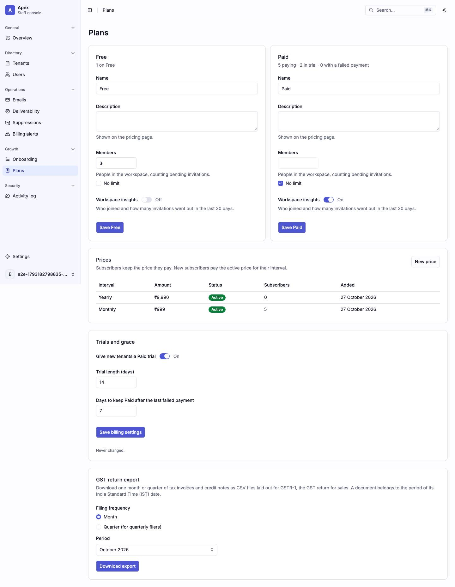

In the shots the capture's staff account has no name, so the Trials and grace line reads "Last changed by on Oct 27, 2026.". The shots are of apex 8.1.0. From apex 8.1.1 on, that date reads "27 October 2026".

|                     |                                                                                                                                                                                                                                                                                                                                                                                                                                                                                                                                                                                              |
| ------------------- | -------------------------------------------------------------------------------------------------------------------------------------------------------------------------------------------------------------------------------------------------------------------------------------------------------------------------------------------------------------------------------------------------------------------------------------------------------------------------------------------------------------------------------------------------------------------------------------------- |
| Purpose             | What each plan gives a tenant, how many tenants each plan serves, and what Paid costs. Every staff role reads it, so support can answer a customer about limits and prices. An admin and up edits it.                                                                                                                                                                                                                                                                                                                                                                                        |
| File                | `src/pages/_app/plans.tsx`                                                                                                                                                                                                                                                                                                                                                                                                                                                                                                                                                                   |
| Guard and redirects | `_app`; every staff role (express's `GET /platform/plans` is a viewer route). Below admin the edit controls are not rendered; every plan and price write is admin.                                                                                                                                                                                                                                                                                                                                                                                                                           |
| Layout              | `AppLayout`                                                                                                                                                                                                                                                                                                                                                                                                                                                                                                                                                                                  |
| Data                | The loader starts `GET /platform/plans` (`['platform', 'plans']`): both plans with their entitlements, version, prices and tenant counts, the entitlement catalog, and `priceWarningAboveMinor`. It also starts `GET /platform/billing-settings` (`['platform', 'billing-settings']`), which the Trials and grace card reads on its own. Writes: an admin's plan save posts `POST /platform/plans/:id/preview` (changed entitlements only), then `PATCH /platform/plans/:id`. A new price posts `POST /platform/plans/:id/prices`. A settings save posts `PATCH /platform/billing-settings`. |
| Sections            | The `h1`, one card per plan, **Prices**, **Trials and grace**, and the GST return export; listed [below the table](#plans-sections).                                                                                                                                                                                                                                                                                                                                                                                                                                                         |
| Components          | `Card`, `Input`, `Textarea`, `Checkbox`, `Switch`, `Table`, `ToneBadge`, `Select`, `Note`, `Dialog`, `AlertDialog`, `ReasonDialog`, `PlanChangeConfirmDialog`, `NewPriceDialog`, `EmptyState`, `Skeleton`, `LoadError`, `RoleDenied`, `QueryState`, `SectionBoundary`, `RadioGroup`, `TaxExportCard`                                                                                                                                                                                                                                                                                         |
| Transitions         | none; the page stays put after a save                                                                                                                                                                                                                                                                                                                                                                                                                                                                                                                                                        |

#### Plans sections

1. The `h1`.
2. One card per plan, Free first (`PlanEditorCard`):
   - the plan's name as its `h2`;
   - the counts line ("4 on Free"; "3 paying · 2 in trial · 1 with a failed payment");
   - for an admin, the form: Name, Description, each limit as a number with a No limit box, each feature as a `Switch`, and Save {plan};
   - below admin, the same values as text.
3. **Prices** (`PricesCard`, Paid only, since express refuses a price on Free): Interval, Amount, Status (Active or Retired), Subscribers, Added, and for an admin a New price button.
4. **Trials and grace** (`BillingSettingsCard`, with its own read and states):
   - for an admin, the switch Give new tenants a Paid trial, Trial length (days) and Days to keep Paid after the last failed payment, and Save billing settings;
   - below admin, the same values as text;
   - under both, "Last changed by {name} on {date}." (the name in `Pii`). Once the editor's account is gone, express sends no editor and the line reads "Last changed on {date}.". Before the first staff edit it reads "Never changed."
5. The GST return export (admin and up), described below.

#### Saving and exports

**Saving a plan.** Only the changed fields go out, with the `version` read. The name and description go through `useChangedFields`, the entitlements through their own diff. Nothing changed reads "Change a field before saving."

- A change to the name or description alone opens one `ReasonDialog` ("Save {plan}?"). It says only what changed: "The new name shows on the pricing page and on the Billing page of every workspace on {plan}." and "The new description shows on the pricing page.", as react renders them.
- A changed entitlement is previewed first. A failed preview opens no dialog.
- When the preview lowers anything (a smaller limit, a limit where there was none, a feature turned off), `PlanChangeConfirmDialog` ("Lower limits on {plan}?") opens. It lists every change ("Members: 3 → 2") and says "{n} tenants are on {plan}. They get the lower limits now and keep their data. A tenant over a limit can’t add more." It needs the box "I checked the tenants this affects" and a reason.
- Otherwise one `ReasonDialog` says "{n} tenants are on {plan}. The changes apply to them now."
- Either dialog adds the name or description sentence when the same save changes them.
- Every save runs through step-up, and the toast is "{plan} saved.".

**When another staff member saved first** (409 `PLAN_VERSION_CONFLICT`), the dialog closes and the plans reload. Every field the reader left alone takes the saved value. Every field they typed in keeps it (a limit's number and its No limit box count as one field). The card says "Another staff member changed this plan. We loaded their values and kept what you typed. Review and save again." The next save diffs against the reloaded plan and sends its version. If the reload fails, the card says their values didn't load, the page shows its Try again, and Save saves nothing until the plans have loaded.

**Saving the trial and grace rules.** Only the changed fields go out, with the `version` read at the first edit, through `useChangedFields`. They are compared as numbers, so a typed "014" is the stored 14. Nothing changed reads express's "Change at least one setting: trials, the trial length or the grace period."

- The days are whole numbers, 1 to 90 for the trial and 1 to 30 for the grace, with express's messages.
- Save opens one `ReasonDialog`, "Save billing settings?", which says only what the save changes: "New trials use these rules. Trials already running keep their end dates." for the switch or the trial length, and "The new grace applies now to every tenant with a failed payment." for the grace.
- Then step-up and the PATCH run; the toast is "Billing settings saved."
- When another staff member saved first, the settings reload. Every field the reader left alone takes the saved value, and every field they typed in keeps it. The card says "Another staff member changed the billing settings. We loaded their values and kept what you typed. Review and save again." If the reload fails, the card says their values didn't load, and Save saves nothing until they have.

**A new price** is whole rupees, sent as `amountMinor` in paise. Above `priceWarningAboveMinor` a warning note reads "Charges above ₹15,000 need the customer to approve each payment. Keep {monthly|yearly} prices at ₹15,000 or less.", with the chosen interval. The description says the new price replaces the active one for its interval, and subscribers keep the price they pay. The line under the amount says "New subscribers pay ₹{new} per {month|year}." The toast is "New {monthly|yearly} price: ₹{new}."

Paid with no price shows "No prices yet." in the Prices card; the capture has no shot of it.

**The GST (Goods and Services Tax) return export** (`TaxExportCard`, admin and up) is the last card. It shows once `GET /platform/billing-settings` says registration is on or a tax document exists (`taxDocumentsEnabled`, `hasTaxDocuments`).

- It offers a month or, under Filing frequency, a financial-year quarter ("Q2 2026-27 (Jul–Sep 2026)"), in India Standard Time (IST).
- The periods go back to the GST start date (`gstEffectiveFrom`), and the picker starts on the last finished period.
- **Download export** runs `GET /platform/billing/tax-export?period=` after step-up and saves `gstr1-{period}.zip` through `downloadFile`. The toast reads "gstr1-{period}.zip downloaded."
- A refusal toasts express's sentence. A 404 `tax_documents_disabled` also reloads the settings, which may remove the card. Below admin it is not rendered. The fixtures harness shows it with `?tax=on` or `?tax=docs-off`.

| Loading                                                                                                                               | Error                                                                                                                                                               |
| ------------------------------------------------------------------------------------------------------------------------------------- | ------------------------------------------------------------------------------------------------------------------------------------------------------------------- |
| 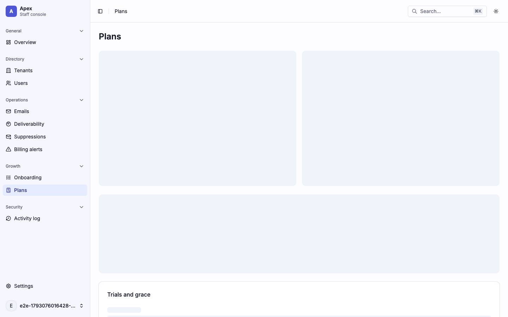                                                                                                     | 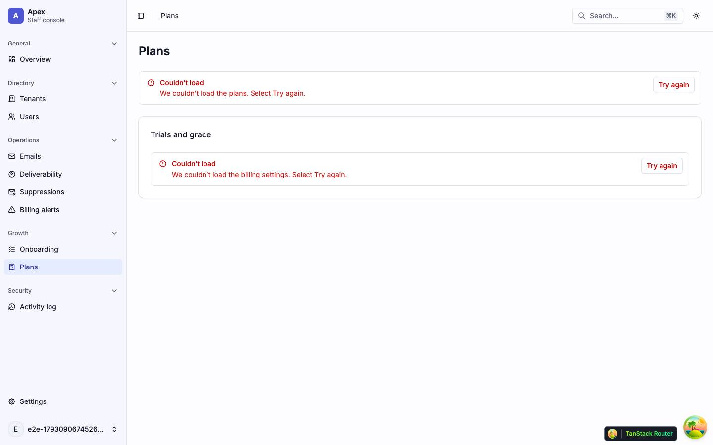                                                                                                                                     |
| skeleton · two `h-96` plan blocks side by side over an `h-56` block; the Trials and grace card shows its own skeleton under its title | alert · `LoadError` "We couldn’t load the plans. Select Try again.", and the Trials and grace card's own "We couldn’t load the billing settings. Select Try again." |

| Mobile                                                  |
| ------------------------------------------------------- |
| 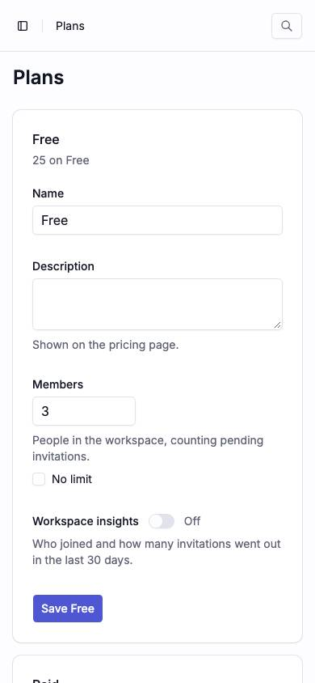                        |
| The plan cards stack, Free first, each form full width. |

| Dark                                       |
| ------------------------------------------ |
| 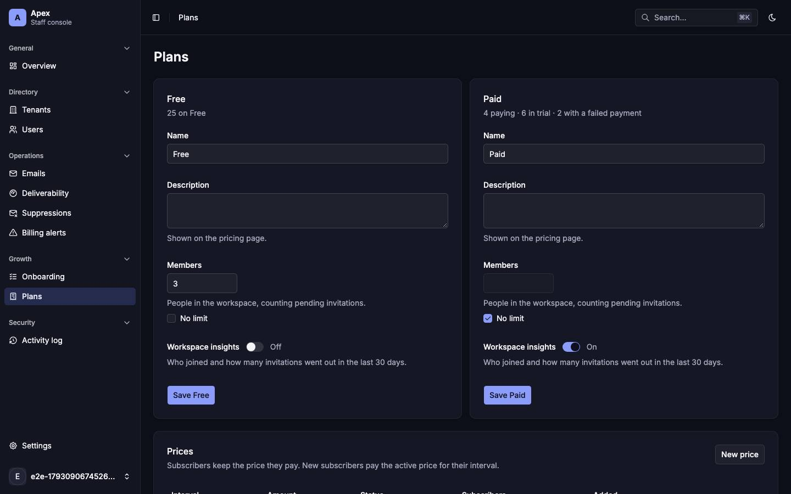             |
| The plan cards and forms on dark surfaces. |

| Role-denied                                                                                                                                        |
| -------------------------------------------------------------------------------------------------------------------------------------------------- |
| 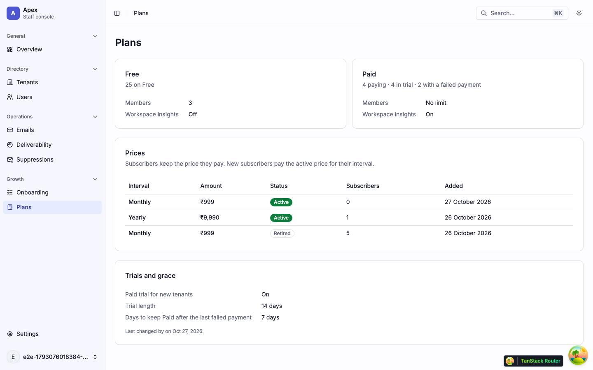                                                                                                              |
| A viewer: the plans, prices, trials and grace as text, with no edit controls and no New price; the sidebar has no Billing alerts or Activity item. |

### `/billing-alerts` — Billing alerts

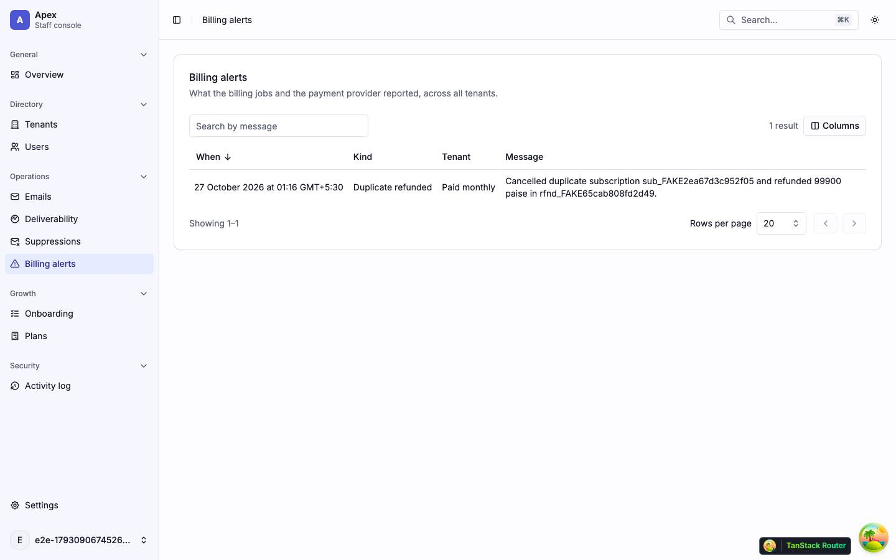

|                     |                                                                                                                                                                                                                                                                                                                          |
| ------------------- | ------------------------------------------------------------------------------------------------------------------------------------------------------------------------------------------------------------------------------------------------------------------------------------------------------------------------ |
| Purpose             | Every billing alert express raised, so an admin can find one older than the Overview card's newest 5.                                                                                                                                                                                                                    |
| File                | `src/pages/_app/billing-alerts.tsx`                                                                                                                                                                                                                                                                                      |
| Guard and redirects | `_app`; admin and up (express's `GET /platform/billing/alerts` is an admin route). Below admin the page shows the not-found card and sends no request; a 404 after that shows `RoleDenied`. Reached from the Overview card's Show all alerts and from the sidebar's Operations section, where only admins and up see it. |
| Layout              | `AppLayout`                                                                                                                                                                                                                                                                                                              |
| Data                | started on mount (no loader): `GET /platform/billing/alerts` (`['platform', 'billing', 'alerts', …]`) with the list's `search`, `sort` (`-at` by default, or `at`) and `cursor` from the URL.                                                                                                                            |
| Sections            | One card with the `h1` and a `DataTable`: When (sortable), Kind, Tenant (linked to the tenant's Billing tab, or "No tenant"), Message. The search box matches the message only, as express does.                                                                                                                         |
| Components          | `BillingAlertsList` (`src/components/features/billing/billing-alerts-list.tsx`, so the route file imports only `billing-reads`), `Card`, `DataTable`, `EmptyState`, `RoleDenied`, `PlatformNotFound`                                                                                                                     |
| Transitions         | a tenant link → `/tenants/$tenantId/billing`                                                                                                                                                                                                                                                                             |

| Loading                                    | Error                                                                        | Empty                                     |
| ------------------------------------------ | ---------------------------------------------------------------------------- | ----------------------------------------- |
| 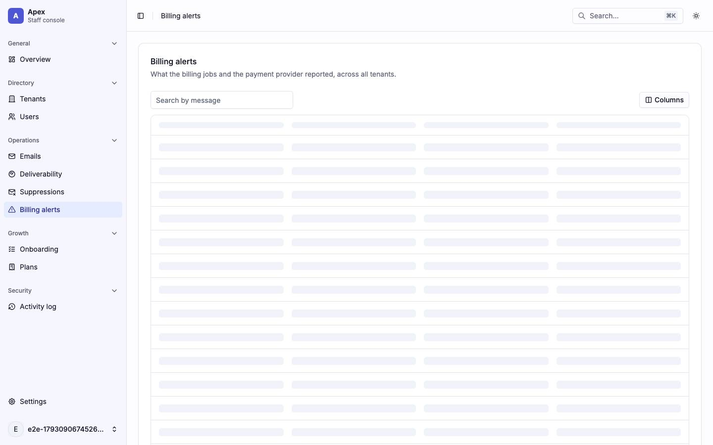 | 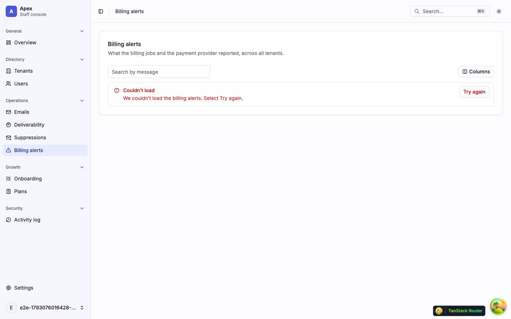                                     | 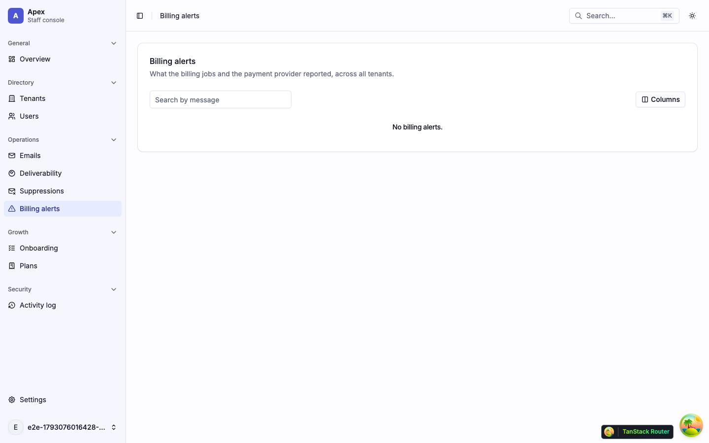  |
| the table's skeleton rows                  | alert · `LoadError` "We couldn’t load the billing alerts. Select Try again." | compact `EmptyState` "No billing alerts." |

| Mobile                                                   |
| -------------------------------------------------------- |
| 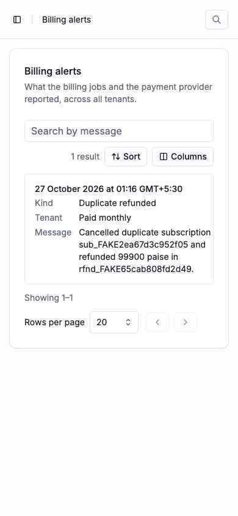                |
| Each alert is a card; Sort joins Columns above the list. |

| Dark                                    |
| --------------------------------------- |
| 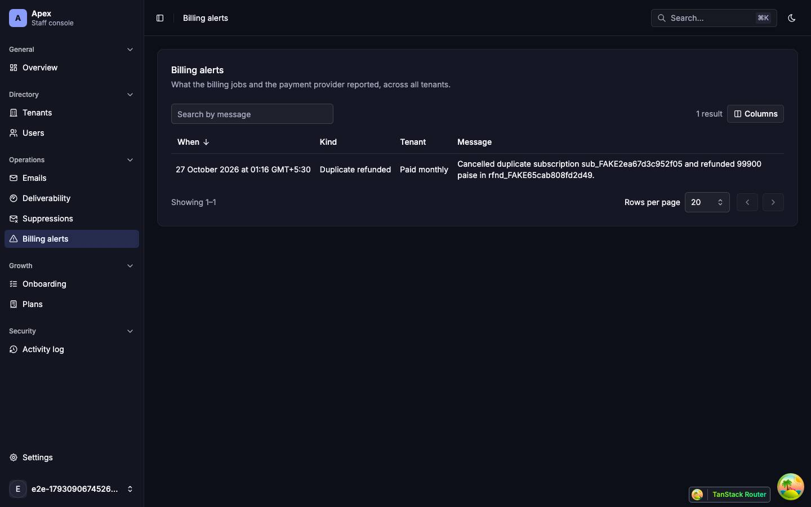 |
| The alerts table on dark surfaces.      |

| Role-denied                                                                                                       |
| ----------------------------------------------------------------------------------------------------------------- |
| 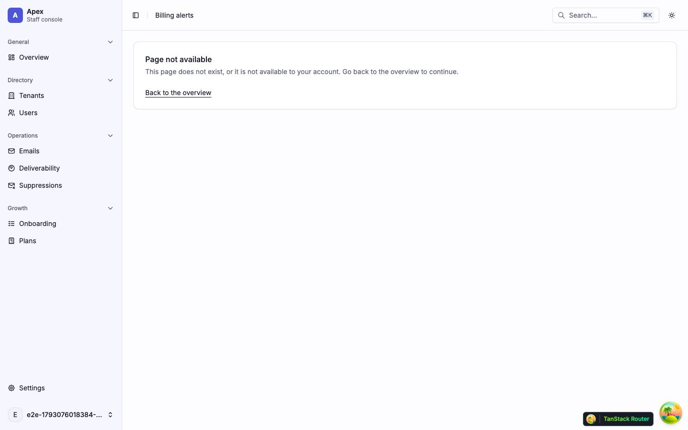                                                                    |
| A viewer: the not-found card "Page not available" and no alerts request; the sidebar has no Billing alerts entry. |
