# Settings

Account settings (profile, security), platform settings (staff, flags, maintenance), and the legacy paths `/flags`, `/maintenance`, `/staff` and `/profile` that redirect into them. Back to the [route map](README.md#route-map).

## Layout

`/settings` (`src/pages/_app/settings.tsx`) is the settings shell, under `AppLayout`. The pages it holds are declared in `src/constants/settings.ts` (`SETTINGS_GROUPS`, `SETTINGS_SECTIONS`).

|             |                                                                                                                                                                                                                                                              |
| ----------- | ------------------------------------------------------------------------------------------------------------------------------------------------------------------------------------------------------------------------------------------------------------ |
| Fetches     | nothing of its own                                                                                                                                                                                                                                           |
| Header      | A `header` (`max-w-3xl`) with the active section's label as the `h1` and its description under it; on `/settings/` itself, "Settings" and "Manage your account and the platform."                                                                            |
| Navigation  | On every `/settings/*` path the sidebar's content swaps to `NavSettings`: Back to console, then **Account** (Profile, Security) and **Platform** (Staff, Feature flags, Maintenance). Every staff role sees every section; each page gates its own controls. |
| Errors      | Each page sets `errorComponent: SettingsRouteError`, the router's error card with an `h2`, so a render crash keeps the settings header.                                                                                                                      |
| Breadcrumbs | Settings › {section}                                                                                                                                                                                                                                         |

The pages are not one width: the header is `max-w-3xl`, Profile and Security are `max-w-2xl` cards, Staff is `max-w-4xl`, and Feature flags and Maintenance take the full width.

Findings: [F-settings-6](findings.md#f-settings-6)

## Pages

### `/settings/` — Settings

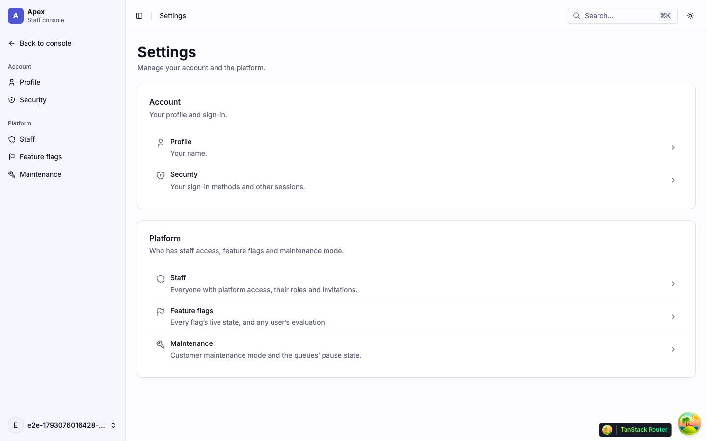

|                     |                                                                                                                                                                                                                                                                                              |
| ------------------- | -------------------------------------------------------------------------------------------------------------------------------------------------------------------------------------------------------------------------------------------------------------------------------------------- |
| Purpose             | The landing page: one card per group listing its sections.                                                                                                                                                                                                                                   |
| File                | `src/pages/_app/settings/index.tsx`                                                                                                                                                                                                                                                          |
| Guard and redirects | `_app`                                                                                                                                                                                                                                                                                       |
| Layout              | `AppLayout` › settings layout                                                                                                                                                                                                                                                                |
| Data                | no query                                                                                                                                                                                                                                                                                     |
| Sections            | `SettingsLinkList` per group: **Account** ("Your profile and sign-in.") with Profile and Security; **Platform** ("Who has staff access, feature flags and maintenance mode.") with Staff, Feature flags and Maintenance. Each row is a link with its icon, label, description and a chevron. |
| Components          | `Card`, `SettingsLinkList` (`ItemGroup`, `Item` link rows, `ItemMedia`, `ItemContent`, `ItemTitle`, `ItemDescription`)                                                                                                                                                                       |
| Transitions         | each row → its section                                                                                                                                                                                                                                                                       |

Findings: [F-palette-8](findings.md#f-palette-8)

### `/settings/account/profile` — Profile

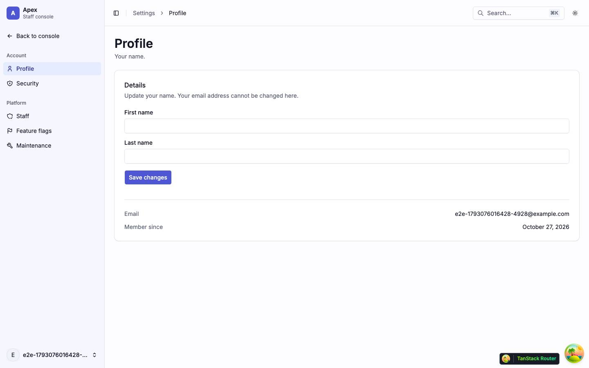

|                     |                                                                                                                                                                                                                   |
| ------------------- | ----------------------------------------------------------------------------------------------------------------------------------------------------------------------------------------------------------------- |
| Purpose             | Change your own name.                                                                                                                                                                                             |
| File                | `src/pages/_app/settings/account.profile.tsx`                                                                                                                                                                     |
| Guard and redirects | `_app`                                                                                                                                                                                                            |
| Layout              | `AppLayout` › settings layout                                                                                                                                                                                     |
| Data                | `useProfile`: `GET /profile` (`['profile']`) with `initialData` from the session's user, so it paints at once and does not refetch until stale; `PATCH /profile` on Save changes, sending only the changed fields |
| Sections            | A **Details** card ("Update your name. Your email address cannot be changed here."): first and last name, Save changes, then the email and "Member since".                                                        |
| Components          | `Card`, `Form`, `FormField`, `FormError`, `Input`, `BusyButton`, `QueryState`, `FormFieldsSkeleton`, `LoadError`, `RoleDenied`                                                                                    |
| Transitions         | none                                                                                                                                                                                                              |

The Details card reads through `QueryState`: while there is no data, `FormFieldsSkeleton` (four label-and-input pairs and the button bar, sized to the form's own spacing and not measured against it); a failed `GET /profile` shows "Profile didn’t load. Try again." with Try again, above the form when the stored user is on screen. The stored user paints the form at once, and a signed-in page always has it, so the skeleton is not reachable here; the error is reached through a refetch that fails, and the stored form stays beside it; a 404 from `GET /profile` is read as a role refusal (`RoleDenied`), which is this app's rule for every `QueryState`. The capture has no section for it, so there is no loading or error shot. In the walk, failing `GET /profile` on a full load failed the session restore instead and landed on `/login?redirect=%2Fsettings%2Faccount%2Fprofile`, so the page's own failure is from the code.

Findings: [F-settings-1](findings.md#f-settings-1)

### `/settings/account/security` — Security

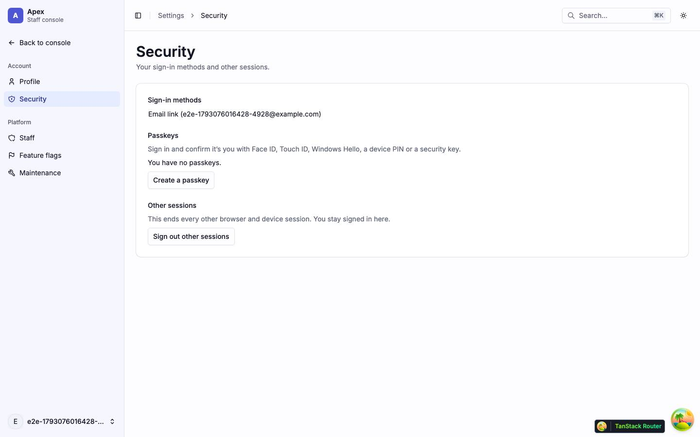

|                     |                                                                                                                                                                                                                                                                                      |
| ------------------- | ------------------------------------------------------------------------------------------------------------------------------------------------------------------------------------------------------------------------------------------------------------------------------------ |
| Purpose             | See how you sign in, manage your passkeys, and sign out other sessions.                                                                                                                                                                                                              |
| File                | `src/pages/_app/settings/account.security.tsx`, rendering `SecuritySection` (`src/components/features/profile/security-section.tsx`, shared with react) in one `Card`                                                                                                                |
| Guard and redirects | `_app`                                                                                                                                                                                                                                                                               |
| Layout              | `AppLayout` › settings layout                                                                                                                                                                                                                                                        |
| Data                | started: `GET /auth/providers` (`['auth', 'providers']`) and, when the passkey mode is not `off`, `GET /auth/passkeys`. `POST /auth/passkeys/registration/*`, `PATCH` and `DELETE /auth/passkeys/:id` from the Passkeys section. `POST /auth/sessions/revoke-others` on its button.  |
| Sections            | Sign-in methods ← providers: "Email link ({address})" first, then each linked provider ("Google"); read-only. Passkeys (below). Other sessions: "This ends every other browser and device session. You stay signed in here." and Sign out other sessions (no request until clicked). |
| Components          | `Card`, `BusyButton`, `QueryState`, `CardRowsSkeleton`, `ItemGroup`, `Item` (sign-in methods), `LoadError`, `RoleDenied`, `Pii`                                                                                                                                                      |
| Transitions         | Sign out other sessions toasts the count it signed out                                                                                                                                                                                                                               |

**Passkeys** (`passkeys-section.tsx`, `passkey-dialogs.tsx`, shared with react, loaded on demand) sits between Sign-in methods and Other sessions, and renders only when the passkey mode is not `off`. Its lead reads "Sign in and confirm it’s you with Face ID, Touch ID, Windows Hello, a device PIN or a security key." Each row shows the passkey’s name inside `Pii`, "Synced" or "This device only", its created date and "Last used {date}" or "Never used", with Rename and Delete. Create a passkey runs through "Confirm it’s you" and toasts "Passkey created."; a browser without WebAuthn shows "This browser can’t create passkeys. Use a current version of Chrome, Edge, Firefox or Safari." Deleting the only passkey warns first ("This is your only passkey. You’ll sign in with an email link or Google until you create another."); in required mode the dialog refuses it instead ("Create another passkey before you delete this one. Your account needs at least one."). A failed passkey list shows "We couldn’t load your passkeys. Select Try again to load them." in the section alone. Nothing about passkeys shows anywhere else except the setup screen.

There is no password control. Other sessions renders at once and does not wait on the providers request; only the sign-in methods hold their place with a heading and two method rows while it loads. A failed providers request shows `LoadError` "We couldn’t load your sign-in methods. Select Try again to load them." in their place, and a 404 from `GET /auth/providers` is read as a role refusal (`RoleDenied`) by this app's rule.

| Loading                                                                                                                               | Error                                                                                                                         |
| ------------------------------------------------------------------------------------------------------------------------------------- | ----------------------------------------------------------------------------------------------------------------------------- |
| 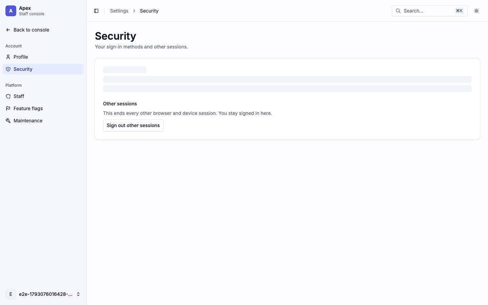                                                                                       | 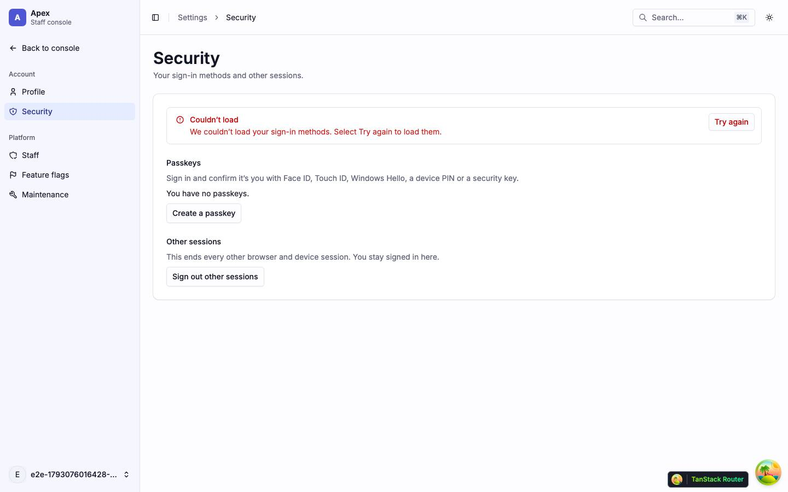                                                                                 |
| skeleton · a heading bar and two method rows in place of Sign-in methods; Passkeys is not drawn yet, and Other sessions shows at once | alert · `LoadError` "We couldn’t load your sign-in methods. Select Try again to load them."; Passkeys and Other sessions stay |

Findings: [F-settings-2](findings.md#f-settings-2)

### `/settings/platform/staff` — Staff

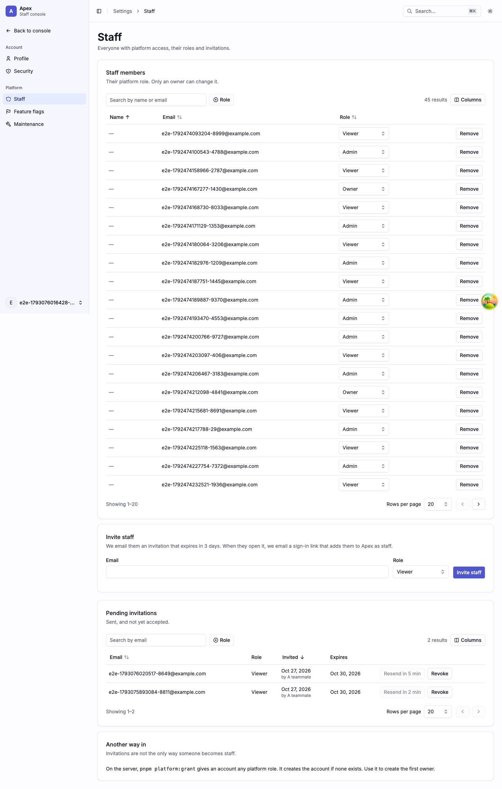

|                     |                                                                                                                                                                                                                                                                                                                                                                                                                                                                                                                                                                                                               |
| ------------------- | ------------------------------------------------------------------------------------------------------------------------------------------------------------------------------------------------------------------------------------------------------------------------------------------------------------------------------------------------------------------------------------------------------------------------------------------------------------------------------------------------------------------------------------------------------------------------------------------------------------- |
| Purpose             | Everyone with platform access and their role, staff invitations, and the other ways someone becomes staff.                                                                                                                                                                                                                                                                                                                                                                                                                                                                                                    |
| File                | `src/pages/_app/settings/platform.staff.tsx`                                                                                                                                                                                                                                                                                                                                                                                                                                                                                                                                                                  |
| Guard and redirects | `_app`; the API decides who may change a role or invite                                                                                                                                                                                                                                                                                                                                                                                                                                                                                                                                                       |
| Layout              | `AppLayout` › settings layout                                                                                                                                                                                                                                                                                                                                                                                                                                                                                                                                                                                 |
| Data                | the platform tenant's own routes, started when the page mounts: `GET /tenants/platform` (the caller's role, `['tenants', 'platform']`), `GET /tenants/platform/members?search&role&sort&cursor&direction&limit&total=1` (`['tenants', 'platform', 'members', request]`), for an owner the owners read `?role=owner&limit=100` (`['tenants', 'platform', 'members', 'owners']`) and, for owners and admins, `GET /tenants/platform/invitations` (`['tenants', 'platform', 'invitations', request]`). The invitations list's URL keys are prefixed (`invitationsSearch`, `invitationsSort`, `invitationsRole`). |
| Sections            | **Staff members** (`MembersCard`: a `DataTable` of Name, Email, Role, Actions, with search, a Role facet, sortable headers and cursor paging). **Invite staff** (its button reads Invite staff) and **Pending invitations** (`InvitationsSection`, the latter a `DataTable` with its own search, Role facet and paging). A static **Another way in** card about `pnpm platform:grant`, the one way in besides an invitation.                                                                                                                                                                                  |
| Components          | `DataTable` through `MembersCard` and `PendingInvitations` (`Item` on phones), `InvitationsSection`, `Card`, `Select`, `Button`, `LoadError`, `Alert` (destructive, step-up dismissed), `ReasonDialog`, `TableRowsSkeleton`                                                                                                                                                                                                                                                                                                                                                                                   |
| Transitions         | none                                                                                                                                                                                                                                                                                                                                                                                                                                                                                                                                                                                                          |

The Staff members and Pending invitations lists are each paged at 20 with their own search and Role facet, and cards on a phone. A pending invitation's Resend counts down as on a tenant's [Invitations tab](tenants.md#tenantstenantidinvitations--invitations). The invite form's description reads "We email them an invitation that expires in 3 days. When they open it, we email a sign-in link that adds them to Apex as staff." When the role read and the members read both fail, the Staff members card shows the role `LoadError` alone (the list is not drawn without a role), and the invitations section waits silently, so the alert shows once.

| Loading                                                                                                 | Error                                                          |
| ------------------------------------------------------------------------------------------------------- | -------------------------------------------------------------- |
| 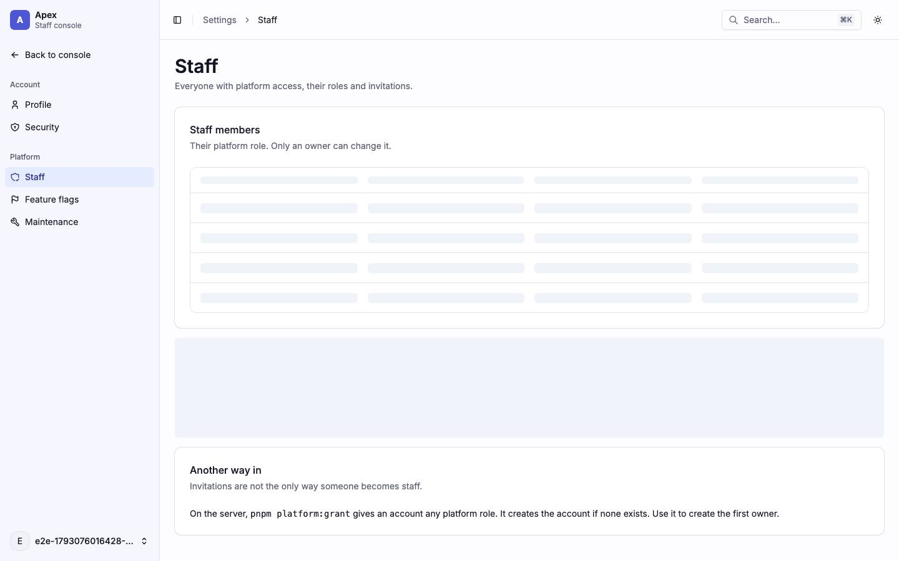                                                           | 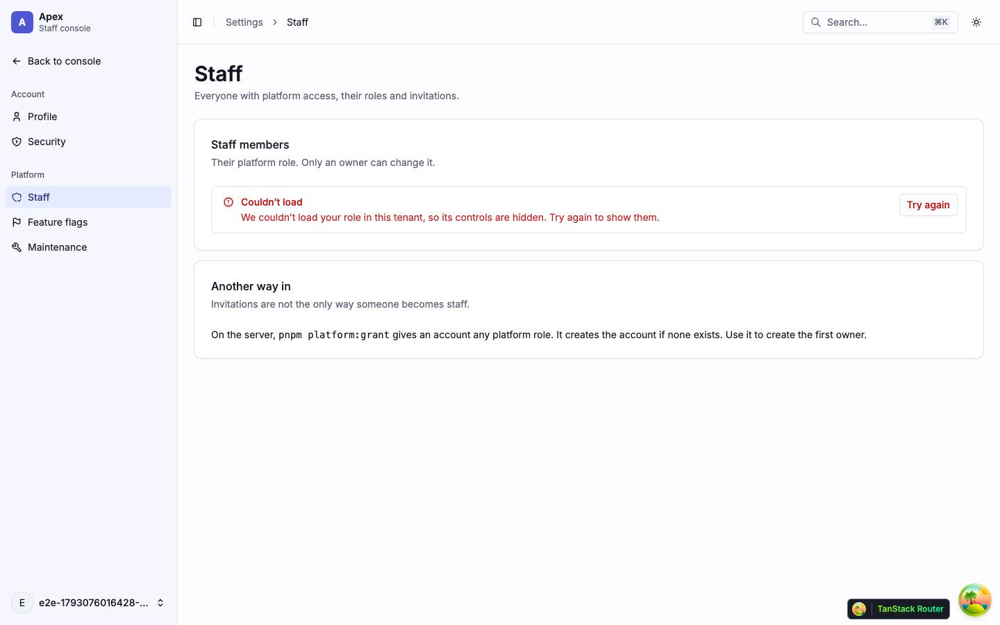                    |
| skeleton · a `TableRowsSkeleton` of 4 columns in the members card, one `h-40` block for the invitations | alert · one `LoadError`, the role message, in the members card |

| Role-denied                                                                                                                                                                                                                    |
| ------------------------------------------------------------------------------------------------------------------------------------------------------------------------------------------------------------------------------ |
| 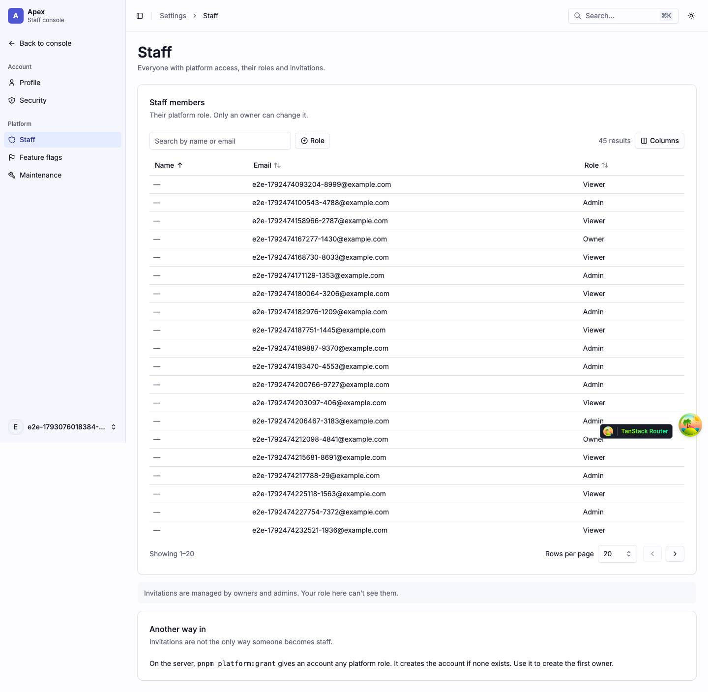                                                                                                                                                                              |
| A viewer: the staff list with each role as plain text and Leave on their own row only; the invite and pending-invitations cards are replaced by "Invitations are managed by owners and admins. Your role here can’t see them." |

Findings: [F-settings-3](findings.md#f-settings-3), [F-settings-4](findings.md#f-settings-4), [F-settings-7](findings.md#f-settings-7), [F-tenants-6](findings.md#f-tenants-6)

### `/settings/platform/flags` — Feature flags

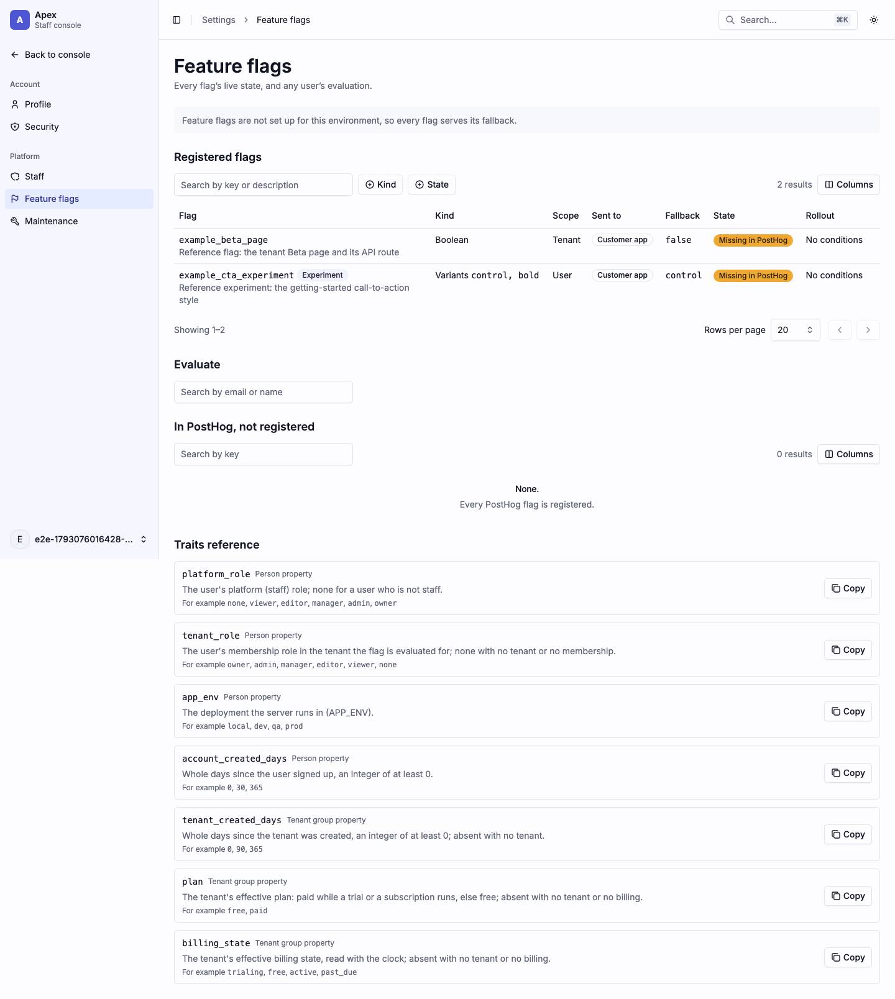

|                     |                                                                                                                                                                                                                                                                                                                                                                                                                                                                                                                                                                                                                                                            |
| ------------------- | ---------------------------------------------------------------------------------------------------------------------------------------------------------------------------------------------------------------------------------------------------------------------------------------------------------------------------------------------------------------------------------------------------------------------------------------------------------------------------------------------------------------------------------------------------------------------------------------------------------------------------------------------------------- |
| Purpose             | Every registered flag's live state, flags PostHog has that the registry lacks, the traits a rollout can target, and for admins any user's evaluation.                                                                                                                                                                                                                                                                                                                                                                                                                                                                                                      |
| File                | `src/pages/_app/settings/platform.flags.tsx`                                                                                                                                                                                                                                                                                                                                                                                                                                                                                                                                                                                                               |
| Guard and redirects | `_app`; `?userId`, `?tenantId`, `?app` (default `react`) drive the evaluate panel                                                                                                                                                                                                                                                                                                                                                                                                                                                                                                                                                                          |
| Layout              | `AppLayout` › settings layout                                                                                                                                                                                                                                                                                                                                                                                                                                                                                                                                                                                                                              |
| Data                | `GET /platform/flags/meta` (`['platform', 'flags', 'meta']`) gates the page; the loader starts it with `GET /platform/flags` and `GET /platform/flags/unregistered`, each a list read (`search`, `sort`, `cursor`, `limit`, and `kind` and `state` on the registry; the unregistered list's URL keys carry the `unregistered` prefix). The evaluate panel (admins and up) reads the registry's first hundred flags with no total, searches `GET /platform/users?search&limit=8`, reads `GET /platform/users/:id` for a picked user, and `GET /platform/flags/evaluate` (`['platform', 'flags', 'evaluate', userId, tenantId, app]`, no retry, `gcTime` 0). |
| Sections            | A not-configured or stale note when PostHog is not set up. **Registered flags**: `FlagRegistryTable` (search by key or description, Kind and State filters, Flag sortable, Flag with its description, Kind, Scope, Sent to, Fallback, State, Rollout, a PostHog link), and when the definitions last changed. **Evaluate**: a user search, then that user's evaluation; below admin, "Admins can evaluate flags for a user." **In PostHog, not registered**: `UnregisteredFlagsTable` (search by key) or "None. Every PostHog flag is registered." **Traits reference**: one bordered row per trait with Copy.                                             |
| Components          | `DataTable` (the registry and the unregistered flags, `landmark={false}`), `Badge`, `Input`, `Button`, `Skeleton` (`h-64`), `CardRowsSkeleton` (the looked-up user and the evaluate panel's registry), `TableRowsSkeleton` (the evaluation), `LoadError`, `RoleDenied`, `Alert` (destructive, user search and user-not-found), `FlagEvaluatePanel`, `TraitsPanel` (`ItemGroup`, `Item`, `ItemContent`, `ItemTitle`, `ItemDescription`, `ItemActions`), `Note` (passive: not configured; warning: stale); `EmptyState` (compact: no flags registered, none unregistered)                                                                                    |
| Transitions         | a user's Flags button lands here with `?userId`                                                                                                                                                                                                                                                                                                                                                                                                                                                                                                                                                                                                            |

| Loading                                       | Error                                       | Empty                                              |
| --------------------------------------------- | ------------------------------------------- | -------------------------------------------------- |
| 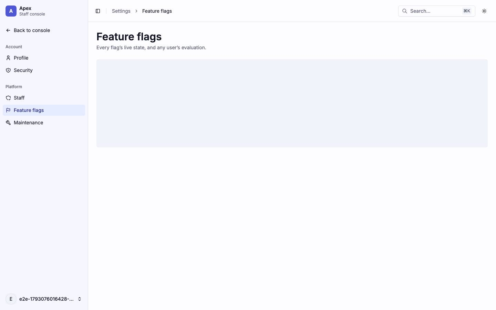 | 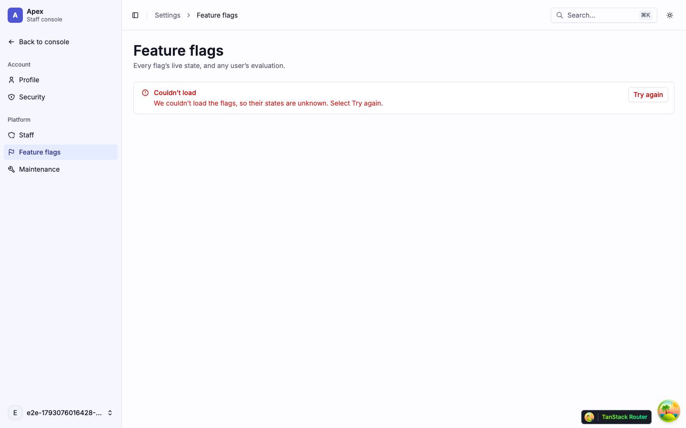 | 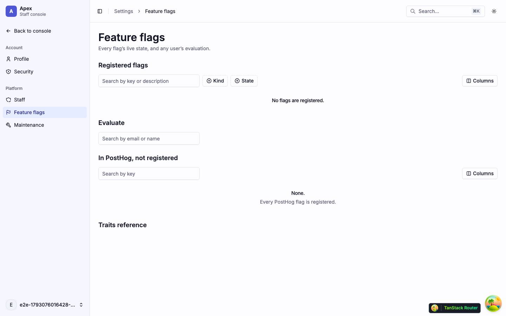        |
| skeleton · one `h-64` block for four sections | alert · `LoadError`                         | registry stubbed empty: "No flags are registered." |

| Role-denied                                                                                                                     |
| ------------------------------------------------------------------------------------------------------------------------------- |
| 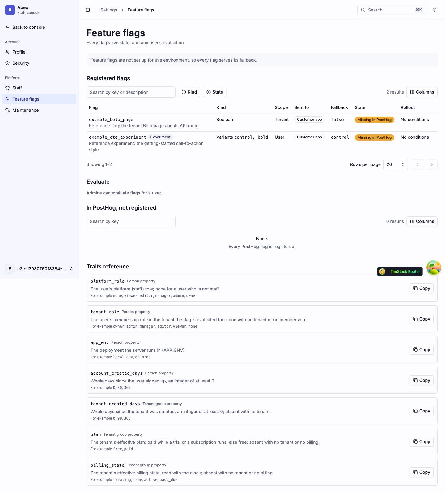                                                                               |
| A viewer: the registry, the unregistered list and the traits; the Evaluate section says "Admins can evaluate flags for a user." |

Findings: [F-settings-2](findings.md#f-settings-2), [F-settings-5](findings.md#f-settings-5), [F-overview-3](findings.md#f-overview-3)

### `/settings/platform/maintenance` — Maintenance

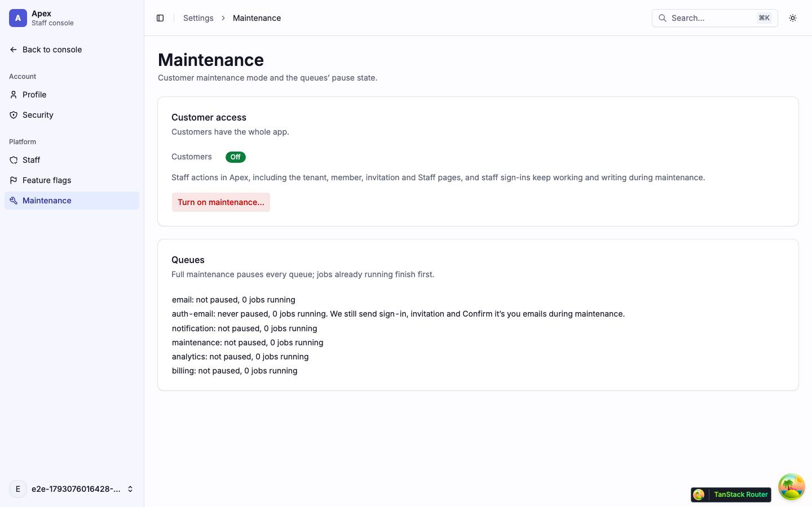

|                     |                                                                                                                                                                                                                                                                                              |
| ------------------- | -------------------------------------------------------------------------------------------------------------------------------------------------------------------------------------------------------------------------------------------------------------------------------------------- |
| Purpose             | Customer maintenance mode and each queue's pause state; platform owners turn it on, change it or turn it off.                                                                                                                                                                                |
| File                | `src/pages/_app/settings/platform.maintenance.tsx`                                                                                                                                                                                                                                           |
| Guard and redirects | `_app`; the controls are owner-only                                                                                                                                                                                                                                                          |
| Layout              | `AppLayout` › settings layout                                                                                                                                                                                                                                                                |
| Data                | `GET /platform/maintenance-mode` (`['platform', 'maintenance-mode']`), the query the shell's banner already polls; `PUT /platform/maintenance-mode` from `ChangeModeDialog` and `TurnOffDialog`                                                                                              |
| Sections            | **Customer access**: the mode badge, a sentence on what customers have, a note that staff keep working, and Turn on maintenance… (or Change and Turn off…) for owners. **Queues**: one line per queue, "{name}: not paused, 0 jobs running"; `auth-email` reads "never paused" and says why. |
| Components          | `Card`, `Badge`, `Button`, `Skeleton`, `CardRowsSkeleton`, `QueryState`, `LoadError`, `RoleDenied`, `Alert` (destructive, conflict and refusal in both dialogs), `ChangeModeDialog`, `TurnOffDialog`; `EmptyState` (compact: no queues); `ItemGroup`, `Item` (the queue list)                |
| Transitions         | none                                                                                                                                                                                                                                                                                         |

The page reads through `QueryState`: while the state loads, two cards, each a title bar over three `1.25rem` rows (an outline of the content, not measured); a failed read with no data is a `LoadError`, a 404 is `RoleDenied`, and a failed refresh keeps the last answer up with the `LoadError` above it.

| Loading                                                | Error                                             |
| ------------------------------------------------------ | ------------------------------------------------- |
| 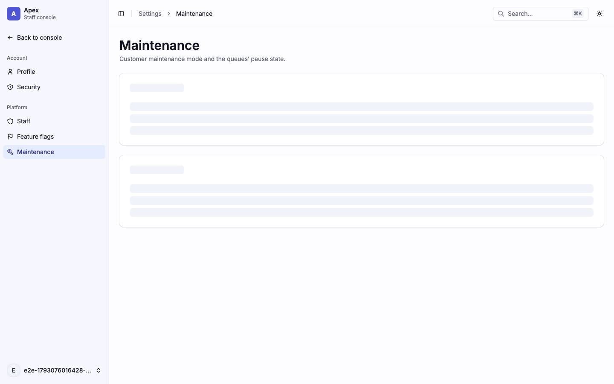    | 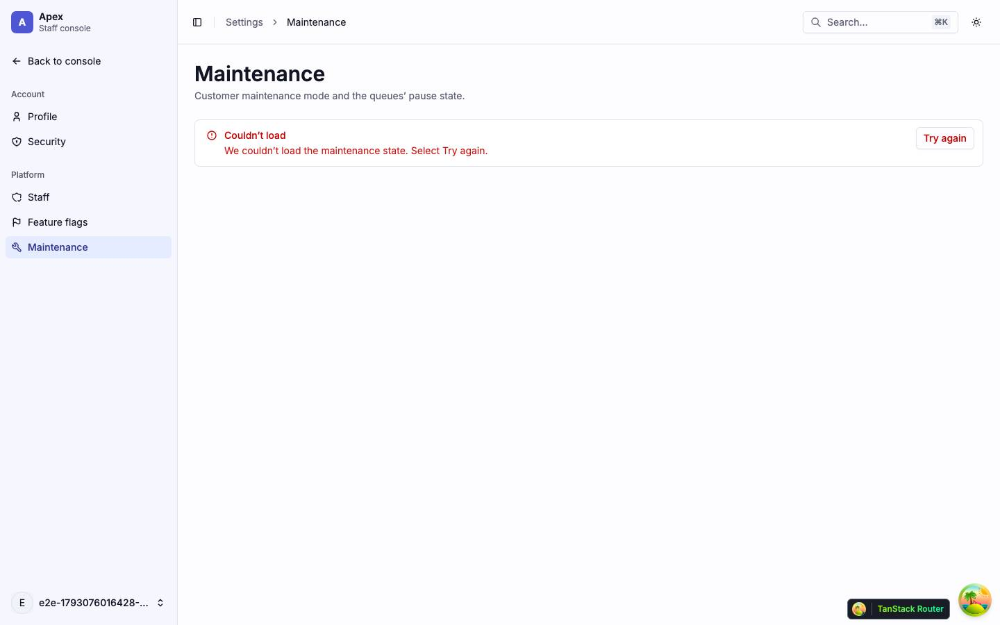 |
| skeleton · two cards, each a title bar over three rows | alert · `LoadError`                               |

| Role-denied                                                                                                                                       |
| ------------------------------------------------------------------------------------------------------------------------------------------------- |
| 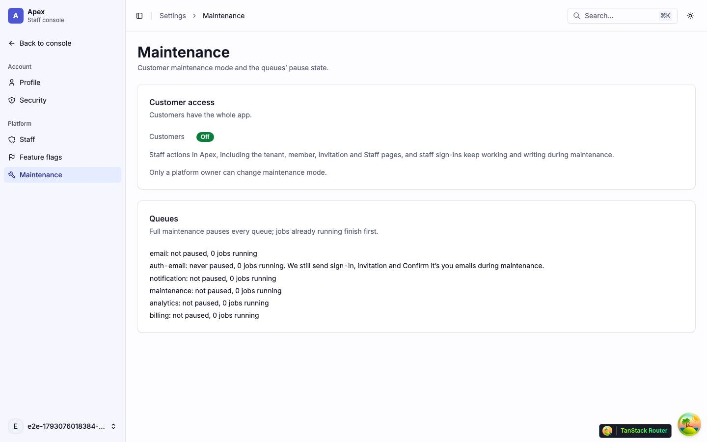                                                                                           |
| A viewer: the state and the queues, with "Only a platform owner can change maintenance mode." in place of the controls. Admins see the same line. |

Findings: [F-settings-2](findings.md#f-settings-2)

## Redirects

Each runs `_app`'s guard first, then throws a `redirect` in `beforeLoad` that keeps the search and hash and replaces the history entry, so Back skips it.

| Route                 | File                                         | Goes to                          |
| --------------------- | -------------------------------------------- | -------------------------------- |
| `/settings/account/`  | `src/pages/_app/settings/account.index.tsx`  | `/settings/account/profile`      |
| `/settings/platform/` | `src/pages/_app/settings/platform.index.tsx` | `/settings/platform/staff`       |
| `/flags`              | `src/pages/_app/flags.tsx`                   | `/settings/platform/flags`       |
| `/maintenance`        | `src/pages/_app/maintenance.tsx`             | `/settings/platform/maintenance` |
| `/staff`              | `src/pages/_app/staff.tsx`                   | `/settings/platform/staff`       |
| `/profile`            | `src/pages/_app/profile.tsx`                 | `/settings/account/profile`      |
