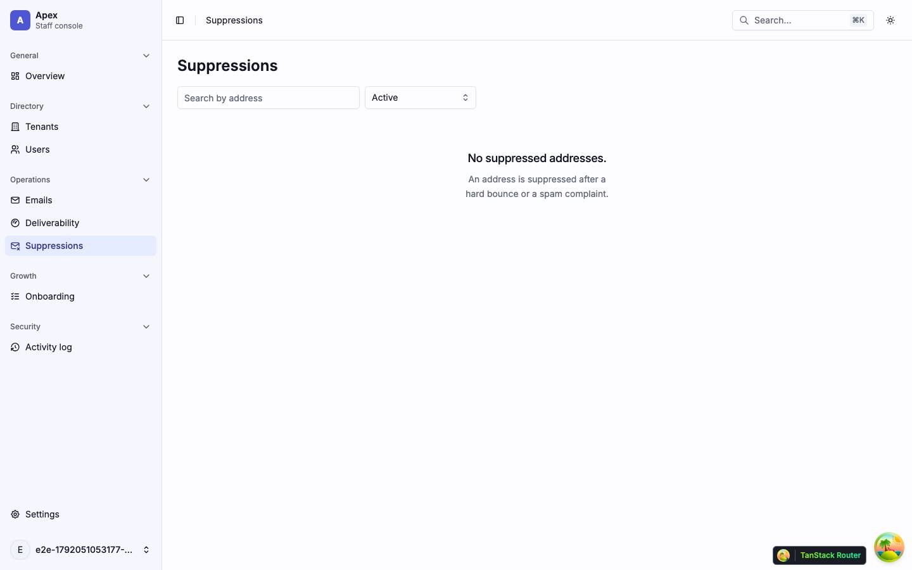
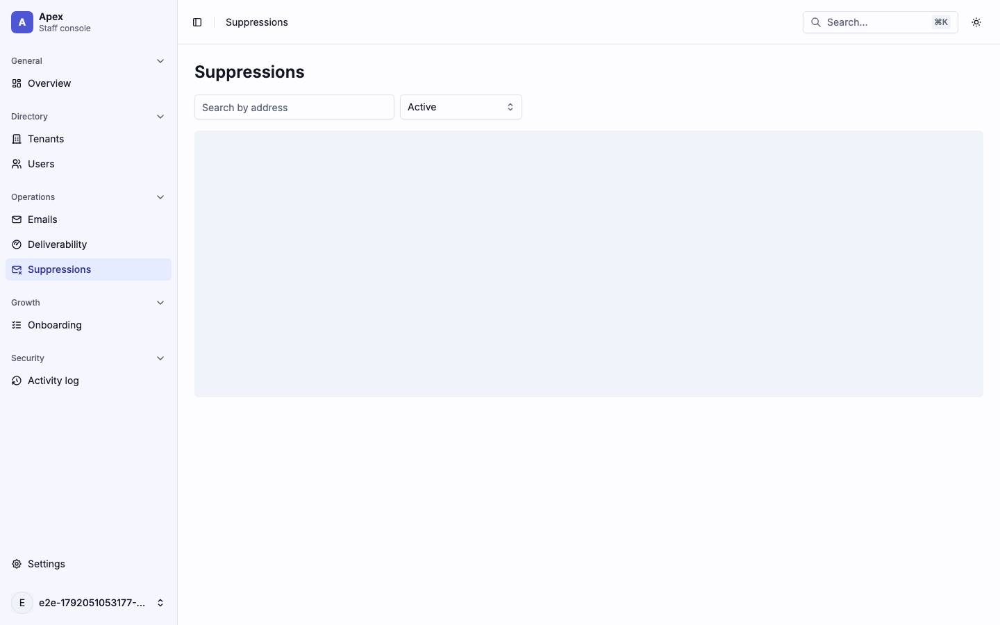
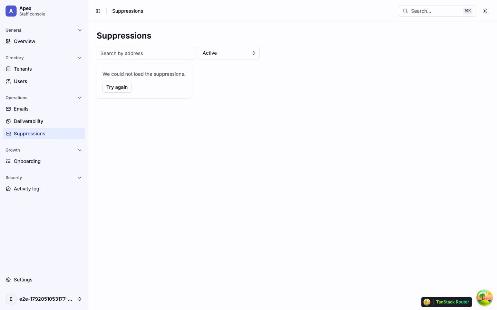
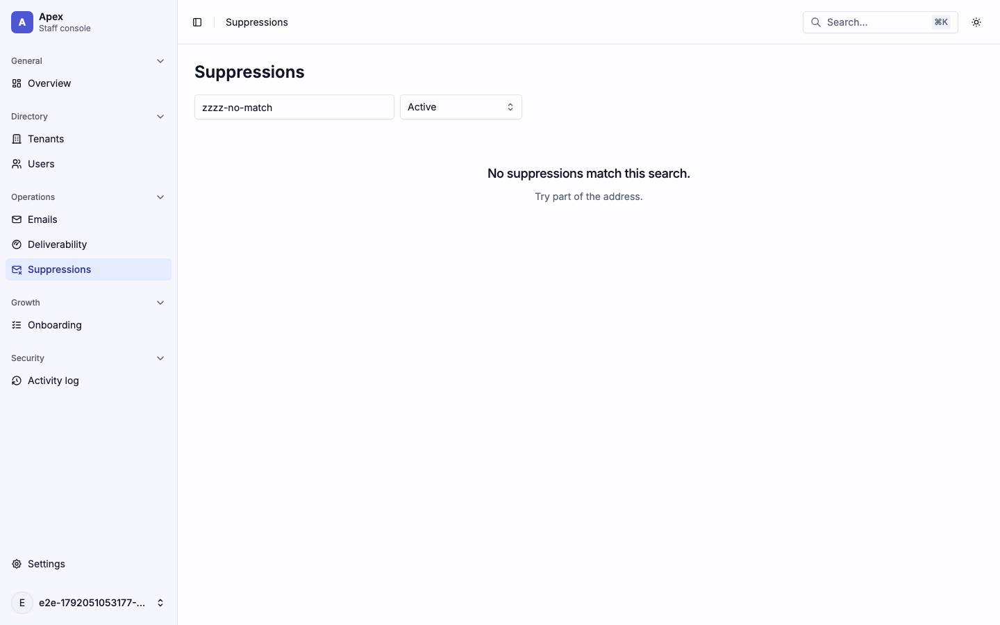
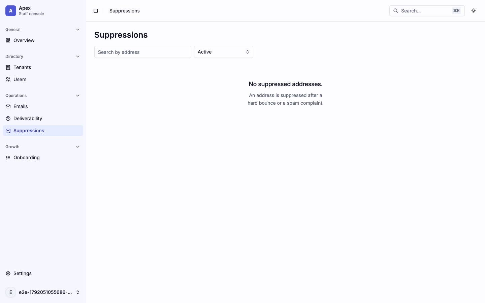

# Suppressions

Addresses no email is sent to after a hard bounce or a spam complaint (`/suppressions`). Back to the [route map](README.md#route-map).

## Pages

### `/suppressions` — Suppressions

|                     |                                                                                                                                                                                                                                                         |
| ------------------- | ------------------------------------------------------------------------------------------------------------------------------------------------------------------------------------------------------------------------------------------------------- |
| Purpose             | Every suppressed address, active or lifted, searched and paged; admins lift one.                                                                                                                                                                        |
| File                | `src/pages/_app/suppressions.tsx`                                                                                                                                                                                                                       |
| Guard and redirects | `_app`                                                                                                                                                                                                                                                  |
| Layout              | `AppLayout`                                                                                                                                                                                                                                             |
| Data                | `GET /platform/email-suppressions?q&state&cursor&direction&limit=20` (`['platform', 'email-suppressions', params]`), started by the loader; `POST /platform/email-suppressions/:id/lift` through `ReasonDialog`                                         |
| Sections            | The `h1`, then "Search by address" (debounced 250 ms, `?q`) and a state `Select` (Active, Lifted, Active and lifted; `?state`). Then `SuppressionsTable` and the Previous/Next icon buttons.                                                            |
| Components          | `Input`, `Select`, `Button`, `Table` through `SuppressionsTable` (TanStack Table `useTable` with no features: Address, Reason, Source, Suppressed, State, and a Lift button for admins), `Skeleton`, `Empty`, `LoadError`, `RoleDenied`, `ReasonDialog` |
| Transitions         | Lift → the reason dialog; the row stays, marked lifted                                                                                                                                                                                                  |

The empty first page is worded per state ("No suppressed addresses.", "No lifted suppressions.", "No suppressions yet."); a search says "No suppressions match this search." The dev database has no suppressed address, so the default shot is the Active empty state.

| Loading                                         | Error                                                     | Empty                                                               |
| ----------------------------------------------- | --------------------------------------------------------- | ------------------------------------------------------------------- |
|  |              |                        |
| skeleton · one `h-96` block                     | alert · `LoadError` "We could not load the suppressions." | "No suppressions match this search." and "Try part of the address." |

| Role-denied                                                                                                                  |
| ---------------------------------------------------------------------------------------------------------------------------- |
|                                                                           |
| A viewer: the same list. Lift is admin only, but with no suppressed address the shot shows the empty list and no row action. |

Findings: [F-suppressions-1](findings.md#f-suppressions-1), [F-suppressions-2](findings.md#f-suppressions-2)
