# Tenants

The tenant list (`/tenants/`), a tenant's tabs under `/tenants/$tenantId`, and the tenant actions menu. Back to the [route map](README.md#route-map).

## Layout

`/tenants/$tenantId` (`src/pages/_app/tenants/$tenantId.tsx`) is the layout every tenant tab renders in, under `AppLayout` ([overview.md](overview.md#the-staff-shell)).

|                 |                                                                                                                                                                                                                                                                                                                                                                                                                                                                                                                                                        |
| --------------- | ------------------------------------------------------------------------------------------------------------------------------------------------------------------------------------------------------------------------------------------------------------------------------------------------------------------------------------------------------------------------------------------------------------------------------------------------------------------------------------------------------------------------------------------------------ |
| Fetches         | Its loader starts `GET /platform/tenants/:id` (`['platform', 'tenant', id]`; a 404 is not retried) without awaiting it, so the router never holds the page: the layout draws at once. On a first visit, when the route's code takes more than 300 ms to arrive, `DetailPending` shows until it does; there is no boot wait beyond `_app`'s flags read. Every tab reads the same cached detail.                                                                                                                                                         |
| While it loads  | A visually hidden `h1` "Tenant" over the header's shape: a name bar (`h-8 w-64`) and a line bar (`h-5 w-48`) beside an actions bar (`h-9 w-28`), then the real tab bar and the `Outlet`. Overview, Flags, Onboarding and Emails draw their own skeletons; Members, Invitations and Activity stay blank until the detail is in. The loaded header replaces only the skeleton part. The breadcrumb reads Tenants › Tenant › {tab} until the detail is in. The skeleton's sizes follow the loaded header's text sizes; they were not measured against it. |
| Gate panels     | A 404 renders an `EmptyState` with the `h1` **Tenant not found**, "It doesn’t exist, or your access changed. Reload if your role was just updated." and Back to tenants. Any other failure renders one `LoadError`, "We could not load this tenant.", whose Try again refetches the detail; it replaces the header, the tabs and the tab, and offers no way back but the breadcrumb. A failed refetch while the tenant is on screen keeps the header, the tabs and the tab, with the same `LoadError` above them; only a 404 still replaces the page.  |
| Header and tabs | The tenant's name as the `h1` with its state badge (`TenantStateBadge`), then "`{slug}` · Created {date}", and the **Actions** menu on the right. Below, a `nav` "Tenant sections" of link tabs (bottom-bordered `Link`s, hand-rolled): Overview, Members, Invitations, Activity, Emails, Onboarding, Flags. Flags has `minRole: 'admin'` in `TENANT_DETAIL_TABS` (`src/constants/tenant-tabs.ts`) and is left out of the nav below admin. On a phone the bar scrolls sideways with no sign that more tabs follow.                                     |
| Actions menu    | `TenantActionsMenu` (`src/components/features/tenants/tenant-actions-menu.tsx`), shown only when one action applies: Edit details, Resend owner invitation (no active owner), Suspend, Reactivate, Archive (admins and up, by lifecycle state) and Delete permanently (owners, archived tenants). Each opens a dialog; the destructive ones go through `ReasonDialog` and the shared step-up dialog. A viewer gets no menu at all.                                                                                                                     |
| Breadcrumbs     | Tenants › {name} › {tab}. The name comes from the same detail query (`TenantCrumb`), so it reads "Tenant" while the detail loads.                                                                                                                                                                                                                                                                                                                                                                                                                      |

In the walk, a load of `/tenants/{id}/members` with the detail held for 2.5 s showed the shell, the breadcrumb Tenants › Tenant › Members and the header skeleton for the whole 2.5 s; the members request started only after the detail answered. With only `GET /tenants/:slug/members` failing, the header and tabs stayed and the Members card showed its own `LoadError`. The capture's error shots fail the detail, so every tab's error shot is the layout's `LoadError` alone.

Findings: [F-tenants-3](findings.md#f-tenants-3), [F-tenants-4](findings.md#f-tenants-4), [F-tenants-5](findings.md#f-tenants-5), [F-tenants-7](findings.md#f-tenants-7)

## Pages

### `/tenants/` — Tenants

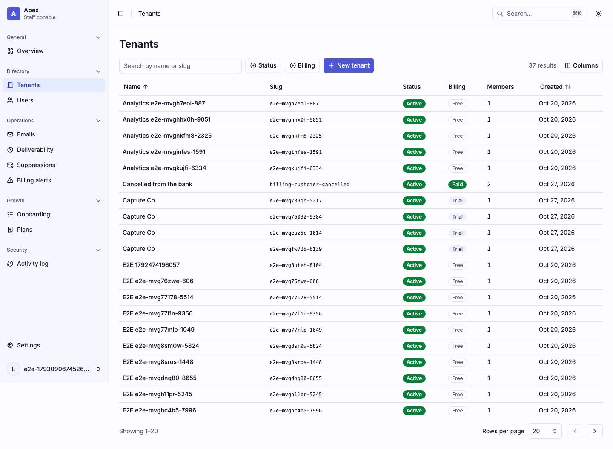

|                     |                                                                                                                                                                                                                                                                                                                   |
| ------------------- | ----------------------------------------------------------------------------------------------------------------------------------------------------------------------------------------------------------------------------------------------------------------------------------------------------------------- |
| Purpose             | Every customer tenant, searched, filtered by state and paged; admins create one here.                                                                                                                                                                                                                             |
| File                | `src/pages/_app/tenants/index.tsx`                                                                                                                                                                                                                                                                                |
| Guard and redirects | `_app`                                                                                                                                                                                                                                                                                                            |
| Layout              | `AppLayout`                                                                                                                                                                                                                                                                                                       |
| Data                | `GET /platform/tenants?q&state&cursor&direction&limit=20` (`['platform', 'tenants', 'page', params]`), started by the loader; `keepPreviousData` while the search changes. `POST /platform/tenants` from New tenant.                                                                                              |
| Sections            | Header row: the `h1`, a search box "Search by name or slug" (debounced 250 ms, into `?q`), a state `Select` (Active and suspended, Active, Suspended, Archived, All; `?state`) and **New tenant** (admins and up). Then `TenantsTable` and a `nav` "Pagination" of two icon buttons, Previous page and Next page. |
| Components          | `Input`, `Select`, `Button`, `Table` through `TenantsTable` (TanStack Table `useTable` with no features: columns Name (link), Slug, Status, Members, Created), `Skeleton`, `EmptyState`, `LoadError`, `RoleDenied`, `CreateTenantDialog` (name, slug, owner email, website, description)                          |
| Transitions         | a row's name → `/tenants/$tenantId`; New tenant → the dialog → the new tenant's page; Previous/Next → the same URL with `?cursor&dir`                                                                                                                                                                             |

Changing the term or the state drops the cursor. An empty page reached with a stale cursor says "Nothing on this page." with First page; a failed page with a cursor adds First page under the `LoadError`. The table is the API's order (by name); nothing sorts client-side, and there is no page count or page size control.

| Loading                               | Error                                                                            | Empty                                                                                          |
| ------------------------------------- | -------------------------------------------------------------------------------- | ---------------------------------------------------------------------------------------------- |
| 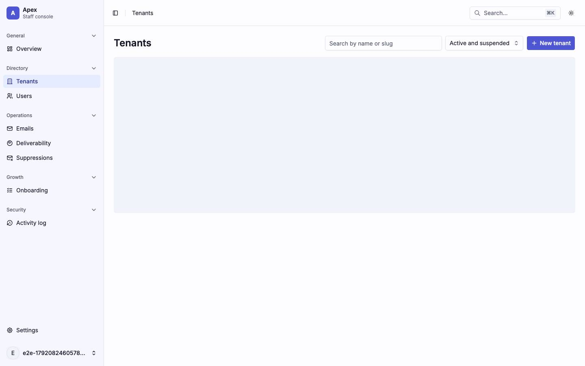 | 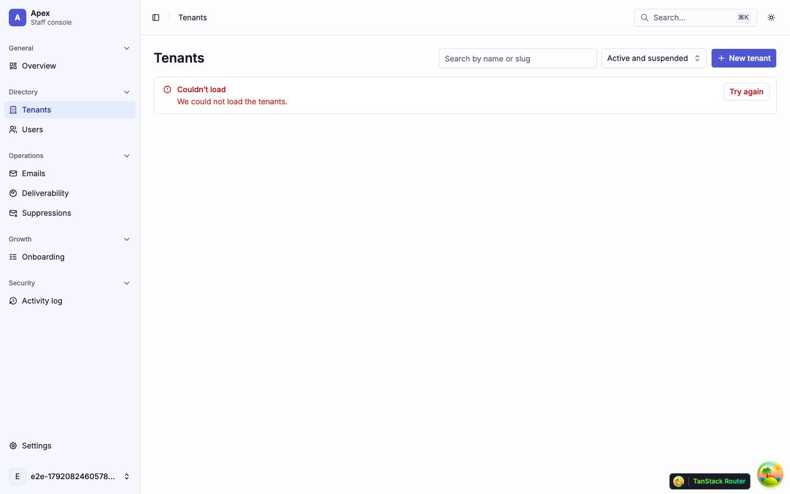                                              | 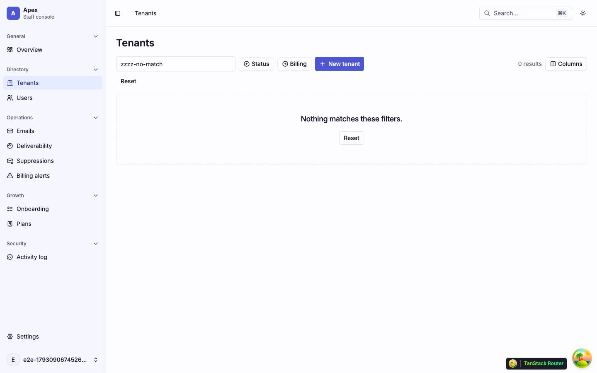                                                            |
| skeleton · one `h-96` block           | alert · `LoadError` "We could not load the tenants.", shrink-wrapped at the left | `No tenants match “zzzz-no-match”.` and "Try part of the name or the slug, or another status." |

| Dark                                                            | Mobile                                                                                                                                 |
| --------------------------------------------------------------- | -------------------------------------------------------------------------------------------------------------------------------------- |
| 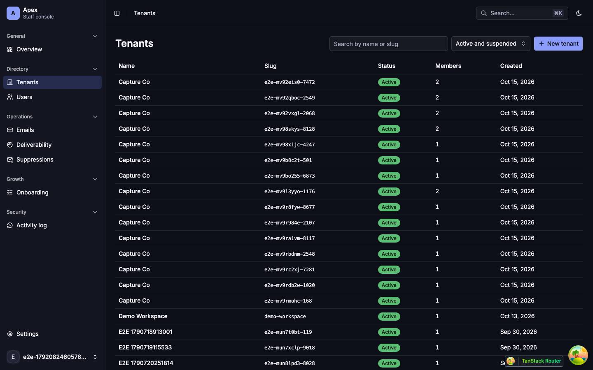                              | 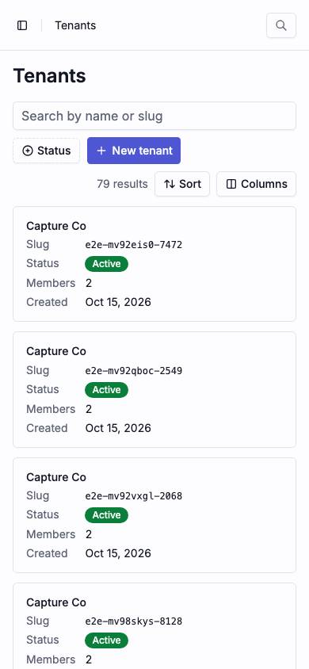                                                                                                   |
| The table on dark surfaces; the status badges keep their green. | The search, the state select and New tenant wrap under the title; the table scrolls sideways and the Status column is cut at the edge. |

| Role-denied                                 |
| ------------------------------------------- |
| 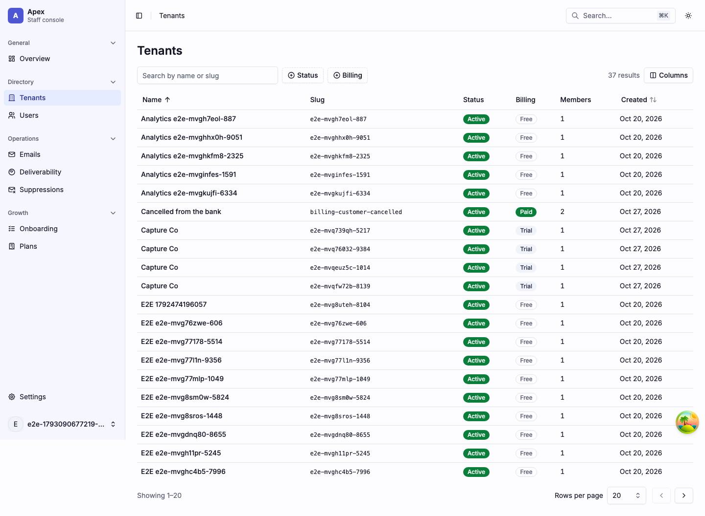   |
| A viewer: the same list without New tenant. |

Findings: [F-tenants-1](findings.md#f-tenants-1), [F-tenants-2](findings.md#f-tenants-2), [F-palette-2](findings.md#f-palette-2)

### `/tenants/$tenantId/` — Tenant overview

|                     |                                                                                                                                                                                                                                                                                                                                                                                                  |
| ------------------- | ------------------------------------------------------------------------------------------------------------------------------------------------------------------------------------------------------------------------------------------------------------------------------------------------------------------------------------------------------------------------------------------------ |
| Purpose             | A tenant's details and owners from the platform read, which works in every lifecycle state, and the staff actions recorded on it.                                                                                                                                                                                                                                                                |
| File                | `src/pages/_app/tenants/$tenantId.index.tsx`                                                                                                                                                                                                                                                                                                                                                     |
| Guard and redirects | `_app`, then the [layout](#layout)                                                                                                                                                                                                                                                                                                                                                               |
| Layout              | `AppLayout` › tenant layout                                                                                                                                                                                                                                                                                                                                                                      |
| Data                | the layout's `GET /platform/tenants/:id` (`['platform', 'tenant', id]`); for admins and up, `TenantHistoryCard` starts `GET /platform/audit-log?tenantId=&access=platform&limit=50` (`['platform', 'audit-log', filters]`, `staleTime` 0, infinite) once the tab mounts                                                                                                                          |
| Sections            | **Details** card: description, website, timezone, locale, members, pending invitations, last updated (and archived, when it is). **Owners** card (`TenantOwners`): each owner's name over their email, an Inactive badge, and "No owner yet." or "No active owner." with the pending owner invitation. **Staff actions on this tenant** (admins and up): `ActivityList` with Load more activity. |
| Components          | `Card`, `Badge`, `Skeleton`, `CardRowsSkeleton`, `ActivityList`, `TenantOwners` (`ItemGroup`, `Item`), `EmptyState` (compact); hand-rolled: the details `dl`, the activity `ul`                                                                                                                                                                                                                  |
| Transitions         | the tabs; an actor's name in History → `/users/$userId`                                                                                                                                                                                                                                                                                                                                          |

While the tenant loads, the tab shows `TenantOverviewSkeleton`: the Details and Owners cards as a title bar over seven `1.25rem` rows each; the History card mounts only once the tenant is in. The History card has its own states: two `h-14` bars while it loads, a `LoadError` "We could not load the activity, so none is listed here. This is not a sign that there is none." when it fails (seen in the walk with only the audit-log read failing; the Details and Owners cards stayed), and "No staff actions recorded yet." when empty. In the default shot the owner has no name, so the Owners card shows the same address twice.

| Loading                                        | Error                                               | Empty                                                   |
| ---------------------------------------------- | --------------------------------------------------- | ------------------------------------------------------- |
| 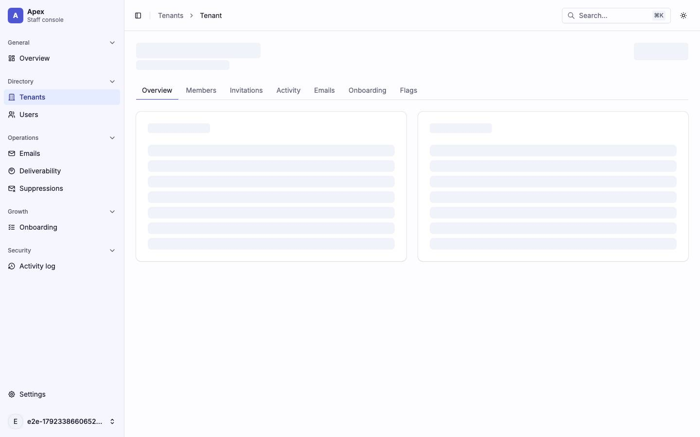  | 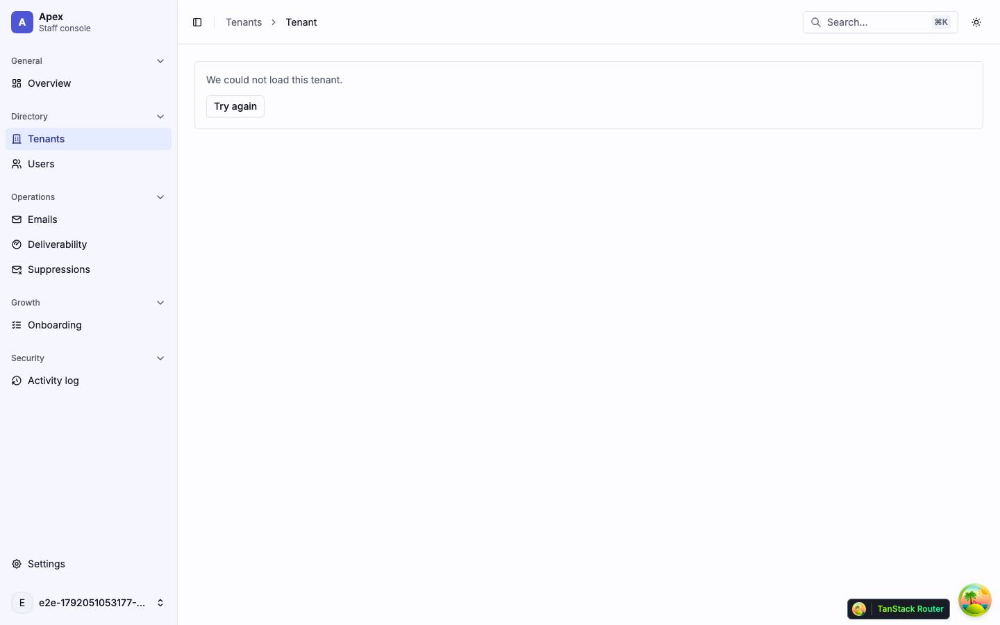         | 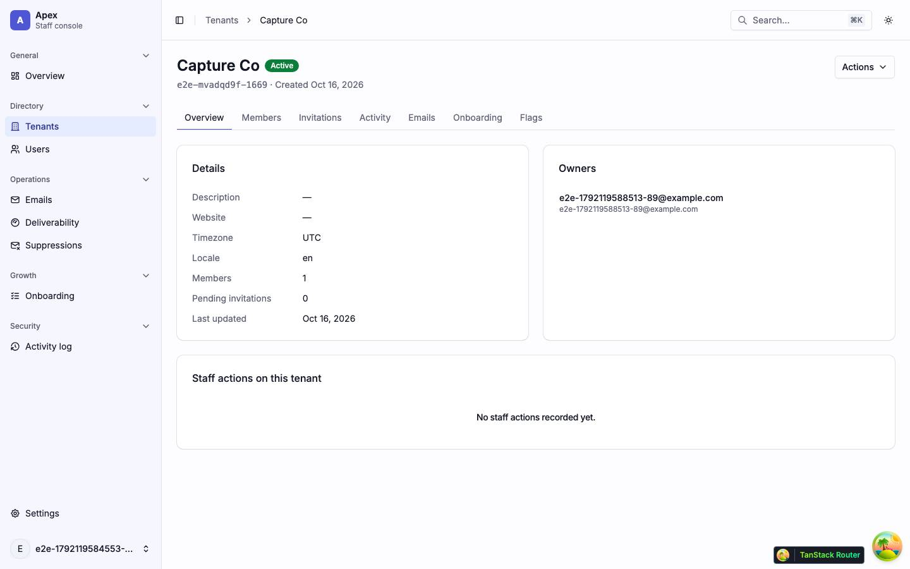             |
| skeleton · the layout's `h-10 w-64` and `h-64` | alert · the layout's `LoadError`, no header or tabs | History stubbed empty: "No staff actions recorded yet." |

| Dark                                       | Mobile                                                                                                           |
| ------------------------------------------ | ---------------------------------------------------------------------------------------------------------------- |
| 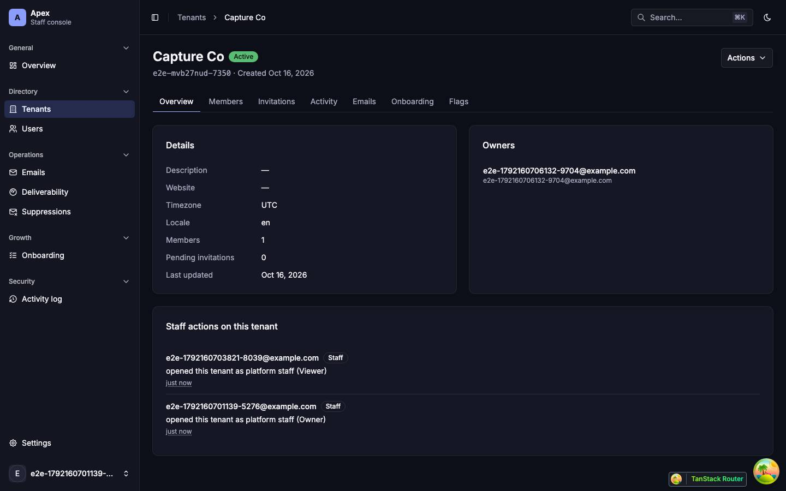 | 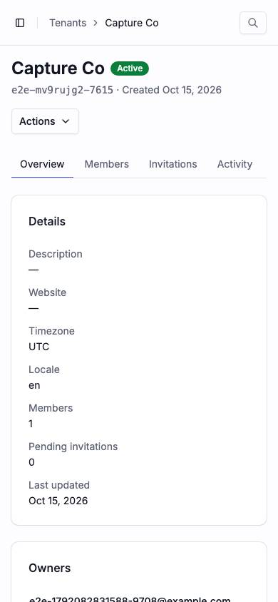                                                                     |
| Cards on the dark surfaces.                | Actions wraps under the title; the tab bar shows four tabs and scrolls; the details rows stack label over value. |

| Role-denied                                                   |
| ------------------------------------------------------------- |
| 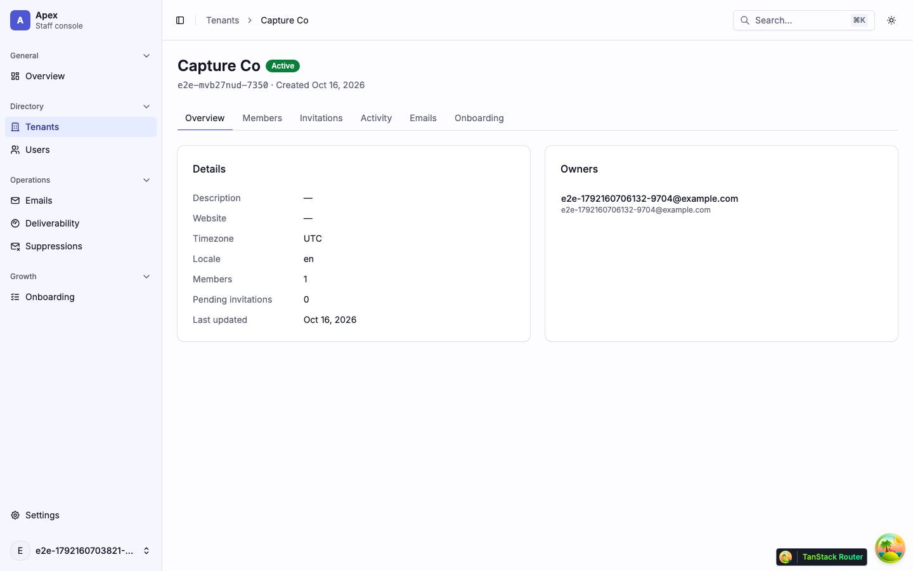             |
| A viewer: no Actions menu, no Flags tab, and no History card. |

Findings: [F-tenants-3](findings.md#f-tenants-3), [F-tenants-4](findings.md#f-tenants-4), [F-tenants-6](findings.md#f-tenants-6), [F-overview-4](findings.md#f-overview-4)

### `/tenants/$tenantId/members` — Members

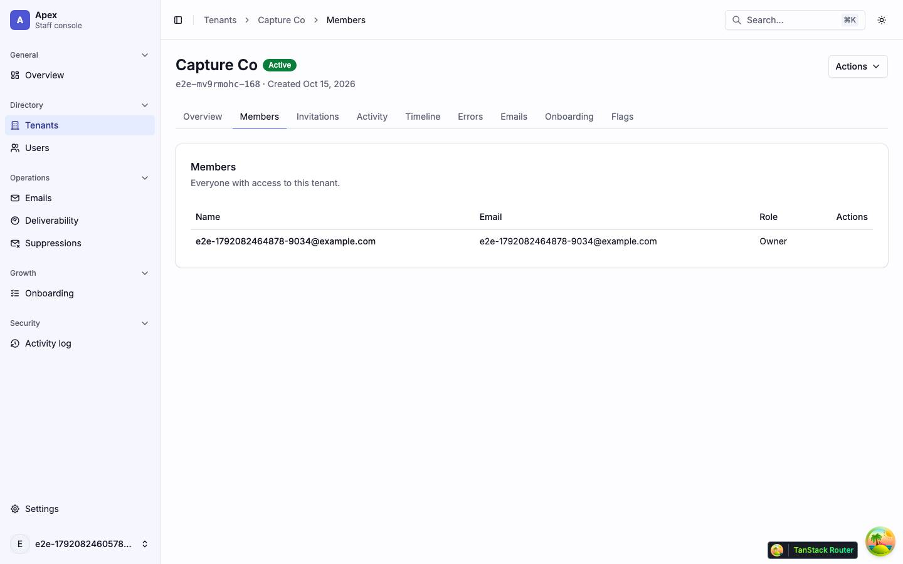

|                     |                                                                                                                                                                                                                                                                               |
| ------------------- | ----------------------------------------------------------------------------------------------------------------------------------------------------------------------------------------------------------------------------------------------------------------------------- |
| Purpose             | Who has access to the tenant, with role changes and removal; staff acting through platform access give a reason.                                                                                                                                                              |
| File                | `src/pages/_app/tenants/$tenantId.members.tsx`                                                                                                                                                                                                                                |
| Guard and redirects | `_app`, then the [layout](#layout). A suspended or archived tenant renders `FrozenTenant` ("This tenant is {state}. Its members and invitations are frozen.") and asks nothing.                                                                                               |
| Layout              | `AppLayout` › tenant layout                                                                                                                                                                                                                                                   |
| Data                | after the layout's detail answers: `GET /tenants/:slug` for the caller's role (`useMyRole`, `['tenants', slug, { tenantId }]`) and `GET /tenants/:slug/members` (`['tenants', slug, 'members', { tenantId }]`). Role changes and removals post to the tenant's member routes. |
| Sections            | One **Members** card (`MembersCard`): "Everyone with access to this tenant.", then a `Table` of Name, Email, Role (a `Select` where the caller may change it) and Actions (Remove); below `md` the rows become bordered cards.                                                |
| Components          | `Card`, `Table`, `Select`, `Button`, `Skeleton`, `LoadError`, `Alert` (destructive, step-up dismissed), `ReasonDialog`, `MembersCard` (`ItemGroup`, `Item` on phones), `EmptyState` (compact)                                                                                 |
| Transitions         | none beyond the tabs; Remove and role changes stay on the tab                                                                                                                                                                                                                 |

The members read and the role read can fail alone, and each shows its own `LoadError` in the card ("We could not load this tenant’s members, so none are listed here. This is not a sign that it has none." and the role message). The list is not paged and has no search.

| Loading                                                                              | Error                                      | Empty                                                                                                      |
| ------------------------------------------------------------------------------------ | ------------------------------------------ | ---------------------------------------------------------------------------------------------------------- |
| 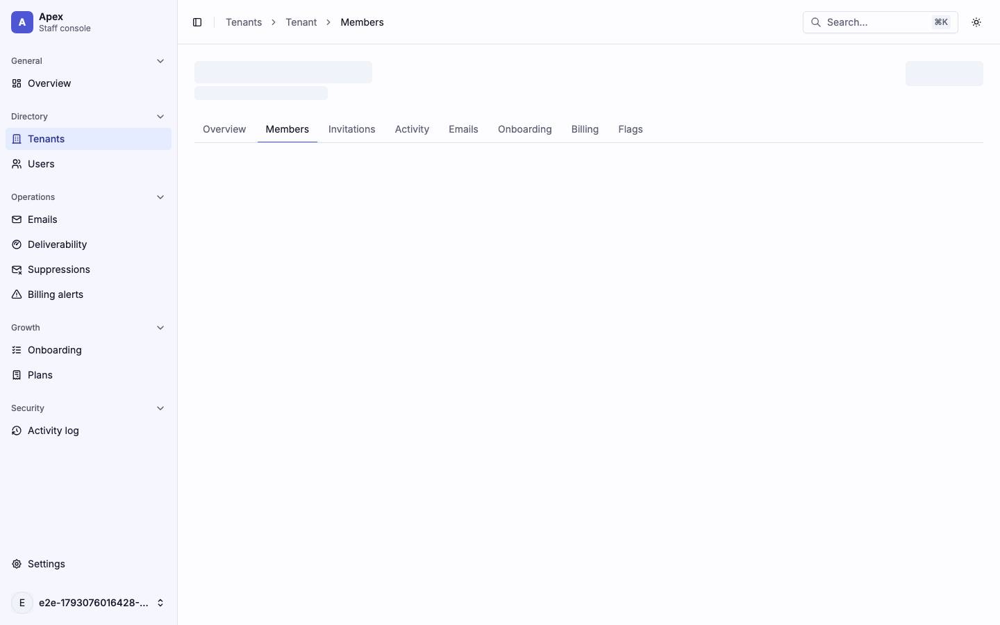                                         |  | 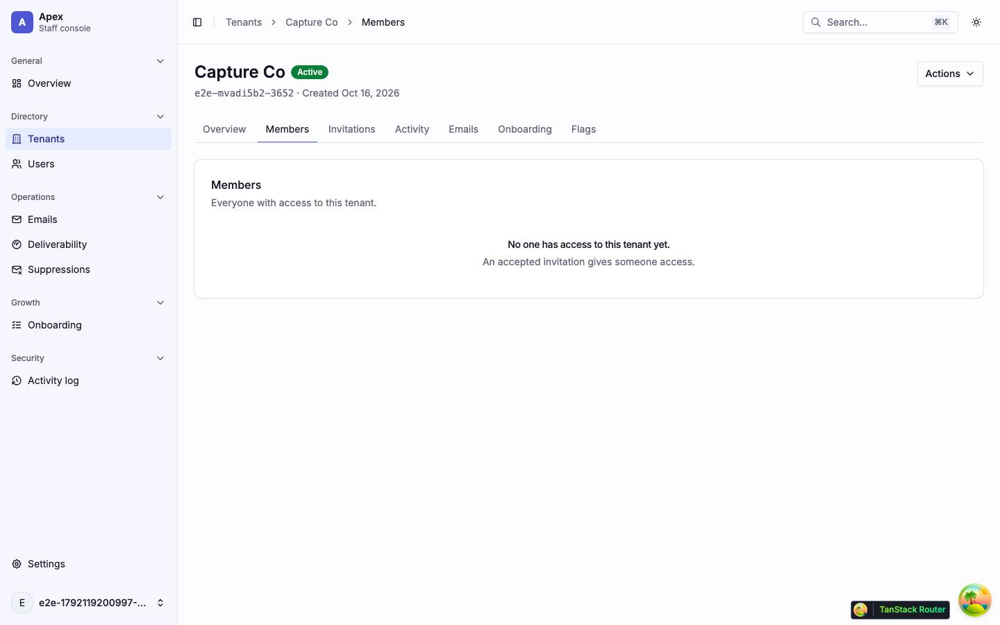                                                                 |
| skeleton · the layout's blocks; the card's own 2× `h-10` shows only after the detail | alert · the layout's `LoadError`           | members stubbed `[]`: "No one has access to this tenant yet. An accepted invitation gives someone access." |

| Role-denied                                                            |
| ---------------------------------------------------------------------- |
| 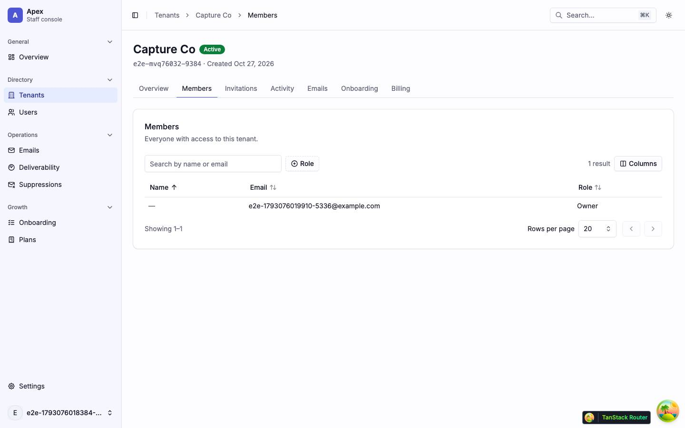                       |
| A viewer: the same list, each role as plain text and no Remove button. |

Findings: [F-tenants-3](findings.md#f-tenants-3), [F-tenants-6](findings.md#f-tenants-6), [F-settings-4](findings.md#f-settings-4)

### `/tenants/$tenantId/invitations` — Invitations

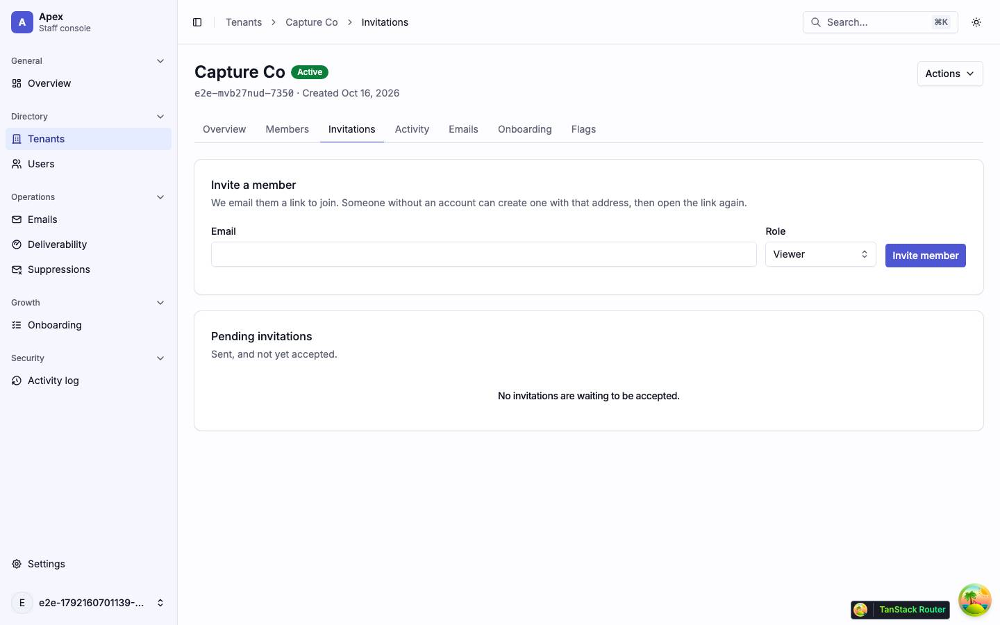

|                     |                                                                                                                                                                                                                                                 |
| ------------------- | ----------------------------------------------------------------------------------------------------------------------------------------------------------------------------------------------------------------------------------------------- |
| Purpose             | Invite someone to the tenant, and resend or revoke pending invitations.                                                                                                                                                                         |
| File                | `src/pages/_app/tenants/$tenantId.invitations.tsx`                                                                                                                                                                                              |
| Guard and redirects | `_app`, then the [layout](#layout); `FrozenTenant` for a non-active tenant. Below the tenant's owner or admin role the tab says "Invitations are managed by owners and admins. Your role here can’t see them." and asks for no list.            |
| Layout              | `AppLayout` › tenant layout                                                                                                                                                                                                                     |
| Data                | after the layout's detail: `GET /tenants/:slug` (the role), then `GET /tenants/:slug/invitations` (`['tenants', slug, 'invitations', { tenantId }]`) once the role allows it; `POST` invite, resend and revoke                                  |
| Sections            | **Invite a member** card (`InviteMemberForm`: email, role `Select`, Invite member). **Pending invitations** card (`PendingInvitations`): one bordered row per invitation with its address, role, inviter, expiry, Resend and Revoke.            |
| Components          | `Card`, `Form`, `Input`, `Select`, `Button`, `Skeleton`, `LoadError`, `ReasonDialog`, `AlertDialog`; `EmptyState` (compact); `ItemGroup`, `Item` (`outline`, the invitation rows), `ItemContent`, `ItemTitle`, `ItemDescription`, `ItemActions` |
| Transitions         | none beyond the tabs                                                                                                                                                                                                                            |

The capture's tenant has no pending invitation, so the default and empty shots are the same page.

| Loading                                                                        | Error                                          | Empty                                          |
| ------------------------------------------------------------------------------ | ---------------------------------------------- | ---------------------------------------------- |
| 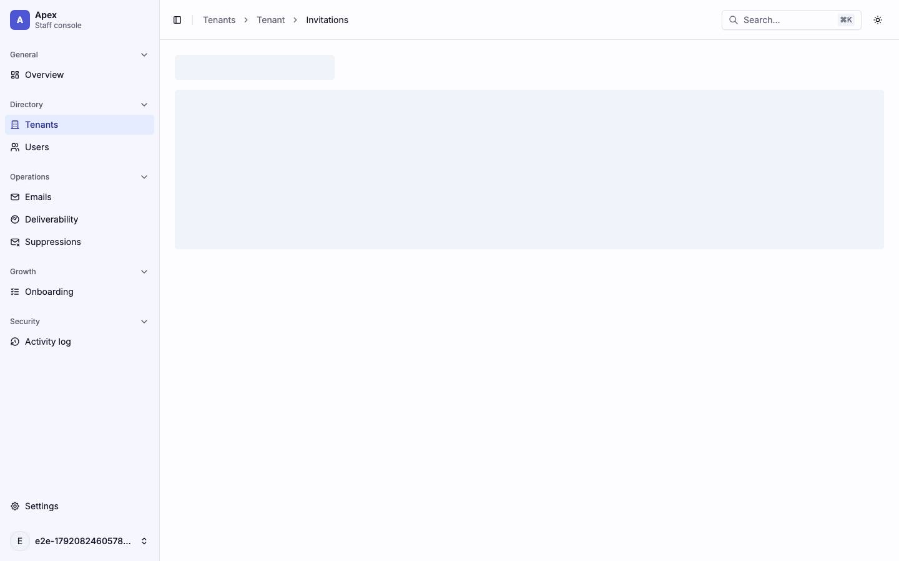                               |  | 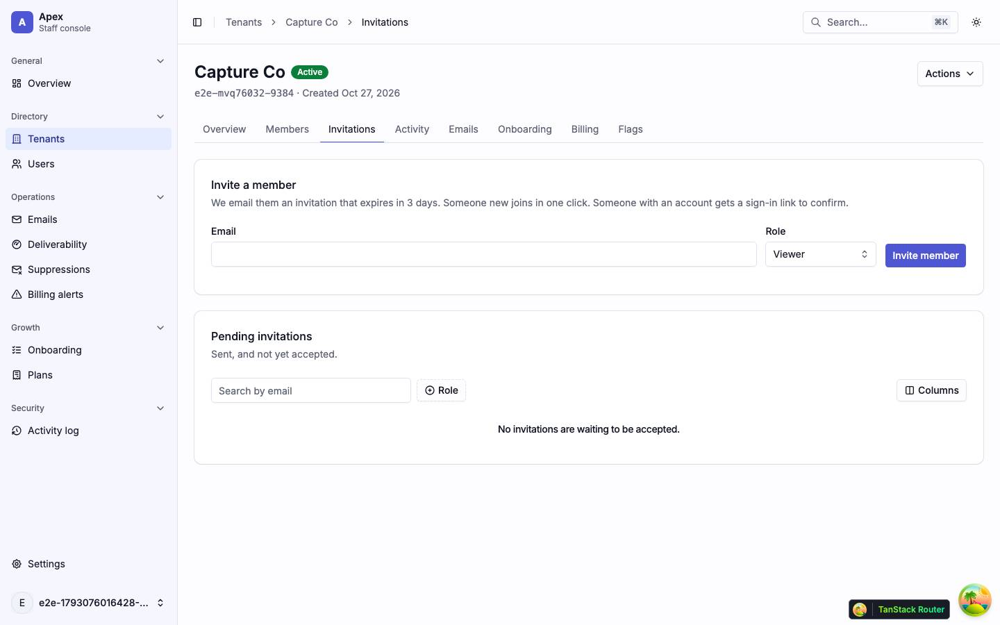 |
| skeleton · the layout's blocks; then the tab's own `h-40` while the role loads | alert · the layout's `LoadError`               | "No invitations are waiting to be accepted."   |

| Role-denied                                                                                                                                                           |
| --------------------------------------------------------------------------------------------------------------------------------------------------------------------- |
| 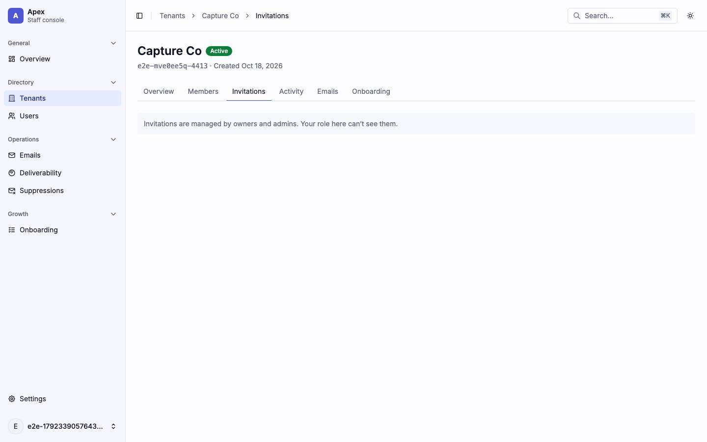                                                                                                                  |
| A viewer: "Invitations are managed by owners and admins. Your role here can’t see them." in place of the invite form and the list; the invitations are not requested. |

Findings: [F-tenants-3](findings.md#f-tenants-3), [F-overview-4](findings.md#f-overview-4)

### `/tenants/$tenantId/activity` — Activity

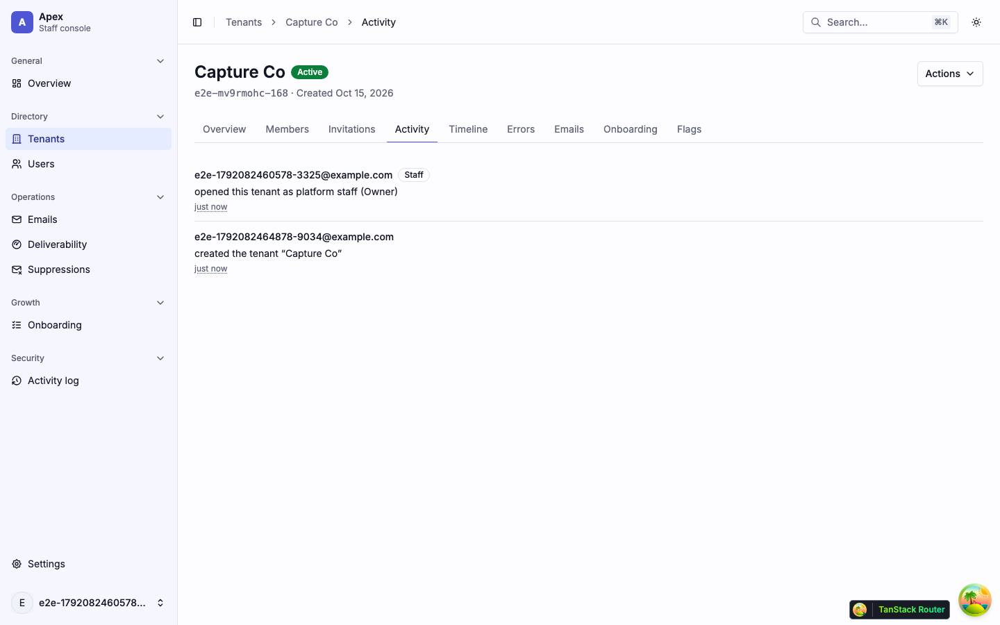

|                     |                                                                                                                                                                                                    |
| ------------------- | -------------------------------------------------------------------------------------------------------------------------------------------------------------------------------------------------- |
| Purpose             | The tenant's own audit log: what its members did, and staff visits.                                                                                                                                |
| File                | `src/pages/_app/tenants/$tenantId.activity.tsx`                                                                                                                                                    |
| Guard and redirects | `_app`, then the [layout](#layout); `FrozenTenant` for a non-active tenant; below the tenant's owner or admin role, "A tenant’s activity is for owners and admins. Your role here can’t see it."   |
| Layout              | `AppLayout` › tenant layout                                                                                                                                                                        |
| Data                | after the layout's detail: `GET /tenants/:slug` (the role), then `GET /tenants/:slug/audit-log?limit=50` (`['tenants', slug, 'audit-log', {}, { tenantId }]`, `staleTime` 0, infinite)             |
| Sections            | `ActivityList`: one row per entry with the actor (a link to the user), a Staff badge for platform access, the sentence and a relative time with the absolute time in a tooltip; Load more activity |
| Components          | `ActivityList`, `EmptyState` (compact), `Badge`, `Tooltip`, `Skeleton`, `LoadError`, `BusyButton`; hand-rolled: the `ul` of rows                                                                   |
| Transitions         | an actor → `/users/$userId`; "View user" on a user target                                                                                                                                          |

| Loading                                                                            | Error                                       | Empty                                                         |
| ---------------------------------------------------------------------------------- | ------------------------------------------- | ------------------------------------------------------------- |
| 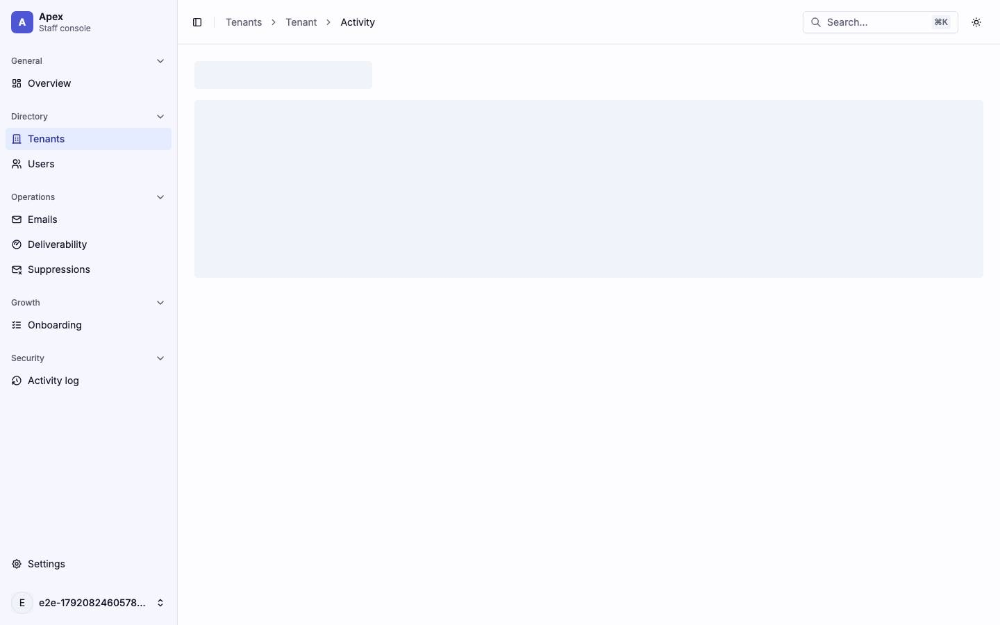                                      |  | 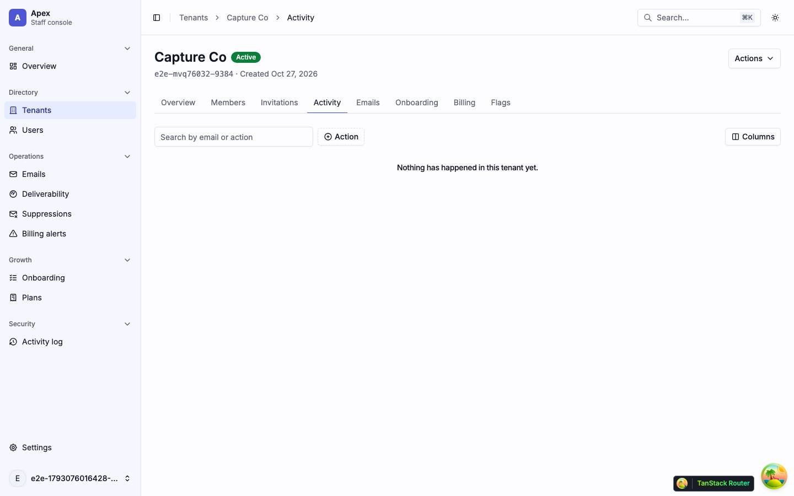                   |
| skeleton · the layout's blocks; then `h-40` for the role and 2× `h-14` for the log | alert · the layout's `LoadError`            | log stubbed empty: "Nothing has happened in this tenant yet." |

| Role-denied                                                                                                                                 |
| ------------------------------------------------------------------------------------------------------------------------------------------- |
| 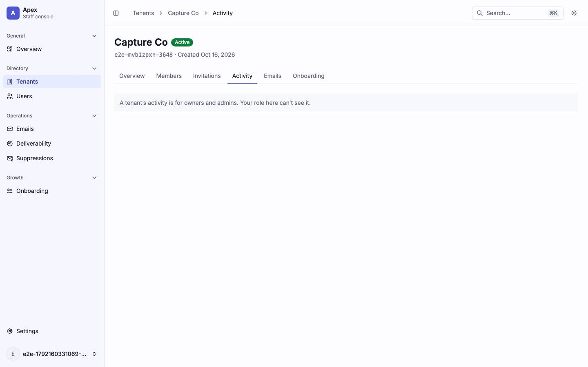                                                                                           |
| A viewer: "A tenant’s activity is for owners and admins. Your role here can’t see it." in place of the log; the audit log is not requested. |

Findings: [F-tenants-3](findings.md#f-tenants-3), [F-activity-1](findings.md#f-activity-1), [F-overview-4](findings.md#f-overview-4)

### `/tenants/$tenantId/emails` — Emails

|                     |                                                                                                                                                                                                            |
| ------------------- | ---------------------------------------------------------------------------------------------------------------------------------------------------------------------------------------------------------- |
| Purpose             | The emails filed under this tenant, newest first, in every lifecycle state.                                                                                                                                |
| File                | `src/pages/_app/tenants/$tenantId.emails.tsx`                                                                                                                                                              |
| Guard and redirects | `_app`, then the [layout](#layout)                                                                                                                                                                         |
| Layout              | `AppLayout` › tenant layout                                                                                                                                                                                |
| Data                | `GET /platform/emails?tenantId&cursor&direction&limit=20` (`['platform', 'emails', params]`), started by the tab's own loader, in parallel with the layout's detail                                        |
| Sections            | "Emails sent for this tenant, newest first." with **Filter these in Emails**, then `EmailsTable` without its Tenant column (Recipient, Template, Status, Created, User) and the Previous/Next icon buttons |
| Components          | `EmailsTable`, `Button`, `Skeleton`, `EmptyState`, `LoadError`, `RoleDenied`                                                                                                                               |
| Transitions         | a recipient → `/emails/$emailId`; Filter these in Emails → `/emails?tenantId=`                                                                                                                             |

The request starts early, but the tab cannot draw its `h-64` skeleton or its rows until the layout's detail is in. The capture's tenant has no email filed under it, so the default shot is the empty state too.

| Loading                                                           | Error                                     | Empty                                                                                  |
| ----------------------------------------------------------------- | ----------------------------------------- | -------------------------------------------------------------------------------------- |
|                        | 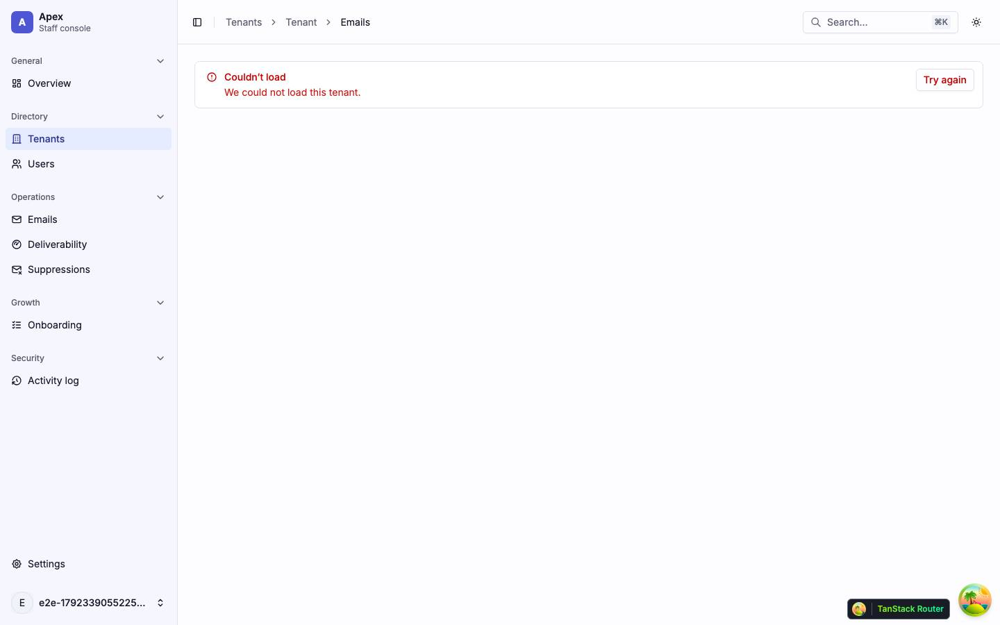 | 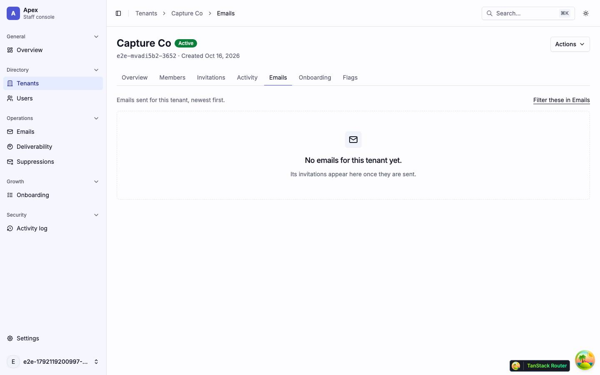                                              |
| skeleton · the layout's blocks; the tab's own is one `h-64` block | alert · the layout's `LoadError`          | "No emails for this tenant yet." and "Its invitations appear here once they are sent." |

Findings: [F-tenants-1](findings.md#f-tenants-1), [F-tenants-2](findings.md#f-tenants-2), [F-tenants-3](findings.md#f-tenants-3)

### `/tenants/$tenantId/onboarding` — Onboarding

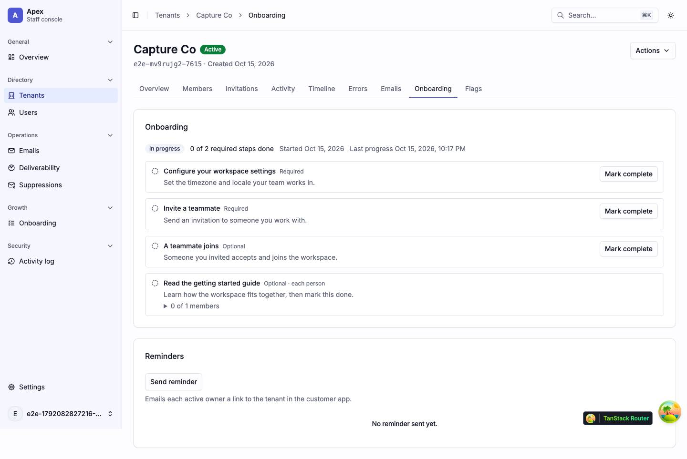

|                     |                                                                                                                                                                                                                                                                                                                                       |
| ------------------- | ------------------------------------------------------------------------------------------------------------------------------------------------------------------------------------------------------------------------------------------------------------------------------------------------------------------------------------- |
| Purpose             | The tenant's onboarding state, each step and how it was done, and the reminders staff sent; admins mark steps complete and send reminders.                                                                                                                                                                                            |
| File                | `src/pages/_app/tenants/$tenantId.onboarding.tsx`                                                                                                                                                                                                                                                                                     |
| Guard and redirects | `_app`, then the [layout](#layout). A 404 from its own read renders `RoleDenied`.                                                                                                                                                                                                                                                     |
| Layout              | `AppLayout` › tenant layout                                                                                                                                                                                                                                                                                                           |
| Data                | `GET /platform/tenants/:id/onboarding` (`['platform', 'onboarding', 'tenant', id]`), started by the tab's own loader; `POST` mark-complete and send-reminder, each through `ReasonDialog`                                                                                                                                             |
| Sections            | **Onboarding** card: state badge, "{n} of {m} required steps done", started and last-progress times, then `OnboardingStepList` (one bordered row per step with Mark complete for admins; a per-person step folds its member list). **Reminders** card: Send reminder (admins, when the API allows) or why not, and `ReminderHistory`. |
| Components          | `Card`, `Badge`, `Button`, `Skeleton`, `CardRowsSkeleton`, `QueryState`, `LoadError`, `RoleDenied`, `ReasonDialog`, `OnboardingStepList` (`Item` as `li` in an `ol`), `ReminderHistory` (`ItemGroup`, `Item`)                                                                                                                         |
| Transitions         | none beyond the tabs                                                                                                                                                                                                                                                                                                                  |

The request starts early, and the tab reads through `QueryState`: the card skeleton is a title bar over five `3rem` rows, a 404 from this read is a role refusal (`RoleDenied`), and any other failure is a `LoadError` whose Try again refetches. The row count is a guess, not measured against the loaded steps.

| Loading                                         | Error                                                             |
| ----------------------------------------------- | ----------------------------------------------------------------- |
| 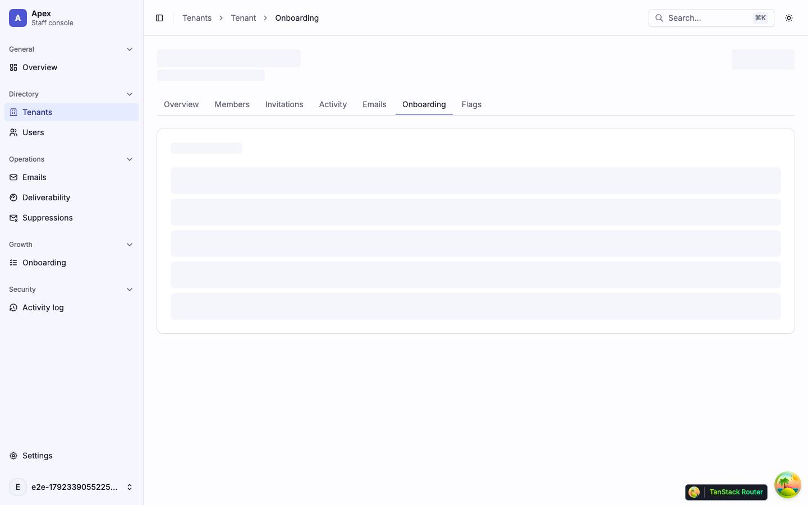 |                      |
| skeleton · the layout's blocks                  | alert · the layout's `LoadError` (the onboarding read failed too) |

| Role-denied                                                                                                                                                               |
| ------------------------------------------------------------------------------------------------------------------------------------------------------------------------- |
| 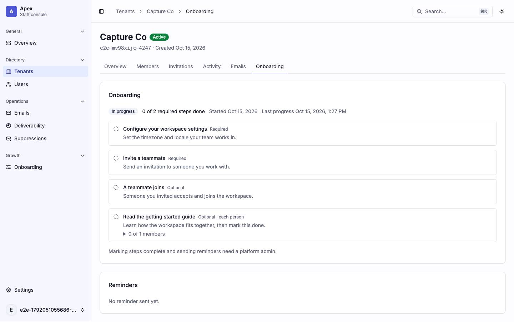                                                                                                                       |
| A viewer: the state, steps and reminders read-only; no Mark complete or Send reminder, and the line "Marking steps complete and sending reminders need a platform admin." |

Findings: [F-tenants-3](findings.md#f-tenants-3)

### `/tenants/$tenantId/flags` — Flags

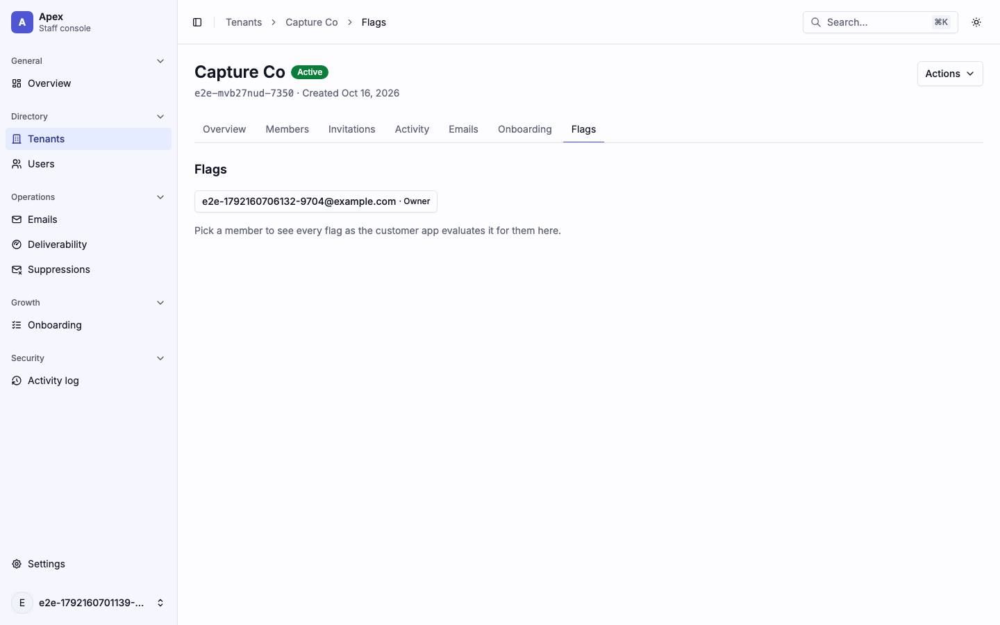

|                     |                                                                                                                                                                                                                                                                                                                      |
| ------------------- | -------------------------------------------------------------------------------------------------------------------------------------------------------------------------------------------------------------------------------------------------------------------------------------------------------------------- |
| Purpose             | Every registered flag as one member of this tenant gets it in the customer app.                                                                                                                                                                                                                                      |
| File                | `src/pages/_app/tenants/$tenantId.flags.tsx`                                                                                                                                                                                                                                                                         |
| Guard and redirects | `_app`, then the [layout](#layout); `RoleDenied` below admin; `FrozenTenant` for a non-active tenant. `?userId` picks the member.                                                                                                                                                                                    |
| Layout              | `AppLayout` › tenant layout                                                                                                                                                                                                                                                                                          |
| Data                | after the layout's detail: `GET /tenants/:slug/members` (`['tenants', slug, 'members', { tenantId }]`) and `GET /platform/flags` (`['platform', 'flags', 'list']`); once a member is picked, `GET /platform/flags/evaluate?userId&tenantId&app=react` (`['platform', 'flags', 'evaluate', …]`, no retry, `gcTime` 0) |
| Sections            | An `h2` "Flags", one toggle button per member (name · role), then "Pick a member to see every flag as the customer app evaluates it for them here." or the picked member's `FlagEvaluation`                                                                                                                          |
| Components          | `Button` (`aria-pressed`), `Skeleton`, `TableRowsSkeleton`, `LoadError`, `RoleDenied`, `FrozenTenant` (`EmptyState`), `FlagEvaluation`                                                                                                                                                                               |
| Transitions         | a member → the same tab with `?userId`                                                                                                                                                                                                                                                                               |

While the tenant loads, the tab keeps its `h2` "Flags" over `MemberPickerSkeleton` (three `h-8 w-36` buttons and a hint bar); the same skeleton stands in while the members and the registry load, and a picked member's evaluation holds `TableRowsSkeleton` (six rows, three columns) until it lands. The button count is a guess, not measured.

| Loading                                                            | Error                                    |
| ------------------------------------------------------------------ | ---------------------------------------- |
| 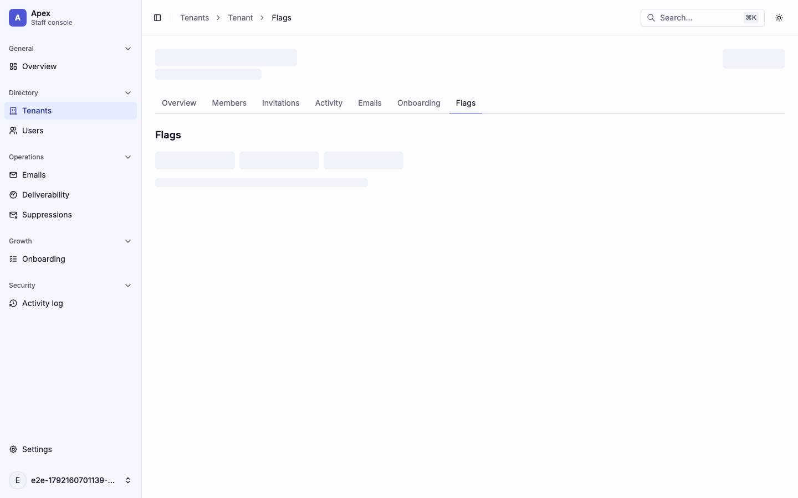                         | 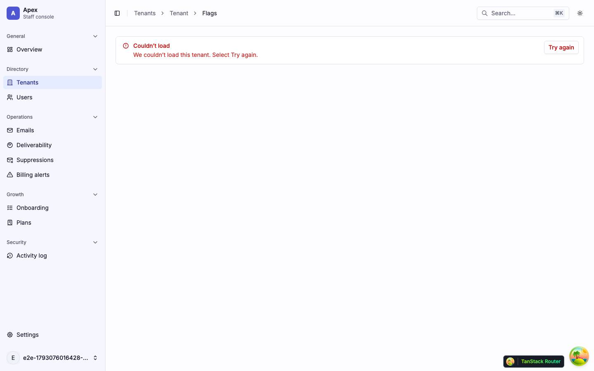 |
| skeleton · the layout's blocks; members and flags have not started | alert · the layout's `LoadError`         |

| Role-denied                                                                        |
| ---------------------------------------------------------------------------------- |
| 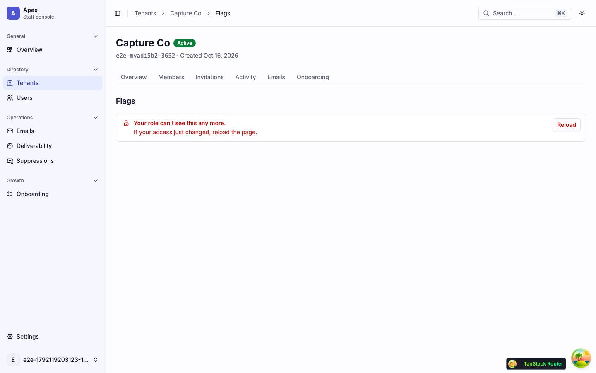                                     |
| A viewer by URL: the tab is missing from the nav, and `RoleDenied` under the `h2`. |

Findings: [F-tenants-3](findings.md#f-tenants-3), [F-overview-5](findings.md#f-overview-5)
