# Users

The user list (`/users/`), one user's page, and the user actions menu. Back to the [route map](README.md#route-map).

## Layout

`/users/$userId` (`src/pages/_app/users/$userId.tsx`) renders a bare `Outlet`: no header, tabs or gate of its own. Its loader starts `GET /platform/users/:id` (`['platform', 'user', id]`; a 404 is not retried) without awaiting it, and `UserCrumb` reads the same query, so the breadcrumb reads Users › User until it answers and Users › {name or email} after. Each page under it reads the detail again and draws its own loading, error and not-found states (`UserNotFound`: "User not found", "This user does not exist, or was permanently deleted." and Back to users).

There is no tab bar. The user page links to Flags with an outline button in its header (admins and up).

Findings: [F-users-5](findings.md#f-users-5)

## Pages

### `/users/` — Users

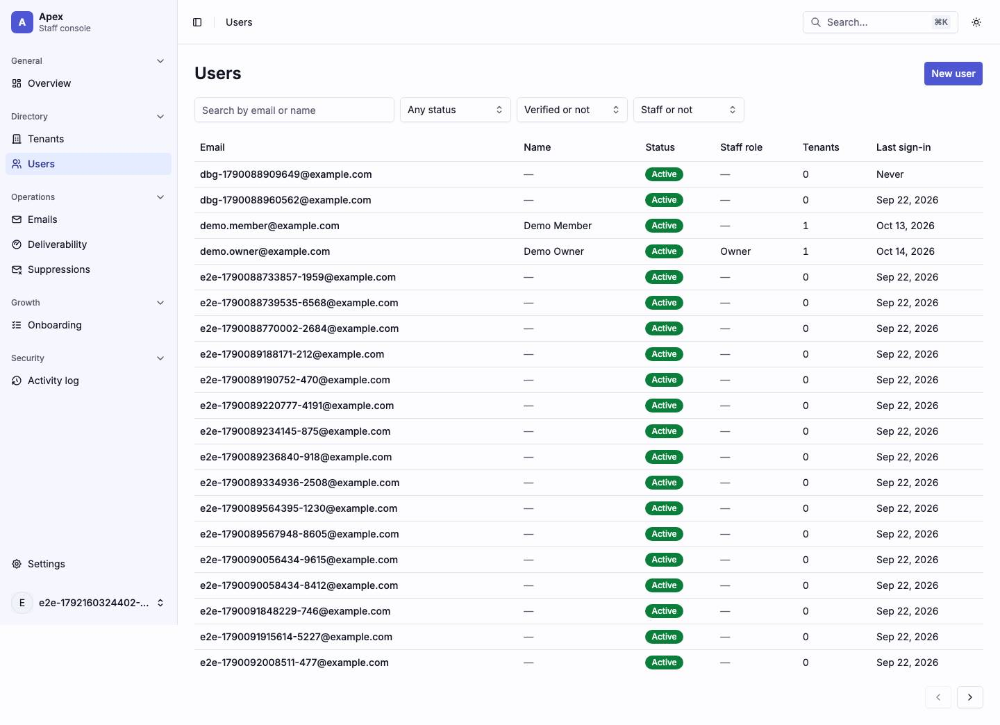

|                     |                                                                                                                                                                                                                                                                                                                                                                                                                                   |
| ------------------- | --------------------------------------------------------------------------------------------------------------------------------------------------------------------------------------------------------------------------------------------------------------------------------------------------------------------------------------------------------------------------------------------------------------------------------- |
| Purpose             | Every account, searched, filtered and paged; admins create one here.                                                                                                                                                                                                                                                                                                                                                              |
| File                | `src/pages/_app/users/index.tsx`                                                                                                                                                                                                                                                                                                                                                                                                  |
| Guard and redirects | `_app`                                                                                                                                                                                                                                                                                                                                                                                                                            |
| Layout              | `AppLayout`                                                                                                                                                                                                                                                                                                                                                                                                                       |
| Data                | `GET /platform/users?search&status&verified&staff&sort&cursor&direction&limit&total=1` (`['platform', 'users', 'list', request]`), started by the loader; the previous view's rows stay up while the next loads. `POST /platform/users` from New user.                                                                                                                                                                            |
| Sections            | The `h1`, then `DataTable`: a toolbar with the search box "Search by name or email" (debounced into `?search`), facets Status (Active, Inactive, Deleted; a comma list in `?status`), Verified (`?verified`) and Staff (`?staff`), Columns, a result count and **New user** (admins and up); the table (Email and Last sign-in sort, `?sort`); then "Showing", a rows-per-page select (`?limit`) and Previous page and Next page. |
| Components          | `DataTable` through `UsersTable` (Email (link), Name, Status, Staff role, Tenants, Last sign-in), `EmptyState`, `RoleDenied`, `CreateUserDialog`                                                                                                                                                                                                                                                                                  |
| Transitions         | an email → `/users/$userId`; Previous/Next → `?cursor` (and `?direction=prev` going back); New user → the dialog                                                                                                                                                                                                                                                                                                                  |

Every search, filter or sort change drops the cursor. The API orders the rows; nothing sorts client-side. The stale-cursor and failed-page states are the same as the tenant list's, and on a phone the rows stack as cards.

| Loading                           | Error                                                 | Empty                                                                                 |
| --------------------------------- | ----------------------------------------------------- | ------------------------------------------------------------------------------------- |
| 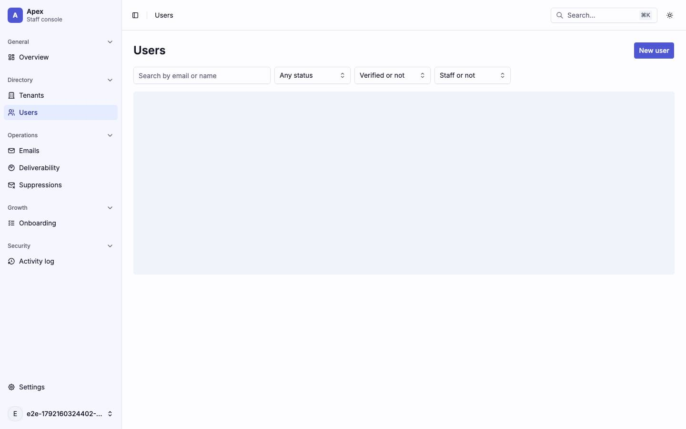 | 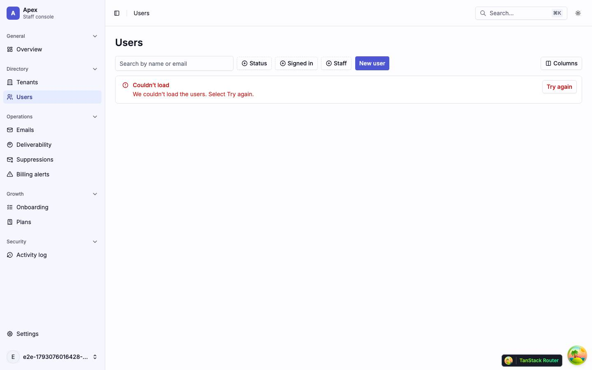                       | 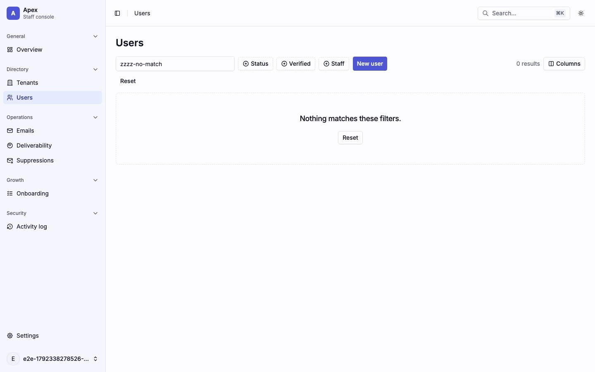                                                       |
| skeleton · table-shaped rows      | alert · "We could not load the users." with Try again | "No users yet." unfiltered; "Nothing matches these filters." with Reset when filtered |

| Dark                           | Mobile                                                                       |
| ------------------------------ | ---------------------------------------------------------------------------- |
| 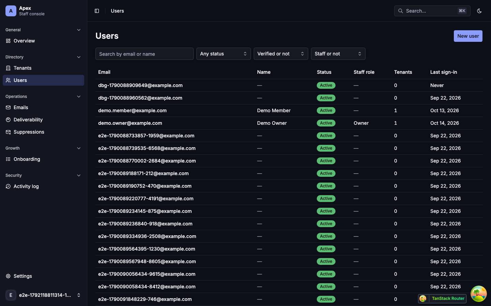 | 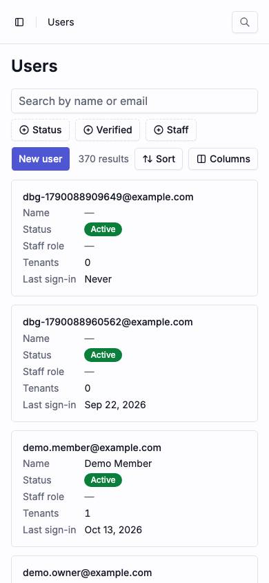                                             |
| The table on dark surfaces.    | The filters wrap to three rows; the table scrolls sideways, cut after Email. |

| Role-denied                               |
| ----------------------------------------- |
| 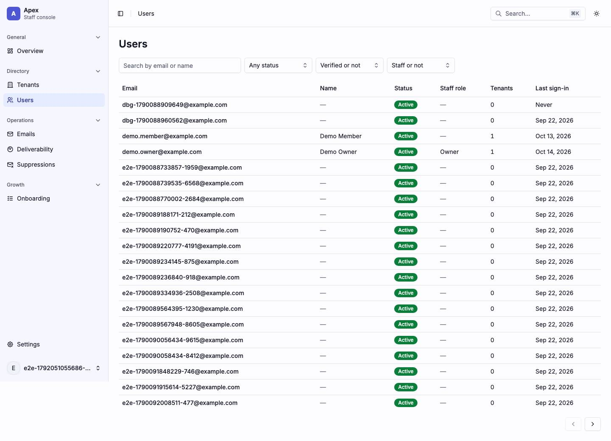     |
| A viewer: the same list without New user. |

Findings: [F-users-1](findings.md#f-users-1), [F-users-2](findings.md#f-users-2)

### `/users/$userId/` — User

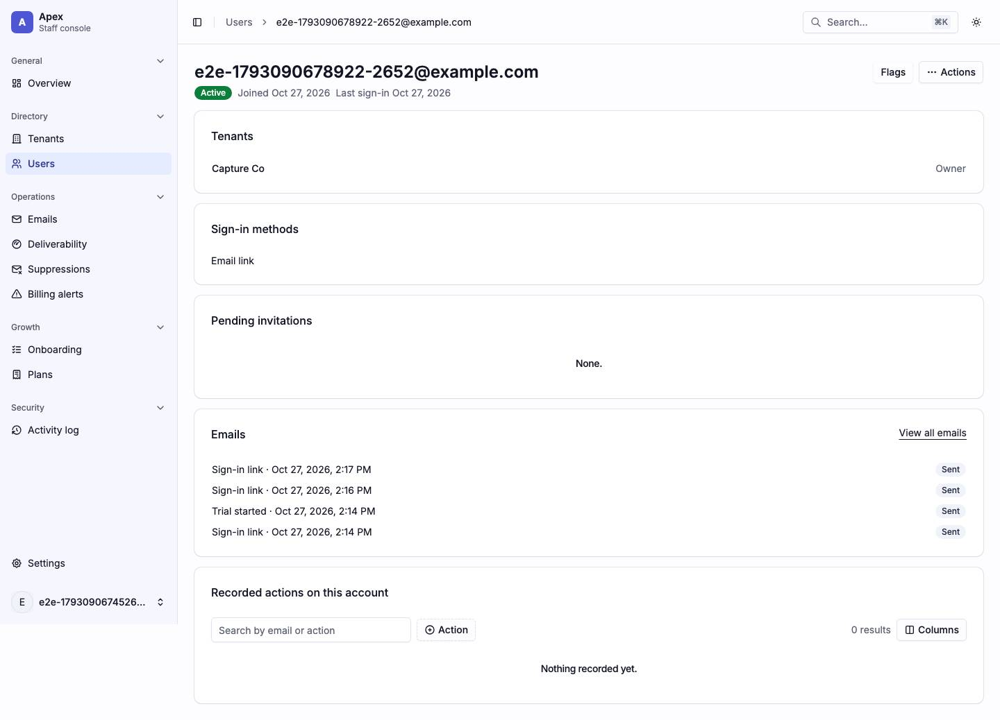

|                     |                                                                                                                                                                                                                                                                                                                                                                                                                                                       |
| ------------------- | ----------------------------------------------------------------------------------------------------------------------------------------------------------------------------------------------------------------------------------------------------------------------------------------------------------------------------------------------------------------------------------------------------------------------------------------------------- |
| Purpose             | One account: who it is, its tenants, sign-in methods and pending invitations, its emails, and for admins its recorded history and a link to its flags.                                                                                                                                                                                                                                                                                                |
| File                | `src/pages/_app/users/$userId.index.tsx`                                                                                                                                                                                                                                                                                                                                                                                                              |
| Guard and redirects | `_app`; a 404 renders `UserNotFound`                                                                                                                                                                                                                                                                                                                                                                                                                  |
| Layout              | `AppLayout` › the bare user layout                                                                                                                                                                                                                                                                                                                                                                                                                    |
| Data                | `GET /platform/users/:id` (`['platform', 'user', id]`), started by the layout's loader. Once it answers: `GET /platform/emails?user&limit=10` (`['platform', 'emails', 'list', request]`, no `total`) for the Emails card and, for admins and up, `GET /platform/audit-log?targetId&limit=50` (`['platform', 'audit-log', filters]`, `staleTime` 0).                                                                                                  |
| Sections            | Header: the name (or the email) as the `h1`, the email, status badges, a Staff · {role} badge, joined and last sign-in; a Flags button (admins) and the **Actions** menu. A deleted account's read-only note. Cards: **Tenants** (each membership, linked, with its role), **Sign-in methods**, **Pending invitations**, **Emails** (the last ten, with View all emails), **Recorded actions on this account** (admins).                              |
| Components          | `Card`, `Badge`, `buttonVariants` links, `CardRowsSkeleton`, `LoadError`, `RoleDenied`, `UserActionsMenu`, `UserEmailsCard` (`QueryState`, `ItemGroup`, `Item`), `UserHistoryCard` (`ActivityList`); `Note` (warning, deleted account); `EmptyState` (compact: "Not a member of any tenant.", "None.", "No emails sent to this account yet."); `ItemGroup`, `Item`, `ItemContent`, `ItemTitle`, `ItemActions` (the memberships and invitations lists) |
| Transitions         | a tenant → `/tenants/$tenantId`; Flags → `/settings/platform/flags?userId=`; View all emails → `/emails?user=`; an email → `/emails/$emailId`                                                                                                                                                                                                                                                                                                         |

While the user loads, the page is a visually hidden `h1` "User", a header of three bars in a `grid gap-1` (`h-8 w-64`, then `h-5 w-48` and `h-5 w-80` for the email and the badges line) and five cards, each a title bar over two rows; the card count is the five an admin sees (a viewer sees fewer once loaded), and the sizes are not measured against the loaded cards. A 404 keeps `UserNotFound` and a failed read with no user keeps its own `LoadError`; a failed refetch with the user on screen keeps the page with that `LoadError` above it. The Actions menu (`UserActionsMenu`) holds, as `availableUserActions` allows: Edit name, Send password reset link (or set-password link), Resend verification email, Sign out everywhere, Deactivate or Reactivate, Delete, and Delete permanently. The Emails card has its own states (an `h-24` skeleton, `LoadError`, `RoleDenied`), as does the History card (2× `h-14`).

| Loading                                                                                                                                 | Error                                              |
| --------------------------------------------------------------------------------------------------------------------------------------- | -------------------------------------------------- |
| 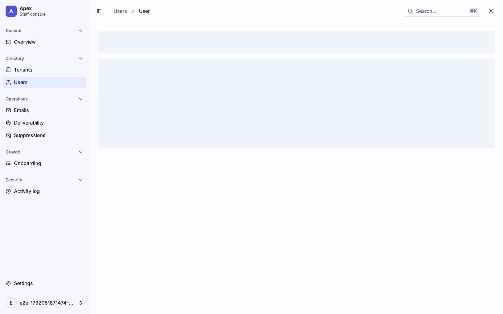                                                                                               | 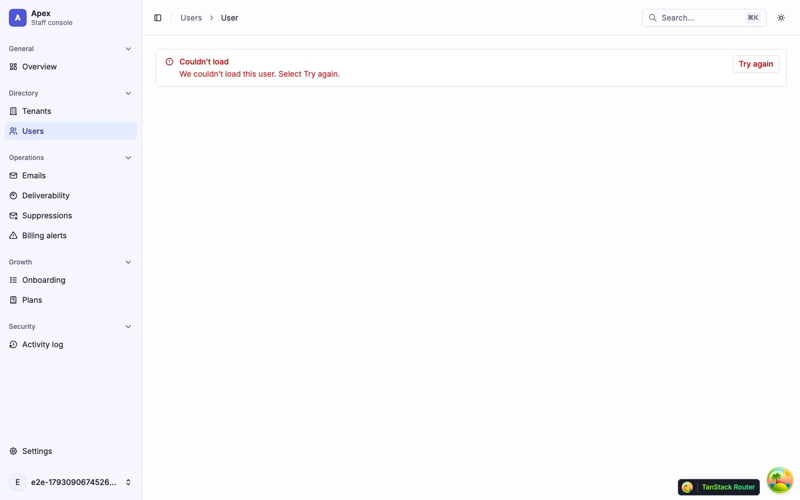            |
| skeleton · three header bars over five cards (a title bar over two rows each), four of them in the viewport; the wrapper is `aria-busy` | alert · `LoadError` "We could not load this user." |

| Dark                                   | Mobile                                                      |
| -------------------------------------- | ----------------------------------------------------------- |
| 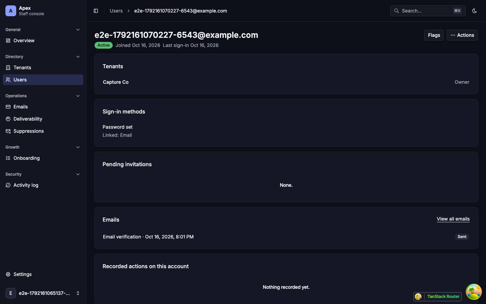 | 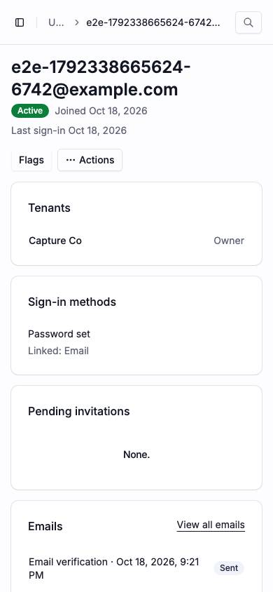                    |
| Cards on the dark surfaces.            | The header buttons wrap under the address; the cards stack. |

| Role-denied                                                                |
| -------------------------------------------------------------------------- |
| 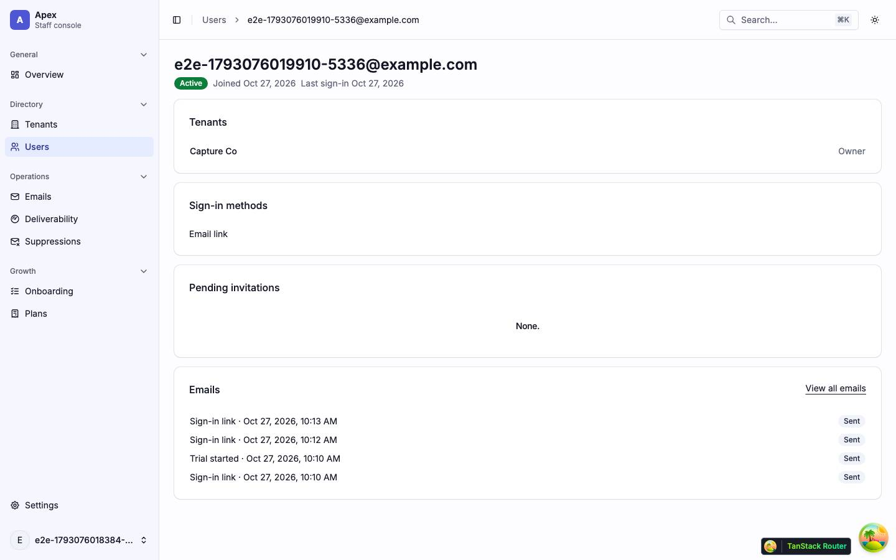                              |
| A viewer: no Flags or Actions, and no History card. The Emails card stays. |

Findings: [F-users-3](findings.md#f-users-3), [F-users-5](findings.md#f-users-5), [F-overview-4](findings.md#f-overview-4), [F-palette-6](findings.md#f-palette-6)
