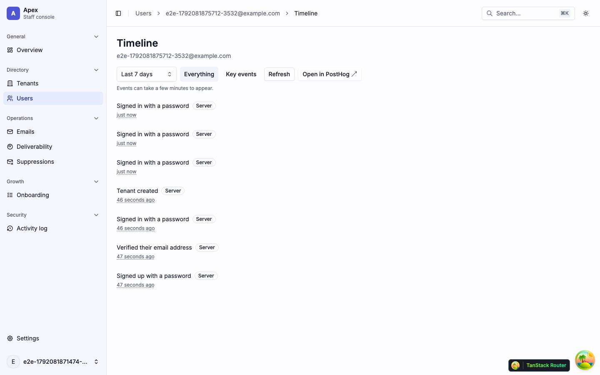
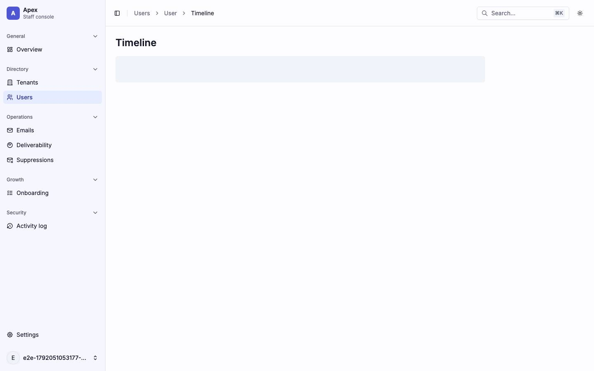
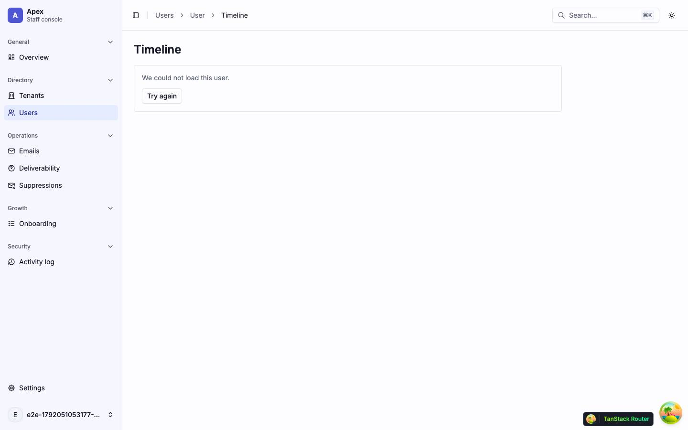
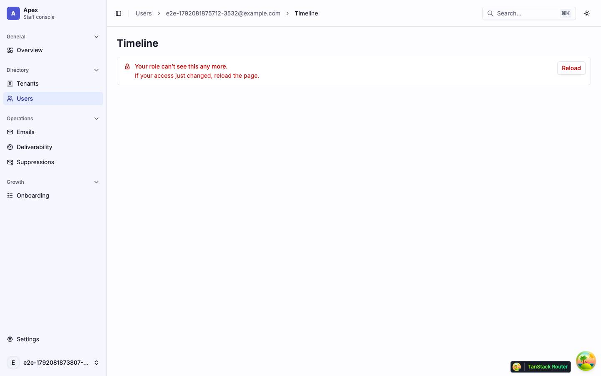
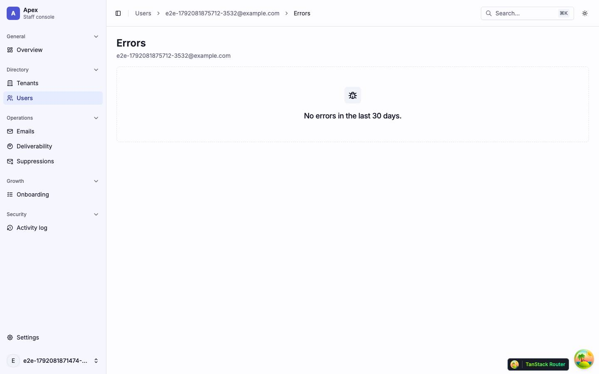
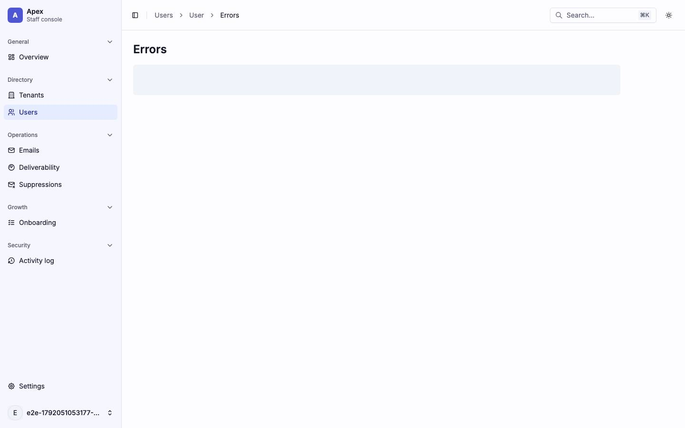
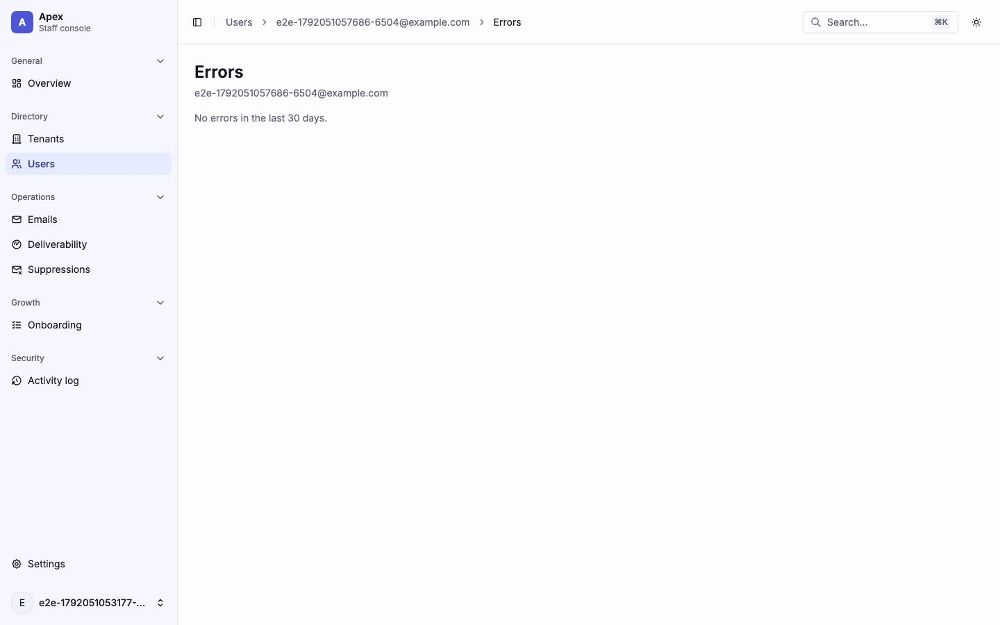
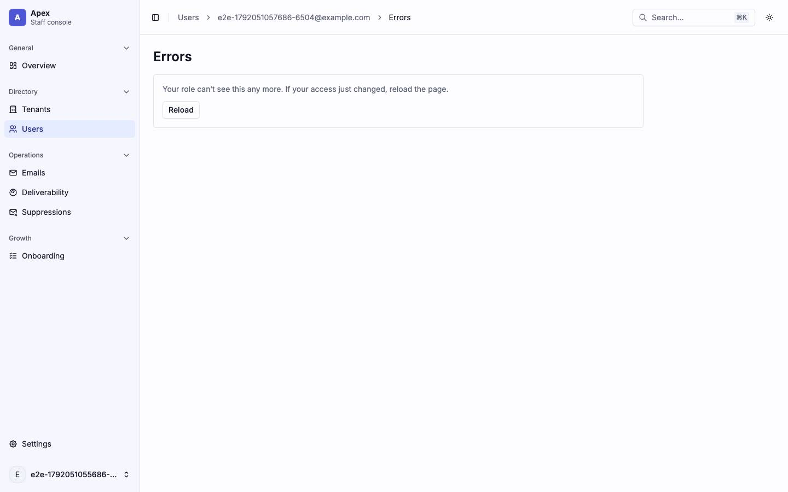

# Users

The user list (`/users/`), one user's page and their Timeline and Errors pages, and the user actions menu. Back to the [route map](README.md#route-map).

## Layout

`/users/$userId` (`src/pages/_app/users/$userId.tsx`) renders a bare `Outlet`: no header, tabs or gate of its own. Its loader starts `GET /platform/users/:id` (`['platform', 'user', id]`; a 404 is not retried) without awaiting it, and `UserCrumb` reads the same query, so the breadcrumb reads Users › User until it answers and Users › {name or email} after. Each page under it reads the detail again and draws its own loading, error and not-found states (`UserNotFound`: "User not found", "This user does not exist, or was permanently deleted." and Back to users).

There is no tab bar. The user page links to Timeline, Errors and Flags with three outline buttons in its header (admins and up); the Timeline and Errors pages have no link back but the breadcrumb.

Findings: [F-users-4](findings.md#f-users-4), [F-users-5](findings.md#f-users-5)

## Pages

### `/users/` — Users

|                     |                                                                                                                                                                                                                                                                                                                               |
| ------------------- | ----------------------------------------------------------------------------------------------------------------------------------------------------------------------------------------------------------------------------------------------------------------------------------------------------------------------------- |
| Purpose             | Every account, searched, filtered and paged; admins create one here.                                                                                                                                                                                                                                                          |
| File                | `src/pages/_app/users/index.tsx`                                                                                                                                                                                                                                                                                              |
| Guard and redirects | `_app`                                                                                                                                                                                                                                                                                                                        |
| Layout              | `AppLayout`                                                                                                                                                                                                                                                                                                                   |
| Data                | `GET /platform/users?q&status&verified&staff&cursor&direction&limit=20` (`['platform', 'users', params]`), started by the loader; `keepPreviousData`. `POST /platform/users` from New user.                                                                                                                                   |
| Sections            | The `h1` with **New user** (admins and up) on the right. A second row of filters: "Search by email or name" (debounced 250 ms, `?q`) and three `Select`s, Any status / Active / Inactive / Deleted (`?status`), Verified or not (`?verified`), Staff or not (`?staff`). Then `UsersTable` and the Previous/Next icon buttons. |
| Components          | `Input`, `Select`, `Button`, `Table` through `UsersTable` (TanStack Table `useTable` with no features: Email (link), Name, Status, Staff role, Tenants, Last sign-in), `Skeleton`, `Empty`, `LoadError`, `RoleDenied`, `CreateUserDialog`                                                                                     |
| Transitions         | an email → `/users/$userId`; Previous/Next → `?cursor&dir`; New user → the dialog                                                                                                                                                                                                                                             |

Every filter change drops the cursor. The stale-cursor and failed-page states are the same as the tenant list's.

| Loading                           | Error                                              | Empty                           |
| --------------------------------- | -------------------------------------------------- | ------------------------------- |
|  |                     |  |
| skeleton · one `h-96` block       | alert · `LoadError` "We could not load the users." | "No users match these filters." |

| Dark                           | Mobile                                                                       |
| ------------------------------ | ---------------------------------------------------------------------------- |
|  |                                              |
| The table on dark surfaces.    | The filters wrap to three rows; the table scrolls sideways, cut after Email. |

| Role-denied                               |
| ----------------------------------------- |
|      |
| A viewer: the same list without New user. |

Findings: [F-users-1](findings.md#f-users-1), [F-users-2](findings.md#f-users-2)

### `/users/$userId/` — User

|                     |                                                                                                                                                                                                                                                                                                                                                                                                                                              |
| ------------------- | -------------------------------------------------------------------------------------------------------------------------------------------------------------------------------------------------------------------------------------------------------------------------------------------------------------------------------------------------------------------------------------------------------------------------------------------- |
| Purpose             | One account: who it is, its tenants, sign-in methods and pending invitations, its emails, and for admins its recorded history and links to its timeline, errors and flags.                                                                                                                                                                                                                                                                   |
| File                | `src/pages/_app/users/$userId.index.tsx`                                                                                                                                                                                                                                                                                                                                                                                                     |
| Guard and redirects | `_app`; a 404 renders `UserNotFound`                                                                                                                                                                                                                                                                                                                                                                                                         |
| Layout              | `AppLayout` › the bare user layout                                                                                                                                                                                                                                                                                                                                                                                                           |
| Data                | `GET /platform/users/:id` (`['platform', 'user', id]`), started by the layout's loader. Once it answers: `GET /platform/emails?userId&limit=10` (`['platform', 'emails', params]`) for the Emails card and, for admins and up, `GET /platform/audit-log?targetId&limit=50` (`['platform', 'audit-log', filters]`, `staleTime` 0).                                                                                                            |
| Sections            | Header: the name (or the email) as the `h1`, the email, status badges, a Staff · {role} badge, joined and last sign-in; Timeline, Errors and Flags buttons (admins) and the **Actions** menu. A deleted account's read-only note. Cards: **Tenants** (each membership, linked, with its role), **Sign-in methods**, **Pending invitations**, **Emails** (the last ten, with View all emails), **Recorded actions on this account** (admins). |
| Components          | `Card`, `Badge`, `buttonVariants` links, `Skeleton`, `LoadError`, `RoleDenied`, `UserActionsMenu`, `UserEmailsCard`, `UserHistoryCard` (`ActivityList`); `Note` (warning, deleted account); hand-rolled: the memberships and invitations `ul`s and the empty `p`s ("Not a member of any tenant.", "None.", "No emails sent to this account yet.")                                                                                            |
| Transitions         | a tenant → `/tenants/$tenantId`; Timeline → `/users/$userId/timeline`; Errors → `/users/$userId/errors`; Flags → `/settings/platform/flags?userId=&app=react`; View all emails → `/emails?userId=`; an email → `/emails/$emailId`                                                                                                                                                                                                            |

The Actions menu (`UserActionsMenu`) holds, as `availableUserActions` allows: Edit name, Send password reset link (or set-password link), Resend verification email, Sign out everywhere, Deactivate or Reactivate, Delete, and Delete permanently. The Emails card has its own states (an `h-24` skeleton, `LoadError`, `RoleDenied`), as does the History card (2× `h-14`).

| Loading                                   | Error                                              |
| ----------------------------------------- | -------------------------------------------------- |
|  |             |
| skeleton · `h-16` and `h-64`, full width  | alert · `LoadError` "We could not load this user." |

| Dark                                   | Mobile                                                      |
| -------------------------------------- | ----------------------------------------------------------- |
|  |                     |
| Cards on the dark surfaces.            | The header buttons wrap under the address; the cards stack. |

| Role-denied                                                                                  |
| -------------------------------------------------------------------------------------------- |
|                                                 |
| A viewer: no Timeline, Errors, Flags or Actions, and no History card. The Emails card stays. |

Findings: [F-users-3](findings.md#f-users-3), [F-users-5](findings.md#f-users-5), [F-overview-4](findings.md#f-overview-4), [F-palette-6](findings.md#f-palette-6)

### `/users/$userId/timeline` — User timeline

|                     |                                                                                                                                                                                                      |
| ------------------- | ---------------------------------------------------------------------------------------------------------------------------------------------------------------------------------------------------- |
| Purpose             | What one user did, across browser and server, from PostHog, and staff actions on them.                                                                                                               |
| File                | `src/pages/_app/users/$userId.timeline.tsx`                                                                                                                                                          |
| Guard and redirects | `_app`; below admin, an `h1` "Timeline" over `RoleDenied`, with no request. A 404 on the user renders `UserNotFound`.                                                                                |
| Layout              | `AppLayout` › the bare user layout                                                                                                                                                                   |
| Data                | `GET /platform/users/:id` (the layout's); once it answers, `GET /platform/users/:id/timeline?range&view` (`['timeline', 'user', id, range, view]`, infinite, `staleTime` 30 s, no retry, `gcTime` 0) |
| Sections            | The `h1` "Timeline" with the person under it, then `TimelinePanel` as on a tenant ([Timeline](tenants.md#tenantstenantidtimeline--timeline))                                                         |
| Components          | `TimelinePanel`, `Skeleton` (`h-16` while the user loads, then `TimelineSkeleton`), `LoadError`, `RoleDenied`, `UserNotFound`                                                                        |
| Transitions         | the breadcrumb back to the user; Open in PostHog and Watch replay open PostHog                                                                                                                       |

| Loading                                                                                         | Error                                                             |
| ----------------------------------------------------------------------------------------------- | ----------------------------------------------------------------- |
|                                                        |                            |
| skeleton · the `h1` over one `h-16` bar: the user read is held, so the timeline has not started | alert · `LoadError` "We could not load this user." under the `h1` |

| Role-denied                                   |
| --------------------------------------------- |
|  |
| A viewer: the `h1` over `RoleDenied`.         |

Findings: [F-users-4](findings.md#f-users-4), [F-overview-5](findings.md#f-overview-5)

### `/users/$userId/errors` — User errors

|                     |                                                                                                                                                 |
| ------------------- | ----------------------------------------------------------------------------------------------------------------------------------------------- |
| Purpose             | The PostHog error issues one user hit in the last 30 days.                                                                                      |
| File                | `src/pages/_app/users/$userId.errors.tsx`                                                                                                       |
| Guard and redirects | `_app`; below admin, the `h1` "Errors" over `RoleDenied`, with no request; `UserNotFound` on a 404                                              |
| Layout              | `AppLayout` › the bare user layout                                                                                                              |
| Data                | `GET /platform/users/:id`; once it answers, `GET /platform/users/:id/errors` (`['errors', 'user', id]`, `staleTime` 30 s, no retry, `gcTime` 0) |
| Sections            | The `h1` "Errors" with the person under it, then `ErrorsPanel` as on a tenant                                                                   |
| Components          | `ErrorsPanel`, `Table`, `Skeleton`, `LoadError`, `RoleDenied`, `UserNotFound`                                                                   |
| Transitions         | the breadcrumb back to the user                                                                                                                 |

The capture's user has no errors, so the default shot is the empty state. The loading shot shows the `h1` over one `h-16` bar, the shape the page draws while the user read is pending; the errors read starts only after it.

| Loading                                 | Error                                              | Empty                                 |
| --------------------------------------- | -------------------------------------------------- | ------------------------------------- |
|  |               |  |
| skeleton · the `h1` over one `h-16` bar | alert · `LoadError` "We could not load this user." | "No errors in the last 30 days."      |

| Role-denied                                 |
| ------------------------------------------- |
|  |
| A viewer: the `h1` over `RoleDenied`.       |

Findings: [F-users-4](findings.md#f-users-4), [F-overview-4](findings.md#f-overview-4), [F-overview-5](findings.md#f-overview-5)
